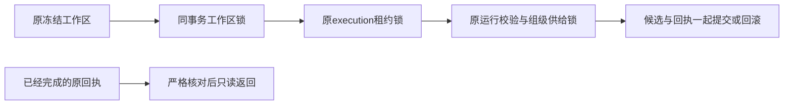

# T1309 独立规格初审记录

本轮完成当前规格的完整 initial 审查，提出 1 项 open major：指定的原 automation 回归与精确写集及预算约束冲突，需要先明确可执行方式。正式规格裁决由 `reviewctl` 消费同目录 `SPEC_REVIEW.json` 后计算；本记录不代替实现、RED/GREEN、公共验收或任务完成回执。

## 审查身份与冻结输入

- 审查者：GPT-6.1 Sol，high，独立 Agent、全新上下文；作者 C 也是 GPT-6.1 Sol/high，独立性类别为 `homogeneous`。未冒称跨模型或跨家族审核。未主动开启 Fast；工具无 tier 开关/读回，因此未声称已验证 tier。
- 技能：已读取 `product-to-code-orchestrator`、`spec-reviewer.md`、`stage-router.md` 与 `_COMMON.md`；已安装 VERSION 与项目 `.skill-version` 同为 `3.29.0`。
- 实际 HEAD：`21aa443545a740004c033ba5de30ddf0ea051afb`。
- SPEC：`docs/features/t1309-group-daily-topic-completion.md`，SHA256 `bfbb572b8700f4894669418ba526a8c69cc0856d6266bbd318b83f57ea6b9f92`。
- constitution：`orchestrator/SYSTEM_ARCHITECTURE.md`，SHA256 `eb1826d4c09054df622d9718c38ca372bd19833e72bd1a752757631a5747c1df`。
- 输入锁：`INPUT_LOCK.json`，SHA256 `31495ec58a831d0eda37c17c6e027da94bd1b2031801727d9c1a55f7036b787e`；实际逐项核验 41 项路径、字节数及 SHA256，零不符。
- 模块范围：`MODULE_SCOPE.json`，SHA256 `bf8403a8ad88362a86f7072432fef0be2313863cf7ef1f66db367057d7a4ef00`。
- 实核只读 worker：`/private/tmp/t1300-artifact-bcz9nlt5/sidecar/frontend/runtime/execution-worker.cjs`，5,618,216 字节，SHA256 `3851b4fb132035f1b03528d68b0fa1c5ab86bda8134d8b98795252295c5a6454`。

## 独立核查与判断

| 核查项 | 真实消费者及结论 |
| --- | --- |
| 阶段、授权和范围 | BACKLOG 顶部两项新任务、PROJECT/PROJECT_CONTEXT、manifest 当前 `4-build`、本任务 DEC 与精确模块一致。T1309 是原维护合同内的局部完成事务修复，不新建 API、权限域或通用锁接口；不重置 T1300 的原审核。 |
| 原失败与根因强度 | U05 原 job/run/AI/execution 映射、纯组 accountId=null、failed 与停用回执吻合。原 run 仍 running/finishedAt=null、最后泛码与首抛缺失均保留。源码确定问题不冒称原请求首个具体 throw 已证。 |
| 真实生产接线 | `persistence-client.ts:6431` 起注入真实 dailyTopicPorts；6434 无条件调用 `lockAccountForSupply`，该实现对空 accountId 抛 OwnershipError，随后供给锁只传 user/account。完成服务的模型与 skip 分支均消费该端口。现有 completion 集成以空 validateRun/finishRun 和自建 advisory 替身测试，确实不足以证明该装配。 |
| 锁序与归属 | `execution-lease.service.ts` settlement 先锁 execution；admission 经 `assertExecutionTaskWorkspaceAdmission`、`assertFrozenWorkspaceMembership`、`lockWorkspaceMembership` 先 account/member/group。当前规格要求 daily 局部 outer tx 先既有 workspace admission、再同 tx lease，action 内重验原快照并拒绝换组，避开新增 execution→group 反向顺序。组带账号保 membership，legacy 保真实平台账号锁；不将 advisory 当写权限。完整冻结字段比对限定为 snapshot 与 lease 内实际 task 的冻结字段，不新增 current group.version 必须等于冻结 groupVersion 的门；现有 membership API 不作该比较，合法改名也会递增 group.version。 |
| 同事务可实现性 | 仓内 Drizzle PGlite `PgliteTransaction.transaction` 的实际消费者实现 nested savepoint/release/rollback；原事务对象可作为同连接服务依赖的设计有源码依据。规格明确禁止重回 root db，要求实际提交/整体回滚/不自等待验证，且不把 PGlite 冒充多连接 PG 死锁压测。本次仅静态核查，没有执行该验证。 |
| 幂等、终态及原账本 | 原 completion 在 existing result 分支返回前核业务/execution/result/call 一致性；当前规格进一步锁定只读终态入口、原 lease/fence 与完整事实检查、禁止回活动提交。原最后 settled provider 回执、unknown/cancel/deadline、任务与运行映射、失败原子回滚均保留，没有新模型调用许可。 |
| 日配额和安全输入族 | `workspaceKey/workspaceFilter` 组优先；`countCandidatesForDay` 按 user/workspace 与完整 UTC 日计数，不分页。方案传完整 scope 并要求纯组、同组不同账号共 quota、legacy、跨 user/group、归档/迁移、UTC 跨日与并发族；不以平台筛选分割创作组额度。 |
| RED 与实际验收可执行性 | 精确两生产/三测试写集可以捕获组合根真实 dailyTopicPorts，复用 owned PGlite/media 与 finally dispose。明确先击中模型完成及 quota/未配置 skip 的生产装配 RED，再改产品并复绿。旧 fork 测试 beforeAll 会写 W 外 dist，规格已禁止原样运行，允许绑定已冻结 worker；另一个被要求只读回归的 automation 测试也会在第一条 it 内重建 dist，见 REV-001。新 immutable 包公共 job→runNow→AI/execution/call→候选/run.finishedAt 验收与旧任务禁重发分明。 |
| frontend 后台隔离 | `CREATOROS_DISABLE_BACKGROUND_DRIVERS` 并不覆盖 `persistence-client.ts:7418` 的 modelWorker.start。既有 model-routing 组合测试实际包装 dispatcher 的 start 为 noop，方案已要求沿用该测试的停止后台模式；新增组合必须保留此层并捕获真实dailyTopicPorts，不能仅设环境变量。此项是现有方案的执行约束，未另加finding。 |
| 架构与语义边界 | 新业务校验放 backend，frontend 仅既有内部组合根接线；不改 schema/contract、通用权限、模型策略、偏好排序或语义判断，符合当前物理架构。无需引入页面设计范围。 |

大白话：先确认这项每日任务属于哪个仍可写的工作区并锁住它，再用原租约完成同一笔事务；同组所有任务共用一个供给额度，已经成功的回执只读返回。

## 未发生的验证与执行前提示

`REV-001` 的确定性证据是 `daily-topic-automation.test.ts:34` 的真实 build 调用、两条 it 仍使用 `../ai-worker/dist/execution-worker.cjs` 及显式 `30000` 局部预算；该文件与 dist 均不在当前精确 W 中。SPEC 只明确将 `daily-topic-worker.fork.test.ts` 降为参考，未为 automation 给出相同处置或范围内完整等价回归。因此不能原样执行，也不能静默省略。最小修订只需明确保留全部原断言、已锁 worker、预算与原未运行事实的可执行验收路径，不扩大产品范围。

本次只运行只读文件检索、哈希和源码检查；未运行测试、模型、浏览器、RPC、数据库访问、构建、reviewctl/taskctl 或控制写入。未停止或重启 controller94030。原 U05 失败未洗绿，未读取活动业务库或敏感原始日志。

只读 `context-plan.mjs --task T-1309 --json` 当前返回“无法从 progress.json 唯一确定当前 pending/claimed step”。这是当前新任务尚无可唯一定位执行步的真实结果；由控制 writer 在正式实施前完成登记和 packet，不由 reviewer 补造。未将它作为规格缺陷。

执行者须先解决 REV-001，再按已审 SPEC 实际获得并保留组合 RED、同事务/savepoint 与 rollback 证据、全部指定输入族 GREEN、类型与相关 Gate，及后续新包公共验收；任何首错、未复现、环境限制与全局旧债均原样记录。除此项外，本轮完整初审未发现其它实质规格缺口。
