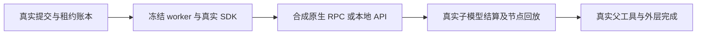

# T1310 受控诊断：原 U04 首错仍未定因

结论：完成约定输入族的有界诊断，未复现原 U04 的反复完成冲突/重入因果。合法完整 usage 的 v2 Codex `topic.generate` 在纯组、合法 legacy 账号均能完成；不能沿 U05 的组锁问题归因。缺 usage 能触发真实“生成缺少完整回执”，但该样本随后保持 unknown_result，第二次正常 drain 未领取，故也不能追认为原案根因。目前没有足够依据批准生产修复。诊断断言通过不代表产品各族全 PASS；原 U04 FAIL/取消事实不变。

## 输入及实际执行边界

当前 HEAD `a1329e6e9`，候选源 `dc46cfa700ec9c9cbada47fb76237d0b50d10a67`。33 项 INPUT_LOCK 全部字节/SHA 相等，SPEC/packet/handoff SHA 与授权输入一致；见 `runtime/FINAL_INPUT_VERIFICATION.json`。冻结 worker `/private/tmp/t1300-artifact-bcz9nlt5/sidecar/frontend/runtime/execution-worker.cjs` 为 5618216 字节，SHA `3851b4fb132035f1b03528d68b0fa1c5ab86bda8134d8b98795252295c5a6454`，未 build、修改或复制其产品代码。

真实运行 backend submission/dispatcher/租约/账本/host completion 与 fork 后的冻结 worker；使用当前官方 `chatbox.topic`、`topic.generate` Skill 快照和真实 v8 `topics[]` schema，真实 SDK/native JSON-RPC/structured sequence/replay。纯组通过真实 createGroup 创建且 accountId=null；legacy 通过真实 createAccount 创建其合法组关系。节点上游业务 prepareTopic 采用明确中性替身，不接用户资料，业务采纳端口全部禁止。

仅将 worker 的 Codex 原生子进程/version 边界替换为 owned 合成 JSON-RPC 子进程，使用空 CODEX_HOME；API 对照用 owned loopback HTTP 替身。0 实际外部模型、0 当前 candidate/旧任务请求、0 活动 DB。**存在真实受控模型调用链及合成 turn，绝非“0 调用”**。DB 为逐例新建内存 PGlite；不借原账户认证、线程或存储。

test=540000ms、hook=180000ms、single worker、retry0；外层86400s。保持产品原 continuous 预算（maxCalls/maxTokens/deadlineMs 均 null），未用配置中的有限默认值覆盖其原策略。未缩时、补造 token、改 attempt 上限或吞异常。

## 已观察的输入族

14 个最终选定样本逐项见 `runtime/CASE_MATRIX.json`，它们来自不同执行批次和各自冻结 harness 快照，不能写成同一最终 suite 的 14/14 产品 PASS。

| 输入 | 纯组 / legacy 实际结果 | 完成含义 |
|---|---|---|
| Codex 合法完整 usage | succeeded / succeeded；各 3 账本 call，1 子 model，2 合成 turn/start | 父工具 ok/proposal，1 候选；真实 complete→外层 settle/commit 完成 |
| 首次 not-json、随后合法结构 | succeeded / succeeded；各 2 子 model、3 turn/start | 实际消费者结构修复成功，父工具 ok/proposal |
| 持续 not-json（代码 case 名 partial） | 外层 succeeded / succeeded；各 3 子 model、4 turn/start | 父工具 error/none、0 候选；合成外层收到工具失败后结束，**不是 partial validation 或选题成功** |
| 子原生 usage 缺失 | unknown_result / unknown_result；各 1 子 model、2 turn/start | 首 throw 为 completeChatGeneration ConflictError“生成缺少完整回执”；子 settled 但 totalTokens=null |
| 子已 settle 后停止 worker | 两例均 attempt2 unknown_result | 重放子 receipt，只读 root；不是未结算子恢复 |
| 子原生完成、settle 委托前停止 worker | 两例均 attempt2 unknown_result | 同原子 call 经 thread/read 恢复、结算；root 原 inProgress 保持未知 |
| API 合法流式对照（独立旧 API 路由） | succeeded / succeeded；各 4 账本 call、3 model、3 本地 HTTP | 真实 SDK 子请求也 stream=true；不是 v2 Codex 主目标的替代证据 |

Codex 成功样本在同一真实 ref/binding 上重复 external commit，call ID/status/totalTokens 不变，任务再次 claim 为 null；duplicate-receipt 原件逐例保留。API 只核终态不能重复 claim 和账本不变，没有 external 根，不冒签 Codex 重复回执。

恢复的具体事实见 `runtime/RECOVERY_PROOF.json`：原 call ID、operationKey 不变，attempt1→2、fence 更新，turn/start 总数仍 2。已结算族仅 thread/read(root inProgress)；未结算族依次读 child(completed)、root(inProgress)。child 停止前 status=started/providerResult=null，但原 observed usage 已持久化 total=12；恢复后 settled、provider usage 空仍保 total=12，未补造 token。原生绑定的 thread/turn 与捕获 bind 端口输入 hash 逐项交叉一致。root 没有伪造完成或补发 turn，故最终 unknown_result 属该受控状态的诚实边界。

## 缺 usage 与原案的差距

首错真实位置：`backend/src/modules/execution/execution-chat-generation.service.ts:96`，`complete()` 在 :202 调用 receipts。前置子 settled 且 providerResult 存在，唯 totalTokens=null；完整 usage 对照无此冲突。后续外层 settle 抛“子工具回执尚未确认”（`external-chat-turn.service.ts:168`）。原始中文 message、裁剪 stack、call 树、result/任务状态均有原件，不只保 ConflictError 类别。

额外单例 `runtime/cases/attempt07/codex-group-missing-usage/` 为全新诊断任务，非原 U04。第一次末态：task unknown_result、lastErrorCode=CODEX_HOST_FAILED、lastErrorMessage=“服务尚未返回完整结果，任务已暂停，已完成内容保留”；root unknown、tool unknown、子 settled/null total。只正常推进时钟121000ms后再 drain 一次，claimed=0、attempt仍1、0新 call/turn，未再次出现完成冲突。不能由此解释原案 attempt6/反复 commit 冲突，也不能把连续策略本来允许超过 legacy max3 说成调度 bug 或重复计费。 此处合成根在收到工具回复后固定 complete，未模拟真实模型收到失败后在同一 turn 再次调用 topic.generate/其它工具的决策；第二次 drain=0 只证明该固定完整轨迹，不排除“缺回执 + 同 turn 再调工具”触发端口冲突，也不排除原案缺 usage 的可能性。

原日志绑定的36469字节前缀 SHA 仍与原记录一致（当前文件仅追加至36609字节），安全白名单投影见 `runtime/ORIGINAL_SAFE_PROJECTION.json`。原行182为 completeChatGeneration/ConflictError/HOST_PORT_REJECTED，后有 settle/reserve 与 commit 冲突；logger 未存首次断言中文内容或完整子回执事实。原公开 modelCalls calls=[] 不能推导无调用，原 pure-group inspect 的准入拒绝未绕过。当前最少缺原首中文断言/稳定断言标识，以及同首错的父子 call、准备/身份 digest、providerResult 与 usage/total 状态；既有公开证据不能补出这些。原任务已取消，禁止为补证重发/恢复。将来若新增诊断可达性，须独立 SPEC/评审，保持安全白名单；本任务没有据此修改生产。

## 失败保真、Gate 与清理

所有批次的自然 exit、原日志及命令见 `runtime/runs/`、`runtime/RUN_SUMMARY.json`。attempt01 过滤未匹配，12 skip、exit0，计0执行；首次无整份 harness 快照，仅命令日志，明确此留存限度。attempt02 exit1 为 CodexModelSpec 多余 schemaVersion 的严格夹具错误，修正后 attempt03 正常完整链成功。attempt04 两恢复例 exit1 为 sandbox ps spawn EPERM，不能计产品失败；工具升级获批后 attempt05 两例实际执行成功。

attempt06 11 条诊断断言 exit0，其中旧 API 两例的 partial 来自夹具把 stream 子请求误回外层纯文字，原结果保留且排除最终合法 API 对照；按真实 hasTools 类型分流后，仅重跑 API 两例 attempt08，分别成功。attempt07 是前述唯一补充 drain 观察。未重复已过无关族，未把 skips/诊断断言数当功能成功数。

规定的 `node tools/timeout-policy/verify.mjs` 原逻辑真实 exit0，日志/exit 在 `runtime/gates/`。它实际更新了五个包 backend、contract、ai-worker、frontend、mcp-server 下 `node_modules/.vite/vitest/da39a3ee5e6b4b0d3255bfef95601890afd80709/results.json`（可再生测试结果缓存），精确 bytes/mtime 见 cache-location-audit.json；Root 明确允许此原 Gate 必要派生缓存，不追记为此前“scope零派生”。未改产品、依赖源码/config 或删除旧缓存。

成功执行例均 await host.stop/DB.close/API.close，cleanup 原件保留。attempt04 失败 finally 提前抛，**没有显式 DB.close 完成证据**；测试进程退出后内存 DB 不再存在，晚核与最终 ps 白名单审计均未发现自建 fixture worker/协议子进程存活，见 attempt04-process-audit.json 与 FINAL_RESOURCE_AUDIT.json。不冒称其首次 finally 全部清理成功。C controller94030/当前包资源未操作。

诊断结论交 Root/C 决策；不修改原 U04 FAIL，不签父功能矩阵、公共/原生壳或真实模型功能 PASS。报告和原件冻结后 RELEASE 本普通 writer/自建资源；未 commit，未更新控制元数据。
