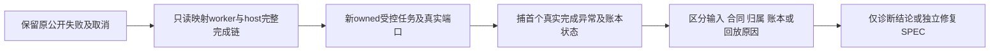

# T1310：诊断选题聊天子工具首次完成冲突与原任务安全恢复

用户已在T1300授权选择Codex后的完整功能修复及实测。Root本轮要求将U04新真实失败独立登记为有界诊断：目前不批准产品修复。具体执行仍GPT-6.1 Sol高思考，Root仅方向/复核，不主动开启加速、无开关回读不冒已确认。

## 原事实及未知

当前production候选源码`dc46cfa700ec9c9cbada47fb76237d0b50d10a67`，全新owned根MhP4pW。原topic.generate聊天链公共POST200，conversation`ai-conv-bcda7005-1286`、source`ai-msg-bcda7005-1297`、AI task`ai-task-7fa8b580-4c0f-48c6-8acd-826e7495b2d9`、execution`execution-task-4e3e9dfc-2db7-419d-9dbf-9c4561b2fc5a`，组`grp-bcda7005-750`。原模型子工具完成冲突反复，A按原公共cancel将原execution取消；最终attempt6/maxAttempts3不是已证调度bug，continuous原策略本就不受legacy max3同样限制。

原件根`docs/verification/t1300/acceptance/runs/final-dc46cfa/a-functional/`，核心为`actions/U04-topic-generate-node/{submission,action-result,task,modelcalls-allpages,public-output}.json`、`U04-original-public-cancel.json`、`U04-original-after-cancel.json`、`U04-original-log-binding.json`。当前安全日志可定位原completion冲突，但未取得首个真实throw具体原因，原modelCalls全分页公开calls=[]，该投影不等价内部未调用；原logger不保断言上下文，pure-group inspect依旧合同拒绝，不能称已检查到完整原payload/子call输入或强认与U05同根因。原attempt>3本身不作为缺陷。原取消任务不重发、不resume、不续期、不改状态。

## 诊断方法与边界

先只读当前冻结源与原公共/安全日志锚，映射chat host→topic.generate子模型→原structured worker/call reservation→settle/complete→父工具回执/恢复。不得绕inspect准入、添加原根日志、打开活动PGlite或复制业务storage/DB。若原件缺字段，明确原案未知；不能拿受控新fixture的异常追认原任务实际首抛。

允许在全新owned临时PGlite/worker fixture内编写并运行完整worker-host诊断harness；生产/contract/worker源码全部只读。复用现有真实聊天/子模型集成harness，受控provider/模型输出固定中性合法结构，真实原SDK/port协议、租约/ledger/业务complete与父工具source/回执应按实际组合走通。记录替身、真实文件SHA、请求/响应原类型、首throw stack安全裁剪、原call树/attempt/fence/状态转换/持久结果/取消与重入观察，不能只有spy/helper重现。

主目标必须是v2 Codex external `topic.generate`，按`contract/src/internal/execution-worker.ts`当前真实prepare/reserve/start/settle/complete及providerResult schema复现；现有`chat-generation-worker.test.ts`的topic.enrich/定位/诊断legacy HTTP样本不能代签。至少正常有效子回执、partial/结构修复和原生只读恢复三个输入族分别走实际消费者，费用totals等strict receipts缺测可核但不预定根因。对照原API/Codex、pure-group/合法legacy账号及正常一次完成/原回执重复的实际差异；必要只读复跑原相关consumer测试。不给诊断预设必须失败或必须与U05同因；无复现也可作为有限诊断结果，但不能签功能成功。异步原authority/deadline/费用预算/unknown/recovery门、continuous行为与cancel/fence保持，绝不加attempt上限、缩时、换模型、吞异常、重写回执或自动重发。原纯组inspect契约与诊断可达性缺口不在本任务修改。

## 精确写集与执行

W仅`docs/verification/t1310/runtime/**`（诊断脚本/受控测试配置/原日志/安全输出）和`docs/verification/t1310/DIAGNOSIS_RESULT.md`；新任务SPEC/DEC/输入锁/模块与BACKLOG由C唯一控制writer维护。生产、既有test、vendor/guard、父SPEC/矩阵/旧证据零改。诊断运行使用此路径内显式Vitest配置，只选择本任务harness；不把新脚本注入产品构建或整个suite。

0付费/真实模型、0当前App业务请求/保存、0旧task重发。仅受控新ownedDB/模型替身；不启动第二candidate或重建当前包。正执行最短120秒，test/hook至少180秒、单worker、retry0，保原更长task预算，外层覆盖全部串行和清理。HTTP/模型秘密不得打印，原安全输出只保必要IDs/类型/hash；退出、失败、夹具错误及未复现均保留。scope授权不是允许读取用户库/凭据或外部平台数据。

交付为原事实/代码映射/受控复现与缺口分列的诊断报告。若证实需改生产，先独立精确修复方案与初审，不将本只读任务偷偷变实施；Root依据首个真实冲突再裁决。此任务不成为父合法剩余独立验证的循环依赖，不关闭父acceptance或将U04原失败洗PASS。评审、真实lease/packet和必要Gate后再运行诊断；当前尚未发生新的受控RED或修复。

冻结输入见`docs/verification/t1310/INPUT_LOCK.json`，精确模块见`docs/verification/t1310/MODULE_SCOPE.json`；此处列允许新增测试/脚手架，不虚构其已存在或已执行。
