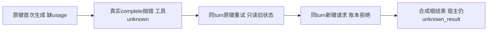

# T1310 同 turn 补充观察

结论：单个新建纯组任务已实际走完“缺 usage → 原键重试 → 新键请求 → 原生根结束”轨迹。原键不重做、新键被未知账本拒绝，未新增子模型调用；通用 RPC error 没有立即终止同一 native turn 是实际观察到的控制流，不能据此认定产品缺陷或原 U04 根因。原案首因仍 UNKNOWN，原 BOUNDED_NOT_REPRODUCED 报告及 285 项证据保持原字节。本补充不批准生产修复，不签真实模型功能成功。

## 绑定与执行

授权基线 `ce473a74a1b41655167ec47f6ce15ecd0cb13ec9`；TASK_PACKET_CE473A74.md SHA `dfc226c155cefd75002de2aeafb0637aaa920c0796a02e418f0b58fb655d01cb`。沿原官方 Skill、v2 Codex route、真实 submission/dispatcher/SDK/lease/ledger/structured host，与冻结 worker 的完整组合。worker 为5618216字节，SHA `3851b4fb132035f1b03528d68b0fa1c5ab86bda8134d8b98795252295c5a6454`，未 build 或修改。

原 INPUT_LOCK 的33项仅 persistence-client 随已审 T1309 变为 `ae54433150e2bc86151d2742481e9c8d4b46a9ce164e54917b80171a93c2b40f`；本补充不调用该组合根，当前受控链所用其余32项一致。实际核验及原报告 SHA 见 runtime/INPUT_VERIFICATION.json，不修改旧锁或追记旧闭包全相等。

只在 native Codex 子进程/version 边界使用明确合成 JSON-RPC 替身，空 CODEX_HOME；真实 worker/端口/归属/账本实现不替换。新内存 PGlite、owned 临时根，无真实外部模型、当前 candidate HTTP、旧 U04、用户库或认证访问。存在真实受控账本调用与两次合成 turn/start，不能写成“0调用”。

## 逐阶段事实

同一 `fixture-thread-1 / fixture-turn-fixture-thread-1`，同工具 topic.generate、同参数 `{basis:positioning}`：

| 阶段 | 实际请求与宿主事实 | 原生回复 |
|---|---|---|
| 首次 `fixture-topic-tool` | 真实子原生输出合法 topics JSON 但没有 usage；子 model settled、providerResult存在、totalTokens=null。completeChatGeneration 首抛 ConflictError“生成缺少完整回执”（execution-chat-generation.service.ts:96/202）；父工具随后记 unknown | error -32601 / CREATOROS_INTERACTION_UNSUPPORTED |
| 同键 `fixture-topic-tool` 重试 | 相同真实 root/toolCallId/参数，reserve 返回原 unknown call；未再次 start/生成/complete。此前 durable catch 自带的原键查询也保留在端口日志中，不能误计为模型重发 | 同一 error |
| 新键 `fixture-topic-tool-new` | 新 native 工具事实可记录，但 reserve 在 execution-call-ledger.service.ts:57/97 拒绝：“已有调用结果或用量未知，须先按原调用对账”；没有新 ledger 行或子模型 | 同一 error |
| 原根 native terminal | 替身明确结束原 turn；宿主尝试 settleExternalChatTurn，external-chat-turn.service.ts:168 拒绝“子工具回执尚未确认”，随后仅将原 external root 记 unknown | 原生 turn=completed；业务执行未成功 |

原件见 runtime/cases/attempt01/codex-group-missing-usage/ 的 native-rpc.ndjson、ports.json、first-throws.json、snapshots.json、same-turn-proof.json。RPC 仅保安全方法、原 ID、stage 与已知通用 error，不记录 account/config 原帧或秘密。

最终 ledger 始终3行：external root `call_55dbb9a8-10c9-473d-932f-cb2d85744a32`、ordinary tool `call_4fb3eb21-cda7-4edc-9aa3-3a1e589415cf`、子 model `call_6ac83919-672c-40ab-9bf2-43f29dab3a58`。从首次 unknown 后至结束，call IDs/operationKeys/fence/预算不变；仅1个子模型、2次 turn/start（根与子各一次）、completeChatGeneration仅1次。新键只进入原生事实表，没有创建第二个普通工具或模型。

任务最终 unknown_result、attempt1、lastErrorCode=CODEX_HOST_FAILED；原 business 状态 queued，0个 aiTaskResult。root unknown 且保留实际合成观测12 tokens，tool unknown，子 settled但totalTokens=null；没有补造子计量，也没有用根12替代子计量。原 continuous 预算仍 maxCalls/maxTokens/deadlineMs=null。详见 runtime/STATE_PROOF.json。

## 限度与复验保真

run attempt01 自然 exit0，1条诊断用例实际执行，69.578秒；test540000/hook180000ms、retry0、single worker、外层86400秒。完整运行前五份脚手架快照、实际命令/输出/exit、实际 worker 输入绑定均保留在 runtime/runs/attempt01/；配置使用 native loader，自己的缓存只在 supplemental/runtime/cache。

这是固定合成决策轨迹，首次生成故意缺 usage，随后明确选择原键和新键、最后结束；没有观察真实模型的自主决策、真实费用、无限请求或其它工具族。未复现原案反复 complete/跨 attempt 重入，也不排除其它输入或原案缺 usage 的可能性；不能将 catch-all 单独定为原案根因。本次没有新增第二 drain、恢复原任务或扩测试族。

packet 仍明确要求 timeout-policy/verify.mjs，故仅运行一次原逻辑，真实 exit0，原日志见 runtime/gates/；不重复已过的补充单例、不改 Gate/config/shim。原 Gate 必要五包可再生 Vitest 缓存足迹按最终审计逐项列出，不扩依赖源码写权。

主用例 finally 已实际 await host.stop、DB.close，cleanup.json存在；未创建 API server。最终进程/输入/旧证据完整性及派生缓存核对见 runtime/FINAL_AUDIT.json。所有本轮写入限定 supplemental/runtime 与本报告，另仅原 Gate 必要缓存；未修改生产、旧报告/证据、控制元数据，未 commit/taskcomplete。冻结后 RELEASE 普通 writer 与自建资源，C controller94030未触。
