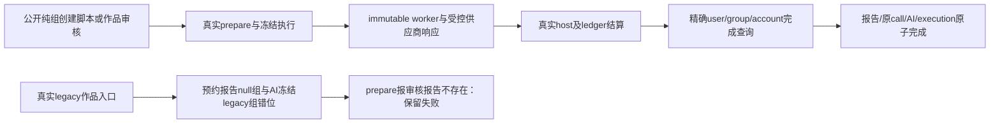

# T1311 实施结果：纯账号组审核完成查询

两源空值安全修复已实现，两个独立完整 worker 主 RED 已实际复现并在修复后通过。公共六入口扩展检查为 **5 PASS / 1 FAIL**；失败是 legacy 作品审核在 prepare 阶段的原报告范围错位，尚未到完成服务。本报告不宣称 T1311 整任务完成或全功能验收通过，等待独立结果审核与后续新包真实模型验收。

## 范围与实际修改

启动锚为 `18bea238d90a9240ca4662996b9cc96170941043`，正式 packet SHA `6f18d430bef5000673477a91c9fe8b5dcaa6f678b2fb994f5e838bf6eae5025f`；lease 由 C 交给 `/root/sol_daily_implementation_current`，原独审 PASS `69f4be5695d3` 未重置。开工实核 32 项输入和绑定 worker 均匹配。

生产只改两个完成服务：

| 文件 | 实际变化 | 最终 SHA256 / 字节 |
|---|---|---|
| `backend/src/modules/review/execution-review-report.service.ts` | AI business 查询叠加原冻结 group 精确条件；group/account 为 null 时用 IS NULL，非 null 用精确等号 | `86e91f8897dcbf405abca5d0fb1830e7d5b82c431eb9ae028450f4df8ff65846` / 6507 |
| `backend/src/modules/review/execution-work-review.service.ts` | AI business 与 work report 查询使用同样的冻结 group/account 精确条件；work skillSnapshot.group 缺省归一 null 比较 | `e5499722a724fe32dba2ecd1ef43403d3d47be675840250fb69b83ca8b6fdd7f` / 6801 |

script report 的实际 schema 没有 group/account 列，最终保留原 user/project/artifact/version/call 回执检查；没有添加 schema。首次实现曾误加入不存在的 report 属性，Root 静态检查指出后删除；该中间字节保留在 green-v1 快照，最终安全回放与类型检查使用修正后两源。work report 的 groupVersion/membershipVersion 默认 null 仍合法，没有新增 current group.version 或 report=execution 版本硬门。

原 settlement/lease/fence/deadline、最后根 call/原供应商回执、完整 text/structured/partial、取消和归档政策保持。未添加 workspace admission、execution→group 锁、通用 workspaceFilter 扩权、AI 采纳候选或 aiTaskResults。frontend persistence-client 未改，仍为 SHA `ae54433150e2bc86151d2742481e9c8d4b46a9ce164e54917b80171a93c2b40f`。

## 两个真实主 RED 与完整公共回归

主组合测试是 `frontend/src/server/__module_integration__/group-review-completion.persistence-client.test.ts`，显式唯一 include，retry 0、single worker。公开创建账号组/项目/原稿/审核；实际生产 prepare、authority、dispatcher、immutable worker、SDK、host、ledger 全部执行。只在外部边界隔离 owned 媒体与渠道权威、提供 loopback OpenAI 协议响应；模型配置经真实公开 Settings 写读。dispatcher 仅抑制自动 start、指定绑定 worker，保留真实 drainOnce 和业务 deps。supervisor 原 ports.invoke 被透明观察，ref/port/input/validate/返回值/异常原样传递；主 RED 原错误来自第一次真实调用，没有事后第二次 commit 替代。

worker 为 `/private/tmp/t1300-artifact-bcz9nlt5/sidecar/frontend/runtime/execution-worker.cjs`，5618216 字节，SHA `3851b4fb132035f1b03528d68b0fa1c5ab86bda8134d8b98795252295c5a6454`；每例实核绑定。没有 build ai-worker/dist、调用真实模型/Codex 凭据或访问现活 candidate、用户库/旧 UNKNOWN 任务。

| 当场运行 | 实际结果 | 说明 |
|---|---|---|
| launcher 首次路径错误 | exit 2，未启动 Vitest | frontend cwd 下 wrapper 路径少 `../`；已单列，不是 RED |
| red-v1 | 2 hook FAIL，exit 1，32.128s | sandbox 拒绝 loopback listen EPERM；无产品 RED；原样申请本轮 owned loopback 准入 |
| **red-v2** | **2 有效主 RED，exit 1，92.570s** | script 第一次 commit 抛“审核任务映射或归属不一致”，源行 31；work 第一次 commit 抛“审核原任务不一致”，源行 15。每族均 1 次实际供应商响应、真实 ledger settled/完整 provider receipt，resultRef=null |
| green-v1 | 纯组两族 PASS，exit 0，85.768s | 相同主链修复后完成报告；此轮中间源尚含随后删掉的 script replay 无效属性，不作为最终 replay/类型证据 |
| **public-scopes-v1** | **5 PASS / 1 FAIL，exit 1，178.839s** | 最终生产两源：纯组 script/work、group+account script/work、真实 legacy/script 完整 fork 成功；真实 legacy/work 在 prepare 前置失败 |

red-v1/red-v2/green-v1/public-scopes-v1 都有运行前完整 test/config/两生产原件/整 worker bundle/合同与业务 source 快照；各 case 的 before-dispatch、outcome、final 保存原业务、冻结 execution、call、报告、请求 schema/source 与第一次 invoke 错误。没有直接种 settled 记录作为主链。

## 安全与兼容层证据

backend 两个测试文件使用第二层受控持久库存：真实账号/组 service、原 enqueue/claim/lease 与 ledger.reserve/start/settle，然后调用实际完成服务。它们不冒公开 prepare/worker；真实 legacy 兼容库存按 execution 实际冻结 grp_legacy_A 构造报告，另将未迁 group=null 历史库存明确单列。该层不能代替上一节失败的公共 legacy/work 路径。

| 运行 | 实际结果 | 归因 |
|---|---|---|
| backend-v1 | 29 PASS / 3 fixture FAIL，exit 1，50.897s | 误读 enqueue DTO 的 payload、父 call 外键使用不存在 ID、误把归档 claim 的 null 返回预期为抛错 |
| backend-v2 | 36 PASS / 1 fixture FAIL，exit 1，51.631s | claim 返回 null 后原实现会写 blocked，夹具误期待 queued；两轮同阻塞先报 Root 后停，实读原合同并获最小校准授权 |
| **backend-v3** | **37 PASS，exit 0，56.282s** | script 22 / work 15；全部历史失败保留，归档断言精确校准为 null+blocked+STALE_WORKSPACE_MEMBERSHIP+实际归档错误、无 lease/新 call |

覆盖同组错账号/null 双向、错 user/group、business/report/task/project/attempt 映射、work optional skill group/operation/冻结 fingerprint/context、原 call/text/provider/parent/最后根调用、partial/缺完整结构、同键并发幂等及错误 replay receipt、取消/deadline/lease/fence、实际 SQL trigger 导致末笔 execution 更新失败的整事务回滚、归档前已 settled 沿原 ref 完成、归档后严格 replay、新 enqueue/claim 拒绝。script 原有 17 项业务断言保留并通过；没有制造它们的修改前 RED。PGlite 证明本地事务/回滚，不冒真实 PG 多连接压力或死锁测试。

## 保留的公共 legacy/work 失败

准确原件见 `runtime/LEGACY_WORK_PREPARATION_FAILURE.json`、`runtime/public-scopes-v1/legacy-work-final.json` 和 `runtime/legacy-work-prepare-source/` 的 10 个真实 source/schema 快照。

公开 accounts.create 产生真实 A 与 grp_legacy_A。旧 no-group 入口创建 work report 时，`workspaceStamp(workspaceKey(ctx))` 写入 `groupId=null/accountA`；后续实际 AI 创建经 membership 锁冻结 `groupId=grp_legacy_A/accountA`。prepare 以 AI 冻结 group 调用 readFrozenTask，原 null 组 report 不匹配，抛 `OwnershipError: 审核报告不存在`。该例 business/report 均 queued，executionTaskId=null，0 execution、0 ledger call、0 provider request。错误栈为 work-reviews.service.ts:27/91 → work-review-task-adapter.ts:19 → structured-business-execution.service.ts:48 → task-wake.ts:30。

此错误在本次两完成服务之前，相关 source 未修改。Root 已接收并交独立登记定界；本轮不修 W 外预约/prepare、不放宽完成身份、不把六入口写全绿。

## 类型、Gate、预算与资源

| 命令/检查 | 当场结果 |
|---|---|
| backend `tsc --noEmit --incremental false` | exit 0，168.335s |
| frontend `tsc --noEmit --incremental false` | exit 0，124.719s |
| 原 `node tools/timeout-policy/verify.mjs` | exit 0，128.506s；174 测试通过，静态扫描 2840 文件无失败 |
| boundary-scan / semantic-boundary-scan | exit 0 / exit 0 |
| orphan-scan | exit 0，0 errors / 100 既有 warnings |
| git diff --check | exit 0 |

实际历史 red-v2 为 test/it=180000、hook=180000；green-v1/public-scopes-v1 与 backend-v3 为 test/it=900000、hook=180000；所有 owned wrapper 独立外层均 86400 秒。实际生产冻结 deadlineMs=1800000，未缩短或续期。Root 审核后将最终 owned test/config 上限增加为 3600000，hook 仍180000、outer86400；**最终 3600000 参数只做预算上限校准，未重跑，也未追签历史运行参数**。正观察为120000且原更长预算保留。

已停止/Dispose 本轮 dispatcher 与 persistence，关闭 owned HTTP server 并删除各自临时 DB/媒体根。`runtime/RESOURCE_CLEANUP.json` 实核记录的 owned PGID 无存活进程、本轮 `t1311-owned-review-*` 专用临时目录无残留；不据此声称未知临时文件全部清零，不触碰94030/65353或其它 agent。原 timeout 命令固有写入 contract/ai-worker/backend/frontend/mcp-server 的五个 `node_modules/.vite/vitest/.../results.json`，精确路径/大小/SHA/mtime 已记录，未修改依赖源码或清除副作用。

未运行旧 script-review-worker-entry、chat-task-submission 等原 build/短预算套件，不写它们本轮 PASS。未构建新包、未做真实模型/正式 App 验收、未 pmem/reconcile/taskcomplete、未 commit。本轮只移交实施结果与待独立审核证据；文档 runtime 被仓库本地 exclude 忽略，后续 C 需按已审写集显式纳入证据。
