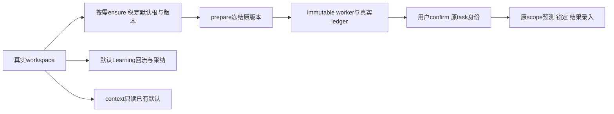

# T1312 实现交付记录

状态：九源实现与受控验证已完成；最后窄回归38PASS、双types和必要Gate exit0，原PG缺环境仍保留。本文只交付实现和受控验证，不签父任务完成，不代表新候选包/真实Codex或平台登录验收。

## 改了什么

默认量表的唯一定义移到backend，保留原六维名称、说明、权重和变更说明。普通G用独立group-default命名空间；真实legacy入口和显式legacy组沿用canonical稳定ID。同组null/A/B及重命名保持同一默认。原startup枚举最多100账号seed已删除；真实绑定事件的完整ctx best-effort warmup保留，首次诊断和默认Learning回流按需ensure，context/getPredictions纯读。

ensure使用同事务的真实ctx admission与root→v1→pointer原子提交。专用默认父链覆盖prediction/draft、lock/result、suggestion/adopt/dismiss及bump/count/pointer；普通getter/workspace utility和subject/leaf权限不扩大。旧current-v2/accountnull及完整用户编辑原样保留，canonical追加版本继承真实父根来源，计数覆盖A/null全部旧版本。

confirm向draft传已锁task冻结身份；唯一兼容例外是已由原task/membership锁证明合法的实际noGroup同A入口，保留原账号叶子scope。页面筛选B不能进入冻结任务的draft锁路径。现役受信binding创建无member真实账号的旧入口也保留：仅本事务新root/v1和已验证null父根下本次新版本，精确核ID/user/account/预期触发器派生G/行数后保留明确null。旧行不迁移、不造group/member，叶子沿原scope。

生产范围严格为SPEC九源；三处附加旧测试只机械重命名注入key，见runtime/MECHANICAL_TEST_RENAME.json。没有contract/schema/通用workspace/worker/迁移源码改动，没有构建ai-worker/dist或新候选包。

## 产品前RED与后续补漏

| 证据 | 当场事实 |
| --- | --- |
| red-v1 | namespace实际resolver选错__no-account__版本；两个完整worker→真实confirm成功后，draft实际ctx为页面B而非已选冻结null/A，三条有效RED。puregroup因attemptId长度不足只是夹具FAIL，不算产品RED。 |
| red-pure-v2 | 只修attemptId前缀并重新完整前冻结；实际纯组公开prepare报rubric-canonical:__no-account__不存在，provider0/execution未绑定。 |
| legacy-public-v3 | 首次修复后的真实noGroup A：prepare/provider1/worker/ledger/confirm成功；原ctxA直接读取本次确认产物报OwnershipError。其task为legacyG/A，draft为legacyG/A，叶子accountnull；完整tuple保原件，第三轮评审后最小A修复。 |
| null-scope-red-v6/v7 | 两个真实目标失败保留，但v6缺新增producer前快照；v7补producer/migration却误列一个不存在的contract路径。两轮都不追签为完整前置源证据。 |
| null-scope-red-v8 | 76份真实前置路径全部存在。现役PlatformCollectionService受控可信proof→VerifiedAccountBindingPort建activeA，真实member0/group0；首次ensure被派生legacyG后归属门拒。另一族已有null父根、A有合法legacy member，bump新版本被trigger派生G后父链门拒。两条是有效RED，生产此前未改。 |
| null-scope-green-v9 | 最窄新insert修复后2PASS；两族继续完成bump、prediction/lock、真实Learning采纳/suggestion/adopt。没有声称这两族包含result、平台真实登录或模型worker。 |

namespace RED只证明当前错误resolver与新规范不符；没有声称round1未实施方案已发生碰撞。confirm RED证明实际ctx衔接错误，未声称复现真实PG死锁。所有原失败、首次评审CONCERNS及round2/round3 PASS lineage保留。

## 验证分层

公开生产组合共6个用例：2个仅prepare（新纯组、namespace旧/新身份）；2个普通组null/A经过真实worker→ledger→候选→跨筛选B confirm→同一prediction lock/manualResult/read；1个真实用户Learning默认/显式回流→采纳/刷新/忽略及跨组拒绝；1个无group A/旧canonical-v2null经worker→confirm后，直接用同一确认prediction ID get/lock/manualResult/read→Learning suggestion/adopt-v3。受控provider按实际冻结六维或合法既有单cta维度返回协议响应；不是stub完成服务、直接种settled证据或真实外网模型。

后端受控库存/故障注入单列：真实account/group服务与真实repository/权限锁；根/版本A|null四矩阵、并发ensure与rename、旧v2编辑保持、跨user/group/非成员/归档/转组、普通量表原scope/share锁、root/v1/pointer触发器rollback、稳定ID/父链/指针/维度损坏拒绝、真实getPredictions全部public表before-after只读。旧null父根库存明确由隔离fixture UPDATE恢复历史状态；不称公开用户路径能制造该历史状态。

无member新增两族来源是现役服务端受信binding port加本地可信proof，非真实平台登录。后链运行真实service方法；不冒公共模型worker链。Prediction/Learning本身仍受原stamp和DB trigger处理，不把它们统称groupnull。

PGlite只证明同session事务/savepoint、真实rollback与SQL锁轨迹；并发由其连接模型串行，不代表真实PG多连接死锁压测。原calibration-positioning-adoption测试保所有定位/安全/回滚断言。旧带build入口的worker suite没有运行，不能记PASS。

## 历史验证与修正事实

- core-v1的4PASS是2 prepare和2 worker→confirm→prediction/lock；当时没有result调用，不能追签result。
- backend-core-v2：69=66PASS/3FAIL；分别为合并DDL被prepared statement拒、DTO不存在accountId的夹具断言、INSERT trigger使所谓null历史根实为legacyG。校准后的backend-default-v3为18PASS。
- frontend-final-v5：6PASS；backend-final-v5：117=106PASS/8FAIL/3原skip，exit1；8首错为7项隔离PG地址未配置和1项新context夹具缺dimensions。没有删原skip或改断言。
- v5双types因新测试取值可能undefined、task强转RequestContext失败。v9前端类型已通过；v9后端类型仍抓到本次fixture嵌套required自动替换错式。旧错式可能生成undefined where而首行恰过，v9该句不作为exact root绑定证据。该表达式随后人工精确修正为required(roots[0]).id及对应查询行的accountId.toBeNull，保原业务存在性与行scope断言，后续由formatted-v10对应case再验。
- backend-final-v9：7文件79PASS/exit0；frontend-final-v9：6PASS/exit0。v9后端类型仍exit2，因此不把v9整体称全绿。
- 新逻辑多行格式整理仅四个相关源/新增块；FORMAT_ONLY.json保前后SHA及完整有序AST(kind/identifier/literal/isTypeOnly)一致。最初校验误含SourceFile.text导致拒写0源，改为实际语义节点后才通过并写入。公共6功能证据绑定格式前后等价源；之后再跑双types及默认/adoption窄回归。

## 预算、环境和清理

所有自有Vitest配置显式include，并在命令中再传精确路径，retry0/singleworker，cacheDir在本runtime。公共正test/it为3600000ms，hook180000ms，观察至少120000ms，外wrapper86400s；原task deadline1800000ms未缩短或续期。无build、无全局exec mock、无操作live候选94030/用户库/旧UNKNOWN/真实凭据模型。

旧三机械调度测试的完整v5命令保原exit1：legacy迁移2例、export进度5例需CREATOROS_TEST_POSTGRES_URL，本机未配置，均实际FAIL，另有3原skip。没有造URL、启动PG或访问用户PG，不重复该完整11分钟集合，也不把PG并发写PASS。后续新不可变候选的真实Codex/平台登录/真机验收仍由父任务接续。

清理精确记录见runtime/RESOURCE_CLEANUP.json；只声明已记录owned进程组、各用例自有临时根和受控server/worker的实际检查结果，不声称系统所有临时文件清零。原timeout Gate固有五包.vite结果缓存足迹单列，未为隐藏副作用删除守卫或缓存。

## 最终运行表与源绑定

| 运行 | 真实exit | 秒 | 实际结果 |
| --- | --- | --- | --- |
| frontend-final-v9 | 0 | 336.539 | 6 passed (6) |
| backend-final-v9 | 0 | 473.517 | 79 passed (79) |
| backend-formatted-v10 | 0 | 227.613 | 38 passed (38) |
| backend-type-formatted-v10 | 0 | 230.931 | 类型/Gate见原完整日志 |
| frontend-type-formatted-v10 | 0 | 247.505 | 类型/Gate见原完整日志 |
| timeout-formatted-v10 | 0 | 176.491 | 原verify全部子命令通过 |
| boundary-formatted-v10 | 0 | 1.27 | 类型/Gate见原完整日志 |
| semantic-formatted-v10 | 0 | 2.135 | 类型/Gate见原完整日志 |
| orphan-final-v5 | 0 | 1.14 | 0 errors / 100 warnings |
| backend-final-v5 | 1 | 679.986 | 8 failed | 106 passed | 3 skipped (117) |

最终生产源SHA（完整bytes及全部测试/前快照在OUTPUT_INDEX）：

| 源 | SHA256 |
| --- | --- |
| backend/src/modules/calibration/default-rubric.ts | 52f25957b6502de1160530daff1618a9475b86c35e3de6d40b08239df9837af7 |
| backend/src/modules/calibration/calibration.service.ts | 1b8552867b15067bd3c4729e141938cba6110633e95a8389589a6ca9a64380ee |
| backend/src/modules/calibration/calibration.repository.ts | 29c360a540fc09da89fbf00ee6409f12f61234f6565f7717c1d0ececf394fa2a |
| backend/src/modules/calibration/index.ts | 4cdc3efb2b10a4a6c341af96aef39a878c2be41e71e92ecfe018c0d314ea404e |
| frontend/src/server/persistence-client.ts | 2503085236dcdace8d8f5368faaab44bd1a40ed938294fe25fa00c8088faa0de |
| backend/src/application/context/calibration-diagnose.ts | b9fc6295d7f59176f4f76cb2e834fa5892d57a47f4ec428e5ee946075736c87d |
| backend/src/application/chat/performance-readers.ts | b6d37b9f9433df435229e3edec446f7504432657250e13562094b0bd3f5024da |
| backend/src/application/scheduling/controls.ts | 84937173927ce25bbf78ab29a41a4c34b01b83e42d29a58ffa1655b0e859bfbf |
| backend/src/modules/ai/calibration-positioning-adoption.service.ts | 06daee04f86dff76afb01152239ef20df68e8d50e51d85545202416c027d72b9 |

实际清理：29个wrapper记录进程组，当前残留0；22个记录临时根均不存在，精确T1312前缀盘点0；绑定worker hash/bytes未变；原timeout五包缓存足迹5项均列JSON。

实现未做commit、pmem/reconcile/taskctl或控制状态写入。最终OUTPUT_INDEX交独立R审核后由Root/C接续；原7项PG缺环境与后续新候选真实provider验收不被本报告覆盖。
