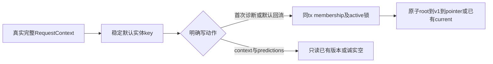

# T1312：恢复纯组校准诊断默认量表

## 当前问题与授权

用户已授权全功能恢复；Root审定本独立修复。当前默认resolver返回rubric-canonical:__no-account__，纯组无法命中合法默认量表；当前尚无本任务组合RED，不追认真实模型根因。六维原校验合法，问题在实体ID、初始化与真实workspace权限；不改评分语义或维度规则。

## 默认key与兼容

普通新组稳定组默认；同组null账号/账号A/账号B解析同一key。精确格式在新模块固定并机械测试，普通组rubric-canonical:group:<groupId>及rubricver-canonical-1:group:<groupId>。无group的合法legacy沿原rubric-canonical:<accountId>、rubricver-canonical-1:<accountId>。真实迁移实体grp_legacy_A按既有ID协议映射原canonical:A，仅兼容实体ID，不把A注入ctx/账号权限。组重命名不改key。

A迁走/归档后，原legacy组+null仍可读取该组已有current；缺默认仅按真实active组、account=null创建，不搬/覆盖同ID异owner；保已有旧来源字段，不迁prediction/score/suggestion或组转移闭包。任何碰撞/断current指针须明确报错，不吞异常或随机挑量表。

## 原子ensure与读写边界

ensure属于calibration service，接完整实际RequestContext，先按原lockWorkspaceMembership及active工作区锁（account→member→group既有顺序），再在同一transaction读取/写入。repoFor和repository会workspaceStamp丢掉account/membership，不可只复用现withWrite便称权限完整；必须先用原完整ctx验证锁，再用正确group stamp落库。不得开root db另一连接造成T1276自等待。原子稳定ID root(current=null)→v1→pointer，重复返回已有完整current，公开bump后的v2+不可覆盖。保所有description/changeSummary，不仅key/weight。复用validateDimensions：至少1个合法monetization key，六维hook=.2/emotion=.2/product_path=.2/social=.15/cta=.15/quotable=.1及原全部说明逐字保留，不增维度门。

首次合法calibration.diagnose准备可ensure；已冻结任务沿原stored版本，不re-ensure。Learning仅用户未指定rubricId的默认回流ensure，显式ID沿原选择。context.calibration/getPredictions为effect=none纯读同key，不得ensure。startup/bind仅用同service、真实full ctx做原已授权warmup，不以accountId猜scope；删除旧最多100账号seed库存路径不得变为启动遍历创建全新组默认。旧预测/score/suggestion历史继续原version，未知/归档/跨组原权限不放松。

## 精确范围

生产共8处：新增 backend/src/modules/calibration/default-rubric.ts；现存 backend/src/modules/calibration/{calibration.service.ts,calibration.repository.ts,index.ts}；frontend/src/server/persistence-client.ts仅默认resolver/量表seed与Learning薄装配；backend/src/application/context/calibration-diagnose.ts；backend/src/application/chat/performance-readers.ts；backend/src/application/scheduling/controls.ts。

不改contract/schema/worker/迁组流程/语义算法/调度策略/原历史实体，不哨兵补库、不将默认ensure用于任意用户显式读取。准确测试W见MODULE_SCOPE：原calibration.service/repository集成、diagnose reader、scheduling controls tests；新增default-rubric.test.ts、default-rubric.integration.test.ts、frontend production-root组合测试。readonly其他消费者/合同/迁移/原校准worker用于核冻结链，非批量修复授权。

## 必须当场发生的验证

产品修改前完整production-root纯组公开calibration.diagnose任务prepare真实缺量表RED：记录provider调用0、execution未绑定及具体missing错误，完整测试/源/配置SHA先快照，不只helper或假reader。另核心ensure原子/身份行为先RED，夹具错误单列。修后同公开prepare→真实冻结worker/model受控协议→完成/confirm/lock/读回；外部协议替身明确，不能称真模型。

同组两账号/null、跨组/用户/非成员/归档、legacy无组/原账号移走归档、新旧owner碰撞、公开bumpv2后并发ensure保v2、SQL trigger rollback/root-v1-pointer无半写、断pointer明确失败、Learning默认/显式、readonly各表before/after相等、rename/历史读/旧冻结任务不变均须覆盖。PGlite单session不冒PG多连接死锁压测；PG仅实际环境可用才声明。新包fresh-owned公开真实校准模型与结果确认、Learning默认回流、只读context另验，不重发旧UNKNOWN/不碰用户库/不发布。

正请求/观察至少120s保原更长，test/hook>=180000ms、retry0、single worker、外层86400s；immutable worker见绑定，不build dist。timeout-policy固定原Gate五包可再生缓存实际足迹保留。只在独立方案PASS、真实lease与修改前完整RED后实施；本SPEC当前待首次独立审核，未获生产写权。最终Gate/pmem/reconcile原样真实登记，不把局部受控绿当整任务或父矩阵PASS。

## 专用默认父链：最终兼容合同

既有canonical root来源继承仅来自真实owned平台A及实际grp_legacy_A实体/关系验证，不从字符串解出A后伪造ctx。root稳定rubric-canonical:A；初版rubricver-canonical-1:A。缺来源不造A，纯组合法新默认可stamp accountnull；已有root/current不迁移、不改stamp、不补v3。A移动/归档后原组+null可只读已有默认current，旧无group账号入口新写仍须实际ctx原owner/active/真实membership权限；组工作区拥有自己默认规则的读写资格，不借旧来源字段取得账号权限。新组default只在明确合法首次写动作ensure，不启动遍历造组default。

为了覆盖历史root accountA、current v2 accountnull，只增加repository内部默认父链专用方法/模式，携完整实际ctx，同user、真实legacy组、exact canonical root、version.rubricId/group、实际叶子owner逐项核验；仅无group legacy兼容分支，version.accountId只允许该已验证默认root来源A或null；group路径按实际组与精确parent关系，不以历史account字段追加权限门。普通rubric、subject、learning、prediction/results原scope和generic getRubric/getRubricVersion/getCurrent、workspaceFilter完全不放宽。对历史版本不强制current（旧冻结任务必须读其原版本）。专用只读default getter不ensure；专用写入口最外层使用原完整ctx与实际实体权限锁，不能从suffix授权、不能跨root fallback。

具体调用族必须闭合：默认reader/ensure的root+current；createDraftPrediction读取version与repo.createPrediction的versionParent真实父锁；withPredictionWrite、lockPrediction内部重复predictionParent、createResult相同parent链；默认Learning回流先原scope归属检查，实际事务保workspace→rubric→learning原序；withSuggestionWrite/adopt/dismiss/mark重复父锁不能丢模式；公开bump的withRubricWrite→current→count→insert→pointer也沿同窄链。subjectParent及叶子stamp/query保原ctx，subject→version既有业务锁序不变。count覆盖该exact root的A/null全部真实版本，避免v2漏计撞唯一键；新canonical版本继承已验证parent真实来源account，不按本次ctx随意重stamp。普通rubric仍原逻辑。

只读可访问历史不是新增写授权；A移动/归档后，旧无group ctxA入口新写依原账号/会员准入拒绝；真实原组+null或合法筛选B仍可读写该组已拥有default，root.accountA仅来源，不再锁A或要求其留组。缺default在真实active组+null的明确合法ensure才创建accountnull；异owner稳定ID碰撞报错，绝不搬库/覆盖/绕会员校验。如要超出这8源或改通用权限才能成立，必须停报精确delta，不能临场扩。

新增重点组合：真实旧canonical rootA/current v2 accountnull原样保留，完整默认prepare→受控model完成→confirm→prediction→lock/结果录入，以及默认Learning suggestion→adopt→新版本；公开bump到v2后并发ensure保v2，原v2缺stamp兼容不能只修首读。普通/错group/错root/version/叶子owner不准借fallback。两账号/null同组、迁移/归档/跨用户及非成员/readonly表before-after、历史version与description完整保留均核。PG多连接仅真实可用才执行声明，PGlite不冒死锁压测。

本任务新增runtime配置必须显式override include为唯一文件、使用明确testNamePattern/文件，不能mergeConfig合并原include误扫其它suite；cacheDir指向自有runtime。固定timeout Gate五包可再生缓存按真实footprint单列，不追签scope零派生。

锁序特别约束：所有默认写仅按实际完整ctx先lockWorkspaceMembership：无group legacy实际A沿A→member→legacyG，group+真实筛选B沿B→memberB→G，group+null仅G；随后root/version/叶子。绝不为历史root.accountA追加账号锁、不构造ctxA，避免group→历史account反序。group权限由实际owned G与持久默认parent.userId/groupId/稳定key关系证明，root.accountA仅来源，A移走/归档不影响G已有default current读写资格。仅无group legacy例外需实际ctxA仍合法legacy workspace（原真实锁/会员已证），再受限读/锁exact默认root及其version含旧v2null，不按suffix授予权限。新group默认始终group stamp/accountnull；新legacy来源只由实际ctx/锁证明盖章，grp_legacy后缀不能造账号。追加canonical版本继承已验证parent来源及原group，不修改历史行。默认parent例外只覆盖root/version，subject/learning/prediction/suggestion叶子原scope与业务父锁次序不变；count/list/bump/adopt同一exact默认链，防漏旧null版本撞号。不得改通用workspace utility或在group锁之后补历史账号锁。

最终实体矩阵：所有新group默认（包括grp_legacy_A）始终stamp accountnull；不为历史来源A补任何锁/权限。只有新无group legacy创建以实际ctxA证据stampA，实际legacy membership存在则归该实际legacy组，未迁旧scope保持groupnull。已有root来源A/null/current均不改，后续version继承owned parent原来源。无group受限默认父链兼容明确覆盖exact canonical root.account=A或null与version.account=A或null的完整矩阵，前提同user、真实legacy组关系、原ctxA仍合法且root/version/叶子parent关系完整；不是仅rootA。正常group依真实组权限访问，与历史A当前是否成员无关。通用workspaceFilter/普通getCurrent/各业务叶子权限不变。
