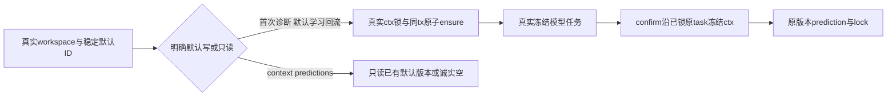

# T1312：恢复纯组校准诊断默认量表

## 事实与本轮审查

用户授权恢复全部Codex功能；Root明确默认量表独立修复范围。当前无group resolver使用rubric-canonical:__no-account__，纯组默认诊断前置缺量表；尚未发生本任务生产前组合RED，不将静态线索追认为旧公共根因。六维原来合法，不改评分语义/维度门。

首次独立initial已真实record为CONCERNS[REV:2423d13cddef]，cycle1 round1，两个open finding保留。当前为同lineage round2待审delta：解决新旧ID命名空间碰撞，以及完整confirm事务实际ctx与冻结ctx导致的锁反序。原SPEC/锁/模块/DEC快照保control/ROUND1，不重置initial，不提前写实现。

## 稳定ID与来源矩阵

普通新组G使用不相交前缀rubric-group-default:<G>、rubricver-group-default-1:<G>；同组null/A/B同一key，重命名不变。旧无group实际账号A保留rubric-canonical:<A>、rubricver-canonical-1:<A>。真实迁移实体grp_legacy_A解析既有canonical:A仅兼容实体ID，不从suffix注入ctx/账号权限。机械覆盖合法旧A='group:G'与普通G并存，两套root/v1不碰撞且各自prepare可用。

所有新group默认（含grp_legacy_A）stamp accountnull；新无group legacy创建才由真实ctxA及原权限证明stampA（实际legacy membership存在归真实legacy组，未迁旧scope保nullgroup）。不造来源A、不凭suffix授权。既有root/current及来源A/null不迁移、不改stamp、不补v3；追加canonical版本继承已验证owned parent原来源和group。A移走/归档不抹旧G对自己default的读写资格，正常group依G权限与持久parent身份，不要求历史A仍为成员。

仅无group legacy受限父链例外：实际ctxA必须仍owned/active、真实legacy workspace/membership合法，才能读锁exact canonical root及真实version；明确覆盖root.account=A或null、version.account=A或null矩阵。只按同user、真实legacy组关系、稳定default ID、root/version.rubricId/group/叶子owner全核；普通rubric不得借此fallback。旧无group A入口迁移/归档后新写仍原guard拒，puregroup合法历史默认读写不借账号权限。

## 同tx ensure与精确默认父链

calibration service接完整实际ctx，先原lockWorkspaceMembership与active校验；仅锁实际ctx：无group A沿A→member→legacyG，group筛选B沿B→memberB→G，group+null为G；随后root/version/叶子。绝不在G后补历史root.accountA锁，不构造ctxA。repoFor/workspaceStamp会丢account/membership，不能只调用现withWrite便称原完整会员锁已发生；先完整ctx真实锁再正确stamp，使用同一tx不新开root连接。

稳定ID原子root(currentnull)→v1→pointer，重复返回完整已有current，公开bumpv2后并发ensure保持v2+。碰撞/断pointer/错parent明确拒，不onConflict吞异常/随机取rubric/覆盖用户版本。保原6维hook .2、emotion .2、product_path .2、social .15、cta .15、quotable .1及原全部description/changeSummary逐字。validateDimensions原“至少一个monetization维度”和归一校验不变。

专用默认root/version getter及repository内部受限父链模式覆盖：createDraftPrediction及createPrediction的versionParent；withPredictionWrite、lockPrediction内部重复parent、createResult；createRuleSuggestion、withSuggestionWrite/adopt/dismiss/mark重复parent；公开bump的withRubricWrite→current→count→insert→pointer。count覆盖该exact root全部A/null版本，防旧v2漏计撞唯一键。旧冻结任务读取原version，不硬绑current；普通getRubric/getRubricVersion/getCurrent、通用workspaceFilter和subject/learning/prediction/suggestion/results叶子scope/query/stamp不放宽。

原subject→version、workspace→rubric→learning业务父锁顺序保留；Learning原scope归属检查在默认ensure前，事务内不另造learning→rubric反序。group-owned default按组权限访问，不用历史来源字段加新权限门；无group兼容例外严核实际ctxA与所有父链。

## 完整confirm衔接（REV-002，第9源）

calibration-positioning-adoption.service.ts外层已锁真实task及assertFrozenWorkspaceMembership的原冻结A/member/G（或puregroup G）。仅calibration分支向createDraftPrediction端口传从该已锁真实task取出的userId/groupId/accountId/groupVersion/membershipVersion，保原request/source，其余subject/version/原receipt不变。页面同组筛选B不再进入该draft下层新B锁，纯组只重取G、冻结A只重取已锁A/member/G；同一传入tx，不构造历史root来源ctx、不新增skipGuard布尔、不改positioning或全局locks。原task冻结字段与membership已真实核验，不从客户端payload自报取权。

用真实confirm入口验证跨页面筛选、task frozen null/A与B、SQL锁轨迹/回滚、原draft冻结版本与叶子owner；不能只spy端口或靠PGlite串行过就宣称PG无死锁。无实用PG多连接环境则明确未压测。发现9源外实际缺口须停报delta，不临场扩权限。

## 调用边界与精确W

首次合法diagnose prepare可ensure，旧冻结任务不re-ensure；Learning只有未显式指定rubricId的默认回流ensure，显式ID原选择。context.calibration/getPredictions effect=none纯读同key，不ensure；startup/bind同service warmup必须真实完整ctx，不accountId猜scope，移除旧最多100账号seed不变为启动遍历创建全新组default。历史prediction/score/suggestion仍原stored版本与迁组闭包。

生产九处：新增backend/src/modules/calibration/default-rubric.ts；原calibration.service.ts/calibration.repository.ts/index.ts；frontend/src/server/persistence-client.ts仅量表resolver/seed与Learning薄装配；application/context/calibration-diagnose.ts、application/chat/performance-readers.ts、application/scheduling/controls.ts；新增授权现存modules/ai/calibration-positioning-adoption.service.ts仅上述calibration分支冻结ctx传递。无contract/schema/worker/迁组/调度/通用workspace修改。

测试精确W及新增允许文件见MODULE_SCOPE_ROUND2。包含现存calibration-positioning-adoption.test.ts以验证完整confirm入口，原positioning断言保持；原calibration/service/repository/context/scheduling回归及新默认/production-root组合。旧suite的build/短预算入口不得原样运行写dist，需明确immutable worker与自有runtime配置。

## 当场RED与验收

产品前真实production-root puregroup公开diagnose prepare缺量表RED：保具体错误/provider0/execution未绑、完整测试及源/配置事前快照。新namespace碰撞与完整confirm跨筛选冻结ctx分别独立前RED，不能让缺量表先失败遮住其它目标；已正确基线如实保留。修后完整prepare→冻结worker/明确owned外部协议替身→真实完成→confirm→prediction→lock/result读回，受控不冒真模型。

同组两账号/null、跨组/user/非成员/归档、legacy无组及A移走/归档、root/version A|null矩阵、public bumpv2后并发ensure保v2、完整描述、SQL trigger rollback/root-v1-pointer无半写/断pointer、默认/显式Learning、纯读各表before-after、rename/历史读/原冻结不变全部覆盖。subject/learning/叶子错owner/parent与普通rubric拒借default fallback；legacy旧v2null须真实完整prepare→confirm→prediction/lock及suggestion/adopt后链，不能只测首读。两个来源ID族各自合法/碰撞异owner拒。

PGlite可证同tx/savepoint/回滚与锁轨迹，不能冒PG多连接死锁压测；PG仅环境实际可用才声明。后续同一新不可变包fresh-owned真实校准模型/确认及Learning回流/只读context另验，保原失败、不重发UNKNOWN、不碰用户库/安装/发布。正请求/观察至少120s保长值，test/hook>=180000ms、retry0/singleworker、外层86400s完整覆盖；原持久task期限不缩不续。自有runtime显式唯一include，禁止mergeConfig误扫；cacheDir自有runtime，固定timeout Gate五包可再生缓存真实footprint单列。原worker绑定不build dist。最终Gate/pmem/reconcile/taskctl真实登记，实施done不等taskcomplete或父全绿。
