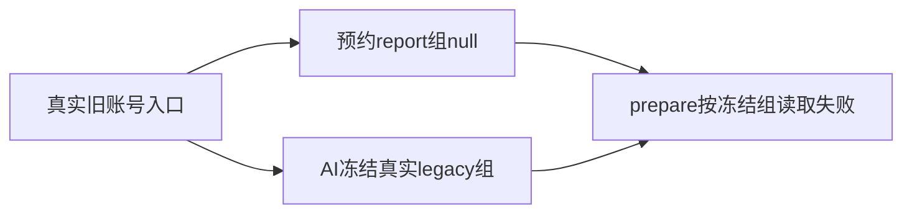

# T1313：恢复旧账号作品审核预约与冻结工作区一致性（待决草案）

Root已授权独立登记T1311新增实际失败，不在原两完成服务范围临场修。原件 docs/verification/t1311/runtime/LEGACY_WORK_PREPARATION_FAILURE.json 及public-scopes-v1/legacy-work-final.json：真实公开accounts.create的A，以合法无group旧入口创建work review；预约report group=null/accountA，后续AI经真实membership冻结grp_legacy_A/accountA，prepare.readFrozenTask按冻结组找不到原null组report，抛OwnershipError“审核报告不存在”。原report/business queued、executionTaskId=null、0execution/0ledger call/0provider请求。

该失败在T1311完成服务之前，公共六scope必须保持5PASS/1FAIL。原报告/task字段分歧已实证；project/composition根及其字段/权限闭包尚待独立实际原件核验，不凭静态推断批准特定修法。10source/schema快照见原legacy-work-prepare-source目录。Root/R将核真实父归属、公开service/事务/会员冻结顺序，随后精确W/测试/同tx锁及独立初审，当前无生产实现或测试写权。

禁止删除T1311精确group/account完成条件、放宽通用workspaceFilter、只重stamp孤立report却留错project/composition、从legacy组后缀注入权限或打开旧用户库。新方案须保真实user/group/account/版本来源、归档/迁移、原scope与source/receipt/幂等和事务回滚。需要改动其它根必须SPEC准确锁审；不将首次prepare失败当模型故障，不重发旧UNKNOWN。后续完整公共创建→prepare→worker→settle→commit RED/GREEN及新包真实验收需当场发生，未执行不签PASS。

## Root已定最小方向（尚未正式锁审，不得实现）

候选生产W仅三现存文件：backend/src/modules/review/work-reviews.service.ts；backend/src/modules/review/work-review-task-adapter.ts；backend/src/application/generation/work-review-root.ts。不改contract、AI生产服务、persistence或通用workspace工具；persistence workAiFor已有全AiService，无额外装配改动。

work-reviews.service最外层按真实ctx完成account→member→G原锁/冻结，新report仅legacy真实freeze盖实际group（普通group仍accountnull）；同tx原子预约/AI创建/失败回滚。私有readFrozenTask先真实readTask并通过现有AiService.getTaskExecutionRuntime窄owner端口读原row真实owner，再对report按exact user/group/account空值安全查询，保全部task/attempt/project/fingerprint/snapshot.scope/frozenContext对应校验，不重读当前父。task-adapter接这个窄owner端口，work-review-root仅AiService Pick增加该既有方法。AITaskResource没有accountId，不能本地补假required字段或从页面/后缀猜身份。

公开get/list/status/confirm继续原parent门，不用私有冻结读取扩公开权限。旧pending不自动重stamp、不自动重发，原可读/可取消以及显式原key仍明确拒绝的边界须写测试；不为恢复入口把原预约移动到当前group/替换source或父引用。

修改前新RED必须保父project/composition实际行及report/task/execution映射当场快照；旧父行未拍，只能标runner公开创建+未变源码stamp推导，不能补写为直接行实证。新组合需真实无group旧入口公开创建到prepare/fork worker/settled/commit、同task重复、归档/跨组/账号移动/错owner/receipt/rollback和公开父门均守原语义。精确测试W、实际输入锁与正式initial在T1312实施冻结后再确定，避免只读persistence SHA刚锁即变；当前只方向草案/真实失败归档，无实现授权。

待核：newreport盖G后，原stage2 original/pending.groupG调用submitTask，AI下游读取legacy groupnull project/composition是否仍可达尚未证明；不得把新reportG等于整链闭合。R将核真实scope映射/原parent读取合同后再定方案，当前不锁、不实施。
