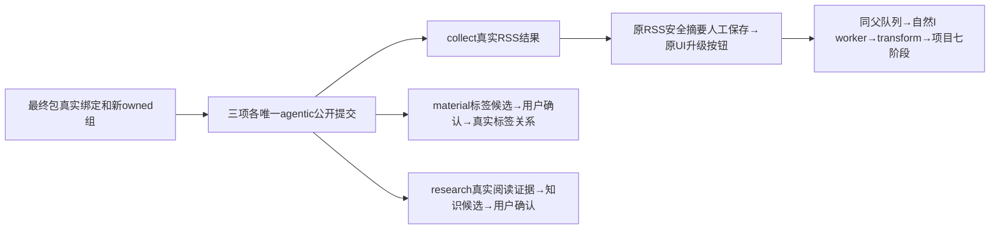

# 最终新包四条公共验收准备：NOT_RUN

本目录只有离线准备。没有读取session、启动浏览器/数据库/worker、网络请求、真实模型或业务提交。最终完整package、新owned root及其真实配置尚未绑定；模板所有身份保持null、executionAuthorized=false。当前C仅授此目录精确12个文件，未授runtime写权或执行许可。旧IIb的825/848、T1321与已完成598d9882的库均不再打开。

阶段沿T1315 verification-only / BUILD，不改变产品、服务合同、父矩阵、设置或评审。product-to-code-orchestrator 3.29.0与项目版本相等；物理边界为外部driver→正式公共dispatch/UI→现役服务/自然调度→原worker，fixture不import生产factory、不接DB、不改worker/SDK/凭据。

四条根各唯一intent见binding.template.json；wx动作标记先于请求，传输未知/业务失败均保原ID，不换提示、key或root追绿。collect新source关闭monitor/runInitial，若public返回合法自动run/task，先原样记录并阻止第二次采集；所有人工fixture前后读真实AI/持久任务清单，合法自动任务不伪称0。material/research必须dryRun=false；候选未采纳前领域读回逐字不变，正式confirm后核真实消费者与adoptionReceipts。

U35复用本次collect真实item/snapshot，只把其safeExtract逐字标为“人工来源摘要，非ASR全文、非新近新闻”经现役uploadManual保存；不编来源、账号、指标或strategy私有字段。先公开upsertProfile再createStatement。正常/intelligence卡片“升级为项目”只点击一次，禁止force/evaluate触发；观察父execution.tasks.list(kind radar_project_upgrade, ownerId item)及同topic child，禁止tick/drain/手动改状态。三个实际settled model operationKey及同transform、定位/快照、Brief和七阶段、刷新“查看项目”正常链接是机械断言；语义和截图须Root独立实际查看，不能仅task succeeded签全功能。

## 原期限及组合覆盖

| 独立段 | 上限秒 | 次数 | 合计秒 |
|---|---:|---:|---:|
| 装配/输入锁前置余量 | 1800 | 1 | 1800 |
| 公开fixture及公共配置核对 | 7200 | 1 | 7200 |
| agentic前置读回hook | 1800 | 3 | 5400 |
| agentic原根观察（POST之前登记） | 1800 | 3 | 5400 |
| agentic业务确认/读回储备 | 1800 | 3 | 5400 |
| U35人工摘要/正常UI启动 | 1800 | 1 | 1800 |
| U35原父及所有自然子链观察 | 28800 | 1 | 28800 |
| U35业务/刷新读回储备 | 1800 | 1 | 1800 |
| 独立清理 | 600 | 1 | 600 |
| **已计算完整串行覆盖** | | | **58200（16小时10分）** |

配置外层86400秒沿原SPEC更长预算；多余28200秒只为外层覆盖，不被任何case作为新任务期限。driver85800秒到界释放自有进程，外层保600秒清理；没有按当前时间重新开任务窗口。原观察与业务读回截止在每根提交前同时登记，业务读回不再等待/重发模型。每个正请求上限900秒，至少剩120秒才启动，使用min(cap,remaining)，不以max(120秒,remaining)延长。NaN/无效日期拒绝；持久finite deadline只取min，continuous null不造有限持久预算。AI prepare未立刻绑定execution时只读原ID，明确终态则停止该根；真实父/子都继承已收紧父期限，不为child另开8小时。

## 真实证明与缺口

agentic正式ai.tasks.results resultData.meta公开actualEngine/threadId/turnId/model/modelProvider；实际模型call从workbench inspect的resultRef→原result.id关联，**AI结果DTO没有executionCallId字段**。不能断言不存在字段。模型名null如实保UNKNOWN。完整冻结route/runtime/requestedModel仍未公开，不拿settings/engines或UI模板代签；配置6槽/版本和实际调用事实分别保存。

material标签读取taxonomy.entityTags.listForEntity，不从assets.get找不存在的tags。research读取真实evidenceRef/snapshotId分窗直至nextOffset=null，knowledge.list/get/revisions与真实采纳回执，不把URL当evidenceRef。U35 projectResource没有group/account：只核已公开DTO、原父/child/item/transform的公开scope，不能并发打开候选在用数据库补隐含字段。generationProgress可选；有则保原观测，不给合法历史输出新增三阶段必填门。

## 离线核验与执行条件

离线命令：`node docs/verification/t1315/final-root/runner/collect.cjs`。它只核真实ENDPOINTS、请求/响应字段、selector源码及语法，实际回执/失败历史写入CONTRACT_READBACK.json，轻量依赖及源字节写INPUT_INDEX.json。该索引是准备期工作树实照，非最终package锁；C/R源可能在独立改动，不能拿它执行。

未来先由C给最终package SHA/sourceHead、全新owned root、0600 session路径、三个confirmed真实回执的五身份及最终执行输入锁。模板不允许执行；另须Root执行许可及C新增runtime写权。wrapper拒绝未绑定/输入漂移，原case marker防重复。只释放driver自有API context/browser及按真实PID身份登记的fork；不停止C的候选服务、不取消原未知任务、不清用户库。禁止安装/build/dist/SDK复制或读取auth。

## 准备期原错配保留

首两次离线collection实际exit1，均已完成34个请求合同与全部语法核对，末尾把tsx可选本机Unix pipe探测计为network而失败。Root准精确纠正：`tsx/dist/client-D3mGB526.cjs`调用栈且参数等于实际`getPipePath(process.ppid)`时，仍在原net方法之前抛出，单列blockedOptionalLocalIpc；没有实际连接。TCP/HTTP/其它net仍FAIL。两次失败完整UTF-8及SHA作为CONTRACT_READBACK.previousReceipt递归保留，不补拍成成功。

初稿静态错配是用`result.executionCallId`关联模型；正式AI result DTO没有该字段。未执行该错配断言，已改为唯一settled model的`resultRef === result.id`关联；不得称原断言曾运行成功。另collect.run/readCollection合法即时完成族返回`{ok:true,itemsNew,itemsUpdated}`而没有runId，不能新加必填：此时只读本次fresh source唯一真实run确定ID，不另提交。pending族仍须真实递增observation的collect.status；即时完成若未调用status，结果明确标注节点覆盖未调用，不冒三工具全覆盖。原source/read/run闭环及真实items/snapshot仍必验。

UI guard只拦计划之外的写入并把attempt判FAIL；必要公共GET/HEAD读取不拦截。跨origin只读请求移除本driver握手/组/认证头，不向外站发送这些私密头；没有绕过模态、force或直接脚本触发按钮。

## Root实物复核两处修正

旧e1a输入索引、026离线回执及两份受影响旧runner完整UTF-8/SHA，先保存在CONTRACT_READBACK的previousReceipt链中（ROOT_REVIEW_DELTA_PENDING_OFFLINE_RECOLLECTION记录），再改新准备字节，不覆盖旧版本为PASS。这里没有真实模型运行或新错误诱发。

research提示已与原staging核对：sourceNote必须逐字等于本次实际阅读证据的sourceUrl，不能在URL旁附解释；说明文字放note。最终还核成功knowledge.write输入、其工具原proposal与正式候选完全一致，sourceNote确实来自本次实际证据。

toolProof先保存全部原始call，再区分成功业务回执与recoveredToolErrors。已明确rejected只作为中间拒绝记录，绝不充当阳性回执；settled错误同样完整保存，不因原任务内后来合法纠错成功就抹掉。所有未结算/unknown调用、unknown副作用/unknown_commit仍拒绝功能PASS。只有成功无错、准确原工具名/输入/call ID的回执可作为所需业务证据，最终proposal与正式model.resultRef/候选/采纳回执关联不弱化。结果单列recoveredToolErrors；这只纠正验收夹具，不修改产品或放宽目录。
