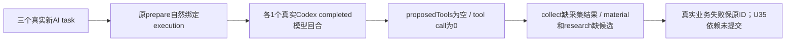

# 最终806a42新包：三agentic实际功能失败与U35未执行

这是本次真实新包的结果，不重写旧825/848 UNKNOWN、T1329受控协议GREEN、T1332受控项目链，也不把模型completed或wrapper运行结束当业务通过。

包source `806a42e67a8a75d74df14eaa917ec1cdbe30d657`；DMG `7d7d16e8e5f025ffe26f054e8ea81a95fe5ec15b4324ccb2c6f38ced7c6c63ff`；新owned root `4UhlM6` / loopback49771；tools纯组 `grp-c32b9e7a-39`；配置revision1，text/vision/image Codex，其余official。最终输入锁092ccc…实际817文件/13链接；原c718准备及12文件保持原样。

三根严格各一次真实公共execution.tasks.create，原AI prepare自然绑定execution；0重发/新提示/换源/取消/采纳，U35没有入队。单根原观察期限均在提交前登记；本次远未耗尽原期限，不能把任务失败归因到测试观察超时。

|族|原AI/执行ID|业务状态|实际工具与候选|
|---|---|---|---|
|collect|`ai-task-c32b9e7a-174` / `exec_6edfc100-18e5-4263-8e78-a72b308fff45`|failed / partial / COLLECTION_INCOMPLETE|1 settled模型；0 proposedTools/0工具/0拒绝；无业务候选|
|material|`ai-task-c32b9e7a-204` / `exec_678d3188-2862-4884-95de-cce63469a4ab`|failed / failed / AGENT_NO_PROPOSALS|1 settled模型；0 proposedTools/0工具/0拒绝；无业务候选|
|research|`ai-task-c32b9e7a-225` / `exec_88ce3e67-0c80-41e8-9f7f-c90ef34f94ef`|failed / failed / AGENT_NO_PROPOSALS|1 settled模型；0 proposedTools/0工具/0拒绝；无业务候选|
|U35策略升级|未提交|NOT_RUN_DEPENDENCY|本次collect没有成功结果/来源item，不构造伪item或换源入队|



## 真实业务读回

本次人工公开前置：source `intelligence-source-c32b9e7a-162`；asset `asset-c32b9e7a-165`；定位 `posstmt-c32b9e7a-160`。fixture前后本组公开AI/持久任务增量都是空数组，仅说明该实际快照没有观察到自动任务，不据此推断所有GET/系统全局副作用为0。

collect同source的公开runs列表为空、items total=0、正式result.collections=[]。material/research正式resultType=execution_diagnostic，AGENT_NO_PROPOSALS；没有可采纳建议，因此未调用confirm，不修改标签/知识条目。没有工具input/output可发：本次实际没有工具call，不补造工具回执。全部实际冻结工具名称/版本/effect、原业务输入、inspect/result/events/steps已完整保在original-three-public-readback三JSON。

## Native模型事实与公开正文限度

- collect：model call `call_4874f079-0665-4c1d-9a25-65dfd3d38fcc`；thread `01a14856-6a9b-7ec3-91e0-af63bfdd7b46`；turn `01a14856-8009-7ea3-a685-bc47ce9bd048`；actualEngine=codex，model=gpt-6.1-sol，provider=openai，tokensUsed=44102。
- material：model call `call_9f819bf9-2b6f-4e36-a4a9-c43aabcc31ab`；thread `01a14856-b975-70d2-849d-f8c70c451f74`；turn `01a14856-ba06-7ad3-9162-b07909c6463c`；actualEngine=codex，model=gpt-6.1-sol，provider=openai，tokensUsed=42098。
- research：model call `call_7e3d54d3-bc8d-4bf3-8f60-ab984852e329`；thread `01a14856-f85f-7171-94ea-6683cdf814e2`；turn `01a14856-f8f9-7013-9b13-a38a82c92b64`；actualEngine=codex，model=gpt-6.1-sol，provider=openai，tokensUsed=44762。

以上tokensUsed是该原回合账本累计值，不是首字时间，也不是单个prompt长度。正式元数据实际公开，完整frozen route/requestedModel/runtime快照仍未由该DTO直接投影，两者不混签。

三根inspect/events全部分页均各1页；events数组为空、steps数组为空。公开inspect对model只投影resultRef等身份，resultText按生产代码固定null；模型原回答没有从该入口返回。collect的commit分支在incomplete时用固定错误覆盖summary；material/research无proposal分支只保存固定diagnostic，不保存原summary。故本次可公开正文是下面三个原始用户goal和真实业务错误，不能伪造或推断模型曾回答“没有工具”。模型是否实际看见dynamicTools仍缺直接现场证明。

## 完整原用户goal（只读原task）

### collect

```text
只采集本次公开来源 intelligence-source-c32b9e7a-162。先collect.plan核对该ID，再collect.run仅提交该目标一次；保存真实runId，并递增observation调用collect.status。只有ok=true才说完成；pending不等于完成。不采其它来源，不重发任务，不改监控设置。
```

公开错误：采集观察尚未全部完成，请查看原采集任务或处理登录；未将提交视为完成。

### material

```text
请实际用material.search搜索“本轮中性图形关系图”，确认素材ID asset-c32b9e7a-165。然后仅为这个实际素材调用material.organize，提出标签“本轮来源核对”。只产正式待采纳建议，不自行采纳；不要整理其它素材或声称标签已生效。
```

公开错误：本次自主任务未产生可采纳的业务建议，请调整任务后重试。

### research

```text
请实际调用web.read阅读公开文档 https://www.rssboard.org/rss-specification，不登录、不操作外部账号、不调用browser.act。若正文有nextOffset，必须沿同evidenceRef和snapshotId依次读完；不要把URL当证据ID。然后仅依据本次真实读取的正文，调用knowledge.write提出一条简短来源笔记，evidenceRefs用本次读取真实ID。sourceNote必须逐字等于本次读取证据返回的sourceUrl，仅该URL，不附加说明；公开文档说明文字放在note。不声称新近新闻或资料外的成效，不自行采纳。若无法读取或需要登录，诚实保留原状态，不造证据。
```

公开错误：本次自主任务未产生可采纳的业务建议，请调整任务后重试。

## 精确源码链与尚未证实的首因

真实冻结工具已经由inspect.frozenTools读取：collect三项、material两项、research五项。由此只能确认后端冻结输入有这些工具，不能代替真实模型的可见性证明。没有工具call/rejection意味着本次未进入Host执行工具/领域提交；目前没有“工具已执行但宿主丢结果”的现场证据。

1. `backend/src/modules/ai-runtime/agentic-business-execution.service.ts`：公共spec→原agentic.run冻结tools/goal/dryRun=false→原authority和dispatcher。
2. `ai-worker/src/execution/codex-agentic-worker-run.ts:51`：`createControlledCodexSession(cwd,signal)`，未传taskTools，默认false；工具随后经chatToolProviderName编码，传给runCodexNativeTurn。
3. `ai-worker/src/execution/codex-app-server.ts:13–18`：只有taskTools=true才在features.code_mode.direct_only_tool_namespaces登记functions；同文件createControlledCodexSession默认taskTools=false，并按该值实际assertConfiguration。
4. `ai-worker/src/execution/external-chat-worker-run.ts:115/117`：现役外部聊天明确传`...,nativeImages,true`或`...,false,true`，与agentic存在精确可读差异。
5. `ai-worker/src/execution/codex-native-turn.ts`：thread/start声明dynamicTools→turn/start→仅item/tool/call请求才进入原onTool；三根公开账本本次没有对应canonical工具事实。thread/start准入成功不等于模型可执行工具。
6. `backend/src/modules/ai/execution-agentic-candidate.service.ts`：正式核原native thread/turn/completed和真实调用账本；collect collections空→COLLECTION_INCOMPLETE/partial；另外两族proposal空→AGENT_NO_PROPOSALS，结果诚实失败。

该taskTools参数差异是源码线索，尚未通过本次现场请求/模型可见性对照证成首因。T1329受控测试证明编码名通过thread/start及原Host账本映射，不证明真实模型在上述配置下看见/调用这些工具。后续如需窄修或无付费可见性诊断，由Root独立裁决与SPEC/范围支持；当前0产品W、不改原提示、不跑新模型/恢复旧thread，也不并发打开在用DB取私有providerResult。

## 实际清理与分类

原wrapper自然exit=1，elapsed=66.89451991597889秒，expired=false、error=null；afterInputDrift=[]，registeredChildrenAfterCleanup=[]，remainingOwnedGroup=[]。自有API context实际DISPOSED；browser NOT_CREATED；候选service保持运行，数据库未由fixture打开。stdout0B。三根模型/工具业务资源已明确RELEASE给C；后续只有原ID公共只读补证与本报告，没有新业务提交。

根模型已真实执行3次；业务功能PASS=0；U35 NOT_RUN。全文语义不能因公开模型正文缺失而补判通过。
