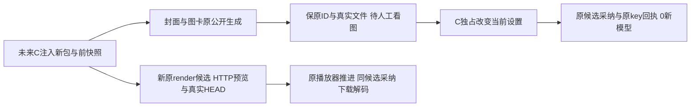

# T1316 新包媒体修复后脚手架（仅准备）

当前0业务执行、0HTTP/API/browser/model/test/build；仅 `node --check`。旧582索引、旧runner、报告、performance两文件及旧任务不改。模板 `finalCandidateBinding:null` / `executionAuthorized:false`，工厂拒绝注册。这里没有新包已产生、生成或验收通过结论。

## 注入和注册

未来C新薄spec从自己的**新包绑定**support注入 `registerMediaRepair({test,expect,phase,binding,owner,rpc,save,journal,writeBytes,fixture})`，不修改本旧模板追记历史。工厂无顶层业务/文件读取，不require旧support/session，当前禁止导入或运行工厂。每次只能一个phase：`generateImages`、`adoptReadyImages`、`previewRender`。单case8小时、outer至少9小时（32400秒），单worker/retry0；若未来外层注册其它case，必须重新机械核总串行预算，不能继续引用9小时。

`binding.finalCandidateBinding`必须由C注入实际sourceCommit、runtimeSha256、baseURL、rootId、ownedGroupId、settingsRevision、beforeSnapshotSha256、performanceReleaseReceipt。C preflight须读取实际包/健康绑定/真实actor与组、全六槽/revision、原启动CLI预算/服务根/前快照并对照；此处不可填预计source或旧owned ID。业务必须在**首个独占性能窗释放后**进行。launch>=180000、navigation>=300000、action/expect>=120000、RPC900000、task观察1800000，保原更长值；本代码不启动浏览器，薄fixture须兑现启动预算。观察的持久期限由公开实际证据读取，缺公开字段记null，不伪造deadline；观察窗在提交前固定，持续原ID、取遇到过的最短实际期限，不续期/不重发/不取消旧任务。低于两分钟剩余观察预算即保原状态停止，不发不足预算的新请求。

`rpc(page,id,input,{groupId,timeout,retry:0})`是真正公开dispatch并返回data；不得静默忽略注入timeout/组。`owner`只设本轮真实组，不写全局settings。save须原子保存、秘密清洗且只写本新run；禁止保存握手/cookie/headers/signed下载URL、环境或原异常正文。`writeBytes(name,Buffer)`写真实下载并返回本run实际绝对路径。

`journal.reserve(key,request)`是持久原子“从未提交”门：任何已存在STARTED/UNKNOWN/FAIL均拒绝写重发，不只跳PASS。请求先留原body/key，再单次提交，丢回复只保预约交C沿原key/ID诊断。`journal.read(name)`读取同run由save留下的**原候选**，不能复制旧库或另造result/receipt。恢复同key采纳必须由C按已保存原请求另行授权，脚手架不会自动retry。

## 必须实现的真实fixture适配（不许stub通过）

- `preflight(page,binding,{phase,settingsWindow})`：上述实际绑定。generate/preview按原冻结配置核；adoption按C原独占窗口实际before/after核，不能强迫恢复生成配置绕采纳。`readSettings`安全读真实六槽/revision；`assertSettingsUnavailable`对照C receipt，确实已改到不可用来源、其它路暂停。runner没有settings写接口，恢复仍由C独占执行。
- `readCallEvidence(page,aiTaskId)`：返回 `{taskId,complete:true,calls:[...]}`，来自该非chat真实公开可达证据或C允许的本owned安全日志白名单投影，带每行 `callId/status/sourceEvidenceRef` 与真实AI/execution/attempt/operation/source/usage/native身份。calls按原顺序、只含持久事实，禁止观测时间字段导致假变化。不能拿仅适用chat的summary404/无字段当0调用，缺可靠证据即BLOCKED。前后整个calls数组相等用于断言0新调用，明示实际外部供应商而非受控替身。
- `persistentDeadline(page,task)`仅解析原公开持久deadline，返回原绝对毫秒或null；不可当前时刻+预算。terminal集合含失败/UNKNOWN/awaiting_confirmation，首个真实失败在poll外立即抛出，不让expect.poll吞失败继续900秒。
- `readIsolation(page,source)`：真实当前与另一平台完整DTO、script metadata和全部分页版本，`allVersionsRead/otherPlatformRead`必须真实可追溯。输出实际SHA/原件，并由C对照本次合法cover/card采纳变化，不能只填true或把新增合法版本误说全窗不变。
- `verifyCandidateSources`：核原project/output/版本/section、AI/execution/call/原generated_asset或creative result/value/真实file、文本和image独立冻结路由/SDK消费者；不能只核有图片。`assertCardReadback`真实articles.get核原section/title保留、目标imageUse精确file、真实CAS新版本与结果receipt。封面沿原ai.confirm，图卡沿creativeResults.adopt（原expected/body/key）与同key重放；不混成两个generic adopt。
- `assertHumanImageReview(ready)`：C/Root真实看两份下载样本的记录。PNG解码仅证明文件，不代视觉质量或来源。
- `captureFailure(page,{label,stage,ids})`：关闭page前保存安全现场截图/已完成步骤、原ID、实际错误类别，避免失败只有wrapperexit。原异常继续throw；本factory不关闭page。**薄fixture必须finally关闭自有page/context及previewContexts创建的API contexts，先保存失败现场再清理；不动C服务、原未知后台任务或共享profile。**

## 三段动作与新包HTTP HEAD

`generateImages`实际公开创建中性project、video output+用户原稿、article output+用户section；随后各一次cover.generate和creativeResults image_card。两链保原请求/ID、原AI/execution、候选、真实下载SHA/像素解码/完整call证据。只到候选ready，不提前confirm；若实际合同已自动采纳，准确停止，不能倒改为未采纳。

`adoptReadyImages`只读上段原候选。未来C注入 `settingsWindow:{exclusive:true,otherModelLanesPaused:true,controllerReceipt,...}`；C先完成真实设置切换及revision记录，runner只读验证。原候选采纳/读回/原key回放，原file SHA、完整calls前后不新增，当前设置仍不可用才记录完成。C最后独占恢复原六槽与真实revision，保before/change/adopt/restore完整收据，不能在采纳前恢复绕readiness。

`previewRender`必须C交接新包真实公共动作产生的 `renderCandidate:{taskId,projectId,outputId,artifactPath,sourceEvidenceRef}`，不能硬编码旧6661，也不在这里重跑已过粗精剪/ASR。实际manifest核原video路径，原awaiting_confirmation task和results先留存。

`previewContexts(page,binding)`由C新绑定认证适配返回 `groupHeader/groupCookie/legalAccountFilter/foreignGroup/noSession` 五个真正APIRequestContext，baseURL必须同实际Next服务，禁止route mock/直调GET。前3合法GET逐字节同SHA；真实Range206与原slice相等。**`.head()`真实发HTTP到Next自动HEAD**，完整200和Range206均空body，Content-Length/Content-Range按真实GET核；不新增HEAD生产实现，不把GET(Request method HEAD)当框架HEAD。crossgroup404、noSession401保实际响应状态，不落秘密headers。

`openRender(page,original)`只通过真实新包页面导航/现有按钮定位原task对应卡（可引用原data-slot与本task实际标题，不加产品marker），返回原卡locator。核video.src指向同task/artifact真实preview路径、readyState/尺寸/有限duration，实际play推进>0.1秒后pause。原execution.confirm采纳同task，下载同asset/file与预览SHA一致，`decodeVideo(filename,{timeout:900000})`必须实际ffprobe+ffmpeg完整解码并返回真实帧数/时长/fullDecode。calls前后不得新增。截图/播放不证明人工听感、复杂多轨质量或0e1旧6661已修采纳。

## 原证据继承边界与待注入项

旧source0e1的ASR3326、粗剪5553、精剪原chat94f5e501、导出与图片410/478/2508仅按原run精确引用。2613/5713首因仍UNKNOWN；6661仍未采纳，绝不重发/改原证据。未来C须注入逐操作 `priorEvidenceMapping`：原run/source/消费者SHA、当前同消费者实际diff、为何不受影响或必要独立smoke。当前不读活persistence/dispatcher/checkpoint，因此此准备不判未影响、不替新包PASS。不为凑数字重做已成功付费模型，也不把新候选测试追签为旧现场HEAD。

未来还需：实际新包与owned输入/actor、私密认证适配（不进证据）、前快照与薄spec/config、有效执行授权/lease、性能释放、独占设置窗口/六槽恢复、真实render来源、call安全投影、人工看图、完整隔离读回与finally资源清理。任何缺项准确BLOCKED，不造凭据/候选/来源/回执。最终统一timeout仅引用C已真实原命令exit0/83.0036s并核实际受测source边界，此prep不重复跑。
