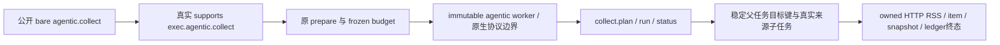

# T1319 局部实施交付

已在唯一生产 W `frontend/src/server/persistence-client.ts` 修复公开 agentic 执行器准入：公共 hasExecutor/loopType 接真实 agenticBusiness.supports，精确从 bare taskType 映射到 exec.<taskType>。确定性 registry 不变，未知类型不获授权。真实 owned RSS 完整链与实际 material/research 定义、各保护族已有证据；未签整任务、新包真实网站/模型或共享 timeout Gate。

## 当场 RED 与最小实现

30 锁输入、packet 与真实 agentic-worker 全字节匹配后开工。`red-v2` exit1/16.699s：新实际 local identity 用户、公有组/真实 RSS source（runInitial=false、monitor=false）经原 compositeTransport execution.tasks.create，原 ExecutionValidationError“未注册的 executor: agentic.collect”，首栈 execution.service.ts:164。AI/execution/call/RSS request 均0。该新 RED 是公开 operation 的实际 transport/service 异常，不冒已启动 HTTP dispatch listener。历史0e1包真实400仍原件；不重发旧任务。

`red-v1` 只在快照前 source 清单校验失败：误列不存在 intelligence.repository.ts，而实际 service 直接DB。Vitest/HTTP/worker均没启动，单列 PRELAUNCH_FAILURE，不算 RED。

产品仅三处薄接线：声明 defaultfalse closure 避免初始化提前访问后置 service；公共 hasExecutor/loopType 读取该 closure；真实 agenticBusiness 定义装配完后赋值 supports(`exec.${taskType}`)。没有给 registry 塞假 executor、硬白名单或 return true，没有改 definition/tools/network/归属/费用/预算/重试。原事务内其它创作入口的 registry 接线未扩改。

## 实际运行与覆盖

`green-v1` exit0/18.678s：首条完整公开采集链通过。`matrix-v2` exit1/85.391s，10例中9PASS/1fixtureFAIL；`final-narrow-v3` 显式 env=input,collect，2PASS/28.701s 闭合唯一 input 夹具校准及加强原 key/期限断言；`source-guard-v4` 显式 env=foreign-source，1PASS/20.364s 补精确原来源错误与零副作用。不能合并成“最终10例整套同字节全部通过”；三轮来源在覆盖表分列。最终观察代码 type-v2 通过，未无因重发完整模型链。

| 族 / 实际 run | 真实入口 / 拒绝层 | 已核副作用与边界 |
|---|---|---|
| collect / v3 | 公共 create → 真 prepare/dispatcher/immutable agentic-worker → Codex 原生协议替身 → collect.plan/run/status → 真 RSS 来源子任务 | 一次真实 HTTP GET、1 run succeeded_with_items、1 item、1 sourceSnapshot；原 AI/execution succeeded、真实 ledger settled；child key=agentic-collect:sha256([原AI taskId,sourceId])；同原 body/key返回原ID、再drain0、不新增请求 |
| material / v2 | 公共 agentic.material → 真 exec.agentic.material definition/continuous budget → 原 worker 模型回合 | 用户 dryRun=true，0RSS，execution/AI succeeded；仅证明真实类型/循环及预演，不称素材建议/采纳已验 |
| research / v2 | 公共 agentic.research → 真 definition/continuous → 原 worker 模型回合 | dryRun=true，0RSS；不称联网 research 或业务提案已验 |
| unknown type / collect v3 | agentic.unknown、exec.agentic.collect 实际 closed enum 契约早拒 | 不能冒单独命中 registry 的 unknown 分支；原 supports 只认真实定义，源码另核 |
| deterministic echo / collect v3 | 原公开 echo.manifest → 真实 runExecutionTask/沙箱 manifest、awaiting_confirmation，再公开discard | 原确定性路径仍可完成，不借 agentic 模型；0模型turn |
| network / v2 | 真 prepare 对 network=allowlist 原 AGENTIC_NETWORK_POLICY_UNSUPPORTED | AI failed，无execution映射/模型/RSS |
| browser / v2 | 参数 browserAuthorization 不等可信grant | 原公开 AI projection awaiting_authorization，0execution/模型；不授网页权限 |
| input / v3 | 真外组公开上传+complete 的 asset 作为原输入 → 公共 create 时原DB资源引用trigger早拒 | 精确 GROUP_RESOURCE_SCOPE_CONFLICT:共享授权已撤销或不存在，请先修复引用；AI/execution/call/modelturn0。不是命中 prepare.validateInputs。v2误等异步prepare而FAIL保留 |
| foreign-source / v4 | 原 groupA 任务调用真实 groupB sourceId，透明观察原 collection.runCollection | 原 OwnershipError/Intelligence source not found；stack requireSource:1127→startRun:2031→runCollection:67；上层仍原generic待对账。显式 runs/items/snapshots0、唯一parent execution，0来源子execution/HTTP；不伪造中文错误 |
| cancel / v2 | 公共command取消真实prepare但未claim execution | execution cancelled、drain0、0model/call/RSS；未声称业务AI原queued行也已cancelled |
| attempt/fence / v2,v3 | 实际第一次resolveModelCredential前，原port用错ref | 两次原“执行凭证已失效”后，同原参数真实调用继续；不替业务deps/结果 |
| budget / v2 | 用户maxSteps1原continuous budget，真实reserveAgenticTool | 原“执行调用次数或用量预算不足”，无第二工具调用/无RSS；实际execution unknown_result/TOOL_REQUIRES_RECONCILIATION，未把预算拒绝写成业务成功 |
| unknown / v2 | 外部边界在原native turn后断开 | 原CODEX_PROCESS_EXITED、model unknown、execution unknown_result；原ID再次drain0、calls全等，不重发/续期，不把0真实模型推成0合成turn |
| 原key/body/期限 / collect v3 | 同原attempt请求；分别改goal、改timeoutSec3600 | 精确 ATTEMPT_PAYLOAD_MISMATCH；原execution整行相等，budget/deadline不续；跨user公开读拒绝 |

每case实际 task/call IDs、原行/原错/精确拒绝层、零副作用项在 `runtime/TEST_COVERAGE.json`。v2 foreign-source 原首可见仅“工具执行结果未确认…”不能签具体归属断言；v4透明 wrapper同参数调用原runCollection一次，原返回/throw原样，不mock成功、validate、host、ledger或completion，补足该证据。

## 外部边界与来源限制

真实 entry=agentic-worker.cjs，1538258B、SHA24c1e7d8eb385e87ed7c69bc5d9b5f4d180df61abe09afe561335a30804a8728；通过原 createAgenticWorkerDispatcher 领取/IPC/SDK/host/ledger，不能用 execution-worker 代签。仅 shim 合成 Codex --version/app-server 子进程协议；thread/turn/tool/usage/completed 方向真实，外部供应商0。Pi运行时入口探测沿原包执行，具体本例 engine 由冻结Codex路由决定，不冒真实Codex认证/可用性。

RSS测试受控网络传输：只为 exact hostname t1319-fixture.example 的DNS边界给public fixture地址；exact feed URL 的 fetch 保 method/headers/redirect/AbortSignal，转到真实新owned loopback HTTP。实际server日志保GET路径、响应415B和SHA；实际responseUrl为loopback，生产fetchIntelligenceFeed返回finalUrl仍原受控URL。生产assertUrlAllowed/重定向门未改、私网127.0.0.1 URL真实拒绝，其它fetch一律拒外联。不是BBC真实公开实采。

所有ctx来自新库真实 identity.resolveLocalContext；外组source/asset也由真实公开入口创建。不复制用户库/Keychain/凭据，不访问当前候选HTTP/双controller/旧UNKNOWN；空owned CODEX_HOME、自有master key，0真实模型，不build/install/dist。PGlite不代签真实PG多连接压测。

v2 metadata caseSelection误写collect，但实际源默认选择10族且原log为10tests；保原件不回写。后续v3/v4显式env选择与metadata一致。wrapper的caseSelection字段不适用于type/Gate命令，不声称这些命令执行collect。所有命令完整stdout/exit保在 RUNS.json；额外原消费者源在每轮启动前快照，来源原guard迁移在v3补冻，未追称v2已有该DDL前快照。

## 类型、Gate、清理和交接

| 检查 | 原结果 |
|---|---|
| backend-type-v1 | exit0/48.700s |
| frontend-type-v1 / 最终v2 | exit0/55.431s、exit0/53.679s |
| boundary-v1 --quiet | exit0/.633s |
| semantic-v1 | exit0/.497s |
| 统一timeout-policy | 本任务未运行，待C最终独占一次实际绑定；不代签PASS |

test/it3600000ms、hook180000ms、outer86400秒、retry0/singleworker/exactinclude/owncache；正观察poll120000ms，interval1000ms为间隔。业务原deadline1800000ms不变；negative budget1/cancel/断线是刻意负例，不缩合法正执行预算。原带beforeAll build/短suite仅只读参考，没有运行或签PASS。

最终源/test/worker见 FINAL_SOURCE_MANIFEST.json；FINAL_READSET_CHECK 证三轮显式消费者源除当时已修root外至冻结无漂移。生产root仅原250308…基线新增薄接线，不新增credential/native/toolchain机制；三既有marker须由独立diff核后Cexact重新绑定，作者不改guard/控制。索引将productionSources/tests/files分列，集成须一起核，不只暂存证据files。

RESOURCE_CLEANUP 实查10个记录owned PG、28个wrapper/native PID，无live匹配；各自host.stop/dispose与HTTP.close完毕。未单独记录全部fork worker PID，以同PG和真实supervisor清理补充，不冒精确全系统扫描。保自有DB/media/workspaces，索引排除DB/缓存二进制；当前产物含自有失效测试lease行，仅属新隔离库，不是用户/候选凭据。没有停止其它进程。

本文与索引冻结后明确 RELEASE root唯一W、新测试/自有证据W，等待Root独立终审/C；无commit、metadata/taskctl/pmem/reconcile或整任务完成。原RED、v2失败、初次launcher失败与旧现场全部保留。

精确最终 SHA：

- `frontend/src/server/persistence-client.ts` — `ffb864d34c4546b3d53813cd88d437cb54cf98731a6dfd9a2fc641c55e16757a`。
- `frontend/src/server/__module_integration__/agentic-public-admission.persistence-client.test.ts` — `b1abc4aafbca2e63cdd29e5ae5bd27f5293fb145d20cd5d1ad836cd7c3c10215`。

索引入口：`docs/verification/t1319/runtime/OUTPUT_INDEX.json`。
