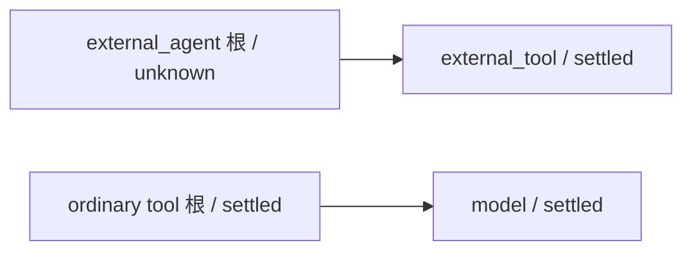

# T1320 独立本地结果审核

审核者：`/root/sol_daily_implementation_current`，GPT-6.1 Sol/high。仅只读核源码、既有原件与 SHA，没有执行测试、模型、HTTP、数据库读取或产品修改。本文件是 Root 明确授权的独立单文件产物，不在 R 已冻结的 413 项索引中，也没有修改该索引。

结论：本轮单源投影修复及已发生的七个不同成功场景未发现新增阻断；恢复保护仍真实失败，属于既存检查点兼容缺口，不能签整任务、全部保护或新候选真实模型验收 PASS。共享 timeout Gate 待 C 最终独占执行。

## 审核绑定

| 工件 | SHA256 |
|---|---|
| `backend/src/modules/execution/chat-tool-stream-projection.service.ts` | `33168684e7b3a74504d6d446e99038239c1580c0e9187f2582e4dd4da6ee4da9` |
| `frontend/src/server/__module_integration__/mixed-codex-tool-stream.persistence-client.test.ts` | `a5ecf2558bf1d40fa61e4407c4f3b7b5f88e1a76a27bebae3d6d080cc2fa28fa` |
| `docs/verification/t1320/IMPLEMENTATION_RESULT.md` | `1a63e17e2465ee6bf23d74dfb2f4b5f7eb1ef53bf7fcd2aa475a6a447ac99706` |
| `docs/verification/t1320/runtime/OUTPUT_INDEX.json` | `933d220e7b1bd99dfd4d57d471caedede5c8c317e7e112bcd5d3948495bbdc63` |

独立逐文件核索引 413 项 bytes/SHA，零漂移。red-v2 / green-v1 / green-protection-v1 / green-protection-v2 的前置快照分别 49/49/49/50 件，全部匹配；red-v2 生产字节与固定候选 `0e1dc6228f1fa3dc02f2b1c7a1cee77ab18d650a` 相同。immutable worker 的完整快照与绑定均为 5618216 bytes / `3851b4fb132035f1b03528d68b0fa1c5ab86bda8134d8b98795252295c5a6454`。

## 实际 diff 与结果

生产 diff 仅一个 projection 文件，31 行增加、4 行删除。普通输入继续依真实调用序列保留严格前缀和逐字节比较；external 输入必须匹配同 root 的唯一真实 external_tool，并经原冻结定义、参数 proof/digest、回执及效果上界验证。未知、重复、错 root 和错误 fence 继续拒绝；没有按工具名称猜测内容或吞冲突。新增输入按全局尾部追加，已有合法交错顺序不重排，proposal 继续终态投影。

- red-v1 是路由夹具未提供 vision 能力的业务前失败，不作为目标 RED。red-v2 为实际完整公开提交→prepare→真实宿主/immutable worker→原生协议替身→Host none→普通生成及子模型→ledger 的目标 RED：首个原端口错误为 `completeChatGeneration` 后置 `ensureInputs` 的“工具输入卡与模型回执不符”。不能据此追认原 825 的首因。
- green-v1 主链 1 PASS；保护 v1 的反序、两次交错、proposal 在前/在后、相同 key 重复共 5 PASS；保护 v2 的 integrity 1 PASS，共七个不同成功场景。独立读真实 ledger、输入输出事件、assistant parts 和唯一 finish，均与结果报告相符。proposal 在终态前无卡，最终唯一卡；相同 key 和重复 commit 不增加调用、卡或 native turn。
- integrity 实际十项拒绝分别是参数字节、toolCallId、other-root 输入、重复输入、陌生输入、重复 external call、原 digest、proof.callId、ordinary 前缀顺序及错误 fence。受控变更后恢复精确原行，完整原终态 commit 成功。v1 integrity 的 SQL callIndex 唯一键夹具失败保留，不能追签已测到保护。
- backend type-v1 exit0/64.270s 绑定最终生产字节；frontend type-v2 exit0/55.404s 绑定最终生产与测试字节。boundary-v1 exit0/0.316s、semantic-v1 exit0/0.352s，与原执行收据一致。共享 timeout-policy 未在本模块重复执行，仍待 C。

这是外部 Codex JSON-RPC 边界被受控替身替换的完整生产组合链，0 真实外部模型；真实 dispatcher、worker、节点、业务端口、调用账本、投影和 commit 未被伪造。不能签供应商可用性、真实新包或旧 UNKNOWN 恢复。跨 user/group/account、取消等本轮没有逐项新公共回归，报告已经明确限制，不能以源码未改追签覆盖。

## 恢复 FAIL 的独立归因范围

`cases/green-protection-v2/recovery/after-controlled-stop.json` 为真实 `unknown_result` / attempt1；原公开 resume 后 attempt2，`after-drain.json` 的首错是 `readCheckpoint → partitionExecutionCalls:13`。四条真实生产调用是：

ordinary model 的 parent 合法。首次被拒的是 external_tool 子项：`execution-call-tree.ts` 的 generic partition 只接受 model→根 tool；而 `external-task-tool.service.ts:73` 本来就生成 external_tool→external_agent，专用 `external-chat-call-tree.ts` 也明确接受该边。checkpoint:111 无条件调用 generic partition，故拒绝先于新增 ensureInputs。

独立核 `execution-call-tree.ts`、`execution-checkpoint.service.ts`、`external-chat-worker-run.ts` 与固定 0e1dc622 候选完全相同。恢复 RPC 没有新增 turn/start；真实公开 resume 已发生，不能称未执行恢复。判定为既存原生 Host 工具树的 checkpoint 恢复不兼容，非本次新增 projection 所致，也非 fixture 将普通 model 错挂 external root。修复需要另审 checkpoint/native 树消费，超出当前单生产 W，已由 Root 登记 T1323；本任务不混修、不抹成 PASS。

## 清理与交接

R 原件记录 52 个 owned native PID 均不存在、各 case host.stop/persistence.dispose 和自然执行退出；本审核只读核这些收据，没有另发进程信号。原自有 PGlite 磁盘保留，不能声明已删全部临时文件。秘密特征扫描的零命中是原已发生结果，不是任意秘密均被证明不存在。

本文件仅签上述本地核查事实与范围判断；整任务状态、T1323、共享 Gate 和后续真实包验收均保留。写完后单文件写权另以消息明确 RELEASE。
