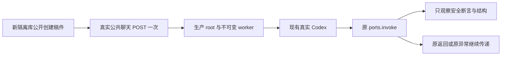

# T-1321：图文重组候选失败的隔离诊断

## 目标、事实与授权

回答一个问题：真实图文重组回合为何没有产生可预览采纳的正式候选；能否在原始异常被 IPC 压缩前，取得实际工具名、固定拒绝断言及脱敏的参数结构证据。

原 source `0e1dc6228f1fa3dc02f2b1c7a1cee77ab18d650a` 的 U14 auto/manual 都已真实终态 succeeded，但业务没有 `work.editor.candidate`，功能 FAIL。已保存 parts 没有成功的 `tool-work.editor.propose`；不能据此排除参数校验前的 native 调用尝试。安全日志分别有 `executeExternalTaskTool / ConflictError / HOST_PORT_REJECTED`，但没有 toolName、中文断言或原参数。模型自述“提交未成功”不是结构化拒因，不能先认 schema 错误。只读证据真相是 [OBSERVATION_INDEX.json](../verification/t1321/OBSERVATION_INDEX.json)。不改原两个任务、ID、提示或冻结文件，不重发。

Root 于本轮明确授权先形成只诊断方案；本文不授权生产修复，也不构成诊断执行 START。正式独评、精确来源锁、lease/packet 与后续执行授权齐备后，才允许一次新诊断。四项在途修复及原 candidate 不受本任务修改。

## 唯一新增真实旅程

使用全新 owned 文件 PGlite、媒体目录和工作空间，真实 `compositeTransport` 创建本地身份下的组、项目、已保存脚本和图文。所有来源使用本次公开创建的中性输入，不复制用户库、原 candidate 的业务 storage 或原任务行，不种 receipt/candidate。脚本与图文作为本轮新输入，保留原文、版本与 sourceRefs；明确不是原模型派生血缘。

通过真实 `graphicPosts.get` 与精确版本读取形成实际 editorTarget，使用现有 `reorganizePrompt('rednote')` 原函数生成的按钮话术，不另写“更容易成功”的提示。一次调用真实 `/api/chat` 的 `POST(Request)`：保留 loopback/新本地握手、实际 `resolveRequestContext`、真实本地主用户/组解析、会话消息保存、`getChatRuntime`、`prepareChatReply`、durable submit、production dispatcher 和真实工具 resolver。测试调用 route handler，不冒称新桌面 UI 点击；原两次 UI 操作已有独立证据。

真实模型只允许这一条新图文重组 root submit；后续同一原 task 的内部工具调用与原恢复仍按生产策略。不得外层 retry、重新 submit、换提示、再开一个模型任务试错或续任务期限。新任务与原两个终态失败任务严格分开。若公开准入或初始化阻断，保存真实首错与 0/未知调用事实，不绕入口改用手造 frozen input。

新诊断使用实际冻结的生产源码与已存在不可变 worker。来源由后续 C packet 明确；四修交付后如选择新源，必须记录与旧 U14 source 的差异，不能说已在旧原件上复现。实际 execution-worker、codex-status-worker、包内 Codex runtime/依赖和宿主 loader 路径、字节及 SHA 必须在运行前绑定，不能只锁 execution worker 而漏掉状态宿主；禁止 build/install/dist 重建。缺任一实际入口即阻断，不造凭据或假状态。

## 透明观察层与隐私边界

仅在测试装配层包装真实 `createWorkerSupervisor`，`options.ports.validate` 和其余依赖不变；`invoke(ref, port, input)` 对同一三个参数原样 await 原 invoke。成功返回同一结果，失败记录后 throw 同一原异常，不转换错误、不补结果、不重调失败端口。实现前锁定现有 T1313 透明包装先例及本轮实际 supervisor/dispatcher。

`executeExternalTaskTool` 允许记录 port、taskId/attempt、原 turnCallId/toolCallId、实际 toolName、调用序号与时间。不得持久化完整 ref/fence、raw input/body、工具正文、模型系统提示、凭据、握手、上游原始错误对象或任意环境。异常消息只允许本轮事前从实际源码逐字登记的固定断言白名单；未知消息仅保存安全 name、字节数和 SHA。stack 只保留核验过的仓内函数/文件/行号帧，去掉消息首行、绝对用户路径与其它帧。

同时透明观察真实工具 resolver：同 ctx/input/ref/signal 原样调用并返回同一个工具集合，只在 fixture 内短暂持有该 ref 的工具对象用于诊断。不得改工具、定义、参数、版本、效果或权限。原 invoke 拒绝之后，若已知断言为“外部工具参数不符合冻结定义”，可对同 raw.input 用该实际工具的 `parameters.safeParse` 做纯观测，输出 issue.path/code/expected 与结构键、类型、长度、整份参数 digest；不保存实际字符串/数字值或 Zod 原错误全文。只有经真实冻结定义/owner/version 与该 resolver 对照一致，才可把这个第二次纯校验结果关联到原拒绝；不一致或无法取得对象时保留缺证，不能换 schema 追签。

新 owned DB 可只读核原 task/root/external call、冻结 editorTarget/tool 定义/owner 协议、provider turn/thread 及输入证明的机械映射；只导出受限字段、schema 与 digest，不导出 secret、runtime credential 或模型正文。实际拒因若属于非 schema 门，按真实固定断言记录，不能用旁路 safeParse 成功覆盖原业务拒绝。

从发送前开始将每个成功/失败 invoke 的安全记录持续落盘，原异常先落证据再继续 throw；SSE 仅持久化已白名单的事件类型、工具名、IDs、状态/安全错误码及时间。随接收追加，finally 完成收尾，不能等“有候选”断言通过才保存整场记录。网络响应、后端日志与 SSE 的时间来源分别标明，不从邻行猜原时间。任何候选内容只留本次中性业务产物，不留 raw JSON-RPC/provider 调试日志。

## 真实 Codex 与资源隔离

`DATABASE_URL` 明确为空，`PGLITE_DATA_DIR`、本地媒体、execution workspace、浏览器目录与临时目录必须指向本轮新 owned root；实际 DB factory 返回的 driver/path 在任何业务请求前核验。应用加密使用本次临时 master key，不取用户应用 Keychain/数据库。共享 candidate、50727/旧65353、两 controller、用户配置/认证和后台 job 均禁止写入。

保持 production 的 `resolveModelCredential` / frozen route / `localCodexStatus.read`。只在新库内通过公开 settings 选择 Codex；不复制旧设置行，不写用户或当前 candidate 的 routing。Codex 通过已有官方宿主继承当前合法认证环境，使用原 `account/read(refreshToken:false)`、`model/list`、冻结身份和正常执行路径；fixture 不读/复制 auth.json、Keychain、token，不登录/退出/改用户 config，不伪造可用状态或注入自造 credential。真实认证缺失即诚实 BLOCKED，不切供应商。只报告实际可读的模型/路由字段，不主动开 fast，无 tier 读回不声称已核关闭。

最短正执行/请求/观察 120000ms，保所有更长生产值；完整 test/it 至少 3600000ms、hook 至少 180000ms、外层 86400s。单 worker/retry0，独立 config 明确 include 唯一文件，cache 仅 own runtime。一次公开 POST 与其原 task 观察有界；实际持久 deadline/continuous/fence/费用策略不变。观察到界而后台未终态记 UNKNOWN，不当 0 模型或成功，不续观察/重发。资源退出只限本次 owned host/worker/SDK 子进程和订阅；先存最后原任务状态，再调用原 stop/dispose，保精确 PID/PGID 与清理结果，不用全局 pkill。隔离 DB 证据保留，不强改终态/清租约。

## 诊断输出与后续决策

输出原提交 ID、身份/target/schema/digest 绑定、实际首异常、正式成功/失败工具回执、最终 task 与业务结果、持续安全轨迹、原退出码、资源清理和文件 SHA 索引。至少明确三种结果：取得确切拒因；本轮成功且未复现；观察期内 UNKNOWN/环境 BLOCKED。后两者不冒已修复旧故障。

生产 `worker-supervisor` 当前将异常压成 `HOST_PORT_REJECTED`，native JSON-RPC 层的异常兜底只保留 `CREATOROS_INTERACTION_UNSUPPORTED`（-32601）；若参数 parse 在 reserve 前拒绝，则无 external ledger/input proof/正式卡。需用本轮原异常及安全 SSE/native响应事实判断它是否妨碍同任务纠正；源码可达性与现场证明分别记录。本文只收集事实，不授权修改 logger、guard、schema、提示、恢复/重试或模型协议。任何修复必须另有精确 SPEC delta、独评和有效执行包。

## 文件边界与阶段

当前分析 W 仅本文与 `docs/verification/t1321/ANALYSIS.md`；OBSERVATION_INDEX、其它任务/原件/控制与生产均只读。后续建议诊断执行 W 为一个新 frontend module integration test 和 `docs/verification/t1321/runtime/**`、诊断结果/索引；具体路径由 C MODULE_SCOPE/INPUT_LOCK/packet 正式化，尚未授权写 test/runtime 或执行。无产品 W。阶段为 PLAN 的有界诊断规格准备，不运行 pmem/reconcile/taskctl、共享 Gate、测试、HTTP 或模型。
