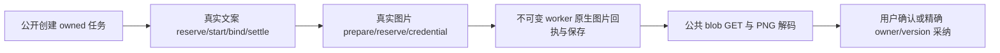

# T1322 局部实施交付

已在已审两生产源内修复两个门；3 条新 owned 受控完整旅程通过。92 项是旅程中的实际故障注入拒绝断言，41 项是原后端测试，三者不合并计数。未签整任务完成、真实 Codex 可用性或旧媒体 UNKNOWN 首因；共享 timeout Gate 仍待 C 独占执行。

## 修复与前置证据

文案按原 structured:copy.generate 无秘密 pin 身份读取，不先读取尚未产生的图片准备；图片仍核原 prepared 输入、sourceDigest、operation/digest 及独立 image.generate/edit route。图片凭据服务在同一只读事务核真实 AI/execution/skill 配对、原业务摘要和图片准备，再调用既有 frozen image resolver；原资产端口前后 admission 未改。

首次编辑产品前，47 锁输入与 worker 均匹配。`red-v1/card` 与 `red-cover-v3/cover` 分别真实首次 bindCodexCall 报“原call未冻结Codex执行权”，coverImage 不存在，原 text thread/start 已发生、turn/start 为 0。两源均原字节。`red-v1/cover` 的尚无 execution 快照、`red-cover-v2` 的异步 prepare 首 tick 0 claim 均是夹具失败，不冒 RED。见 `RED_VALIDITY.json`。

只修 identity 后，`first-fix-v1` 封面完成；图卡沿真实文案 settled/usage12、图片准备、原图片 reserve，自然在 resolveAssetCredential 报“封面图片任务不存在”，第二源当时仍原 SHA 78f48d52f04a827fbd331e88ff18a2a30ccee37e95136da5296f065c75e26a35。没有填 coverImage、种 settled 行或绕 ledger。见 `SECOND_RED_VALIDITY.json`。这些 RED 使用明确传入的 controlled canonical ctx，不冒实际本地主用户的 HTTP 认证全链；后续改用真实 identity.resolveLocalContext 返回的 actor补验完整媒体链。旧 2613/5713 未访问、恢复或重发，当前复现不反证其未知首因。

## 实际完整 GREEN

`final-v7` exit0 / 58.781s，3/3：

| 旅程 | 真实公开输入与后链 | 保护断言 |
|---|---|---:|
| cover | 新真实本机用户/组/project/video output/口播稿 → createAITask cover.generate → 文案和 image.generate 两调用 settled → getAssetFileDownloadUrl → 真实 blob GET200、pngjs 解码2×2 → confirmTask/公开读回 | 30 |
| card | 新 article section/manual 原版本 → generateResult image_card → graphic.card.generate 两阶段 → 候选 awaiting_confirmation → GET/解码 → 原 wechat_article/baseVersion 采纳 → title/sections 不变且 imageUses1 | 30 |
| edit | 公共上传登记/complete + 本地真实字节落盘 → graphic post cardBriefs/seriesProfile 精确 assetFileId → generateResult → 两阶段 image.edit、真实 readCoverReference → native turn 输入 text+image → GET/解码 → 原 graphic_post/baseVersion 采纳、原 title/body/cardBriefs 不变 | 32 |

每条旅程只有两个原 model call，均 settled、各 totalTokens12；用量来自合成原生协议，真实 ledger 落账，不是供应商真实费用。文本 providerResult 保存结构化回执，图片 nativeResult 在 codexCalls 保存 itemId/checksum/model/usage，图片 call 本身 providerResult 为 null，不能称其非空。固定 worker SHA 3851b4fb132035f1b03528d68b0fa1c5ab86bda8134d8b98795252295c5a6454、5618216B，没有 build/dist。

92 项在原真实 supervisor.invoke 前执行真实原端口：文本 engine/mode/capability/runtime/requestedModel/pin、冻结 user/account/group、owner、operation/kind；图片缺准备/sourceDigest/operation/capability/requestedModel、原 call digest/operation、业务 taskType/摘要/AI映射；取消、deadline、lease、attempt/fence、跨 user/group/account；edit 另有真实参考文件缺失/bytes checksum 错误。每次保存实际拒绝与 task/call/business 三行精确恢复证明，参考 bytes 精确恢复，再沿同原 worker 完成。不将 lease 前门拒绝冒作更后 resolver 守卫命中。

三例实际重放同 ref/同 input 的 commitResult 返回同 receipt；图卡重放首次完整采纳 body 返回同 receipt；cover 已 succeeded 再 confirm 沿原合同拒绝。所有 calls/results 全行相等，媒体路径集合不增。错误 expected version 的公开采纳先拒，恢复正确 original version 后成功。

任务准备后通过公共路由设置改为未配置 official，原两阶段仍消费冻结 Codex 路由。`protection-v6` 原 card/edit 采纳却被现有 creativeResults.service:328 当前 probe 以 MODEL_NOT_CONFIGURED 拒绝；这是另存的现有行为，未称合理合同或已解决。`final-v7` 在完成后通过公开设置恢复原选择再采纳，不隐藏此边界。

## 历史失败与限制

所有 18 次命令原 exit/log/snapshot 保留在 `RUNS.json`，不删失败：

- `green-v1` 两例 exit0 仅保存/采纳通过；原 1×1 synthetic PNG 在后续真实 pngjs 解码发现压缩流损坏，不能签解码。新 fixture 由本地 pngjs 生成有效2×2 PNG，`media-owner-v4` 和 `final-v7` 已实际 GET/解码/采纳。
- `media-v2` 三例及 `blob-diagnostic-v3` 单例均在生成成功后 blob403。实际 header 带 owned group、无 account/cookie；HMAC 已过，真实路由解析新库本地主用户，旧夹具却传 canonical user-zyongzhu，scope user 不等。第二次后停盲试，只读定位后从真实 identity 取 actor；未 mock token、scope、group 或 authorize。
- `protection-v5` 三例末尾重复请求断言失败：cover 原会拒绝第二 confirm；图卡用采纳后 value 重造 body 改变 digest。90 个当轮保护已实际通过，但整轮仍 exit1。`protection-v6` 为1PASS/2FAIL，原因见前段配置 probe。
- `frontend-type-v1` exit2 仅新测试 TS2561：本 Vitest 参数是 interval，非 intervals。保原失败，修后 v2/v3 exit0。
- 后端现有 execution-cover-series 显式 mock lease/binding/replay，仅参考/画幅辅助；权限主证为新真实组合矩阵，不能用旧辅助冒真实权限链。

0 真实 Codex/外部供应商请求、无真实凭据、空 owned CODEX_HOME、无用户 DB/Keychain/正式 App/候选 HTTP/controller 操作。Codex app-server JSON-RPC 边界是受控替身，PNG 是2×2测试字节，不是画质验收。公共 operation 走真实 compositeTransport；blob 是真实 route 函数 Request/Response 调用，没有声称启动 HTTP listener。PGlite 不代签真实 PG 多连接锁压测。旧 UNKNOWN 保留，未自动重试或续任务 deadline。

## 检查与冻结

| 命令 / run | 实际结果 |
|---|---|
| backend-v1：两个原测试文件，exact include | exit0 / 22.743s；2 files、41 PASS；原文件字节未改 |
| backend-type-v1：backend tsc --noEmit --incremental false | exit0 / 67.864s，绑定最终两生产源 |
| frontend-type-v3：frontend 同上 | exit0 / 81.44s，绑定最终新测试 |
| boundary-v1 | exit0 / .920s；5既有基线、0新增 |
| semantic-v1 | exit0 / .760s |
| timeout-policy | 本轮未执行；C统一独占后绑定，当前不写 PASS |

所有 vitest test/it=3600000ms、hook180000ms、outer86400秒，explicit include/retry0/singleworker/owned cache；原业务 deadline 未改。正 preparation poll120000ms，interval1000ms 是轮询间隔。type/Gate 命令不把元数据的 testTimeout 字段冒作本身内层执行预算；外层86400秒。无共享 timeout cache 并行。

精确源、测试、worker 字节与 SHA 见 `runtime/FINAL_SOURCE_MANIFEST.json`；全部命令见 `runtime/RUNS.json`；逐项 AC/真实 case IDs、92 拒绝及补充边界见 `runtime/TEST_COVERAGE.json`。`runtime/OUTPUT_INDEX.json` 的 productionSources/tests 与 files 分列，集成须一起核，不能只暂存 files。现有两后端 tests 是已执行未修改 read-set。

`RESOURCE_CLEANUP.json` 实际查18个记录的 owned进程组、100个wrapper/native PID，无存活匹配；各 fixture 实际 host.stop/dispose 完成。未记录 worker PID 不冒单独精确PID证明，由同PG和真实supervisor清理提供补充。保留自有PGlite/media证据；索引明确排除DB二进制与缓存。报告/index 完成后 RELEASE 两生产源、新测试及本任务证据W，等待独立终审/C；未 commit、控制写入或 taskcomplete。

冻结 SHA：

- `backend/src/modules/execution/execution-model-identity.service.ts` — `67b63f0067ed84a7e34f734665a0b558b504464f76556b32825570b406b26e4a`
- `backend/src/modules/execution/execution-cover.service.ts` — `afe00267f5a74eb1754b118af9f10dcb76d020ab960b89b85f73263a5013728c`
- `frontend/src/server/__module_integration__/cover-card-codex-identity.persistence-client.test.ts` — `5750416893ac145987286df1d403a92005ff4c28b6233195e86894f77ac91c7f`
- `backend/src/modules/execution/execution-model-identity.service.test.ts` — `b33c4e136b8b4cf73aa34a5e74153f9cdfe9e07e02258a548dcfa3d06f6334ef`
- `backend/src/modules/execution/execution-cover-series.test.ts` — `29083243d25dfeb610e6adb694eb4beb55b38014a0dba812c6b3f7c9955847d4`
