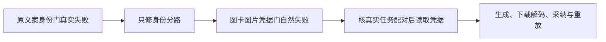

# T1322 独立局部验收

Root 在 B 明确冻结并 RELEASE 后独立核对，认可本次两生产源的局部修复，可由 C 精确整合。此结论不代表真实供应商、新安装候选、统一 timeout Gate 或整个任务完成。Root 未执行产品测试、模型或修改产品。

核对报告 SHA256 `2549c2798878bcd661513814ac9739f819ab541639361b173147f9d5bfed5519`；索引 `ee5a93fbcaf272fb5c832996ebcf5562535a5e0753c04e5c4146e811d780a78b`。实际重算索引 2228 个文件及单列 2 个生产源、3 个测试条目，bytes/SHA 全部匹配。另逐项核 red-v1、red-cover-v3、first-fix-v1、final-v7、backend-v1、backend-type-v1、frontend-type-v3 的事前快照，分别 80/80/81/120/96/96/120 项均匹配，无缺文件。

最终生产 SHA：identity `67b63f0067ed84a7e34f734665a0b558b504464f76556b32825570b406b26e4a`，cover `afe00267f5a74eb1754b118af9f10dcb76d020ab960b89b85f73263a5013728c`。新组合测试 SHA `5750416893ac145987286df1d403a92005ff4c28b6233195e86894f77ac91c7f`；两个后端原测试没有修改。

已读实际 diff、完整身份分路、cover binding、图片端口前后 lease 与 Codex bind、persistence 原装配及组合测试的真实端口包装、故障注入/恢复、下载解码、采纳和重放断言。文案只在真实 copy.generate、scope 与原 /model/N 键匹配时提前读取自身 structured pin；图片仍须既有 prepared 输入/摘要/独立路由。凭据读取使用真实 AI/execution 配对及原业务/准备证据，原 resolveAssetCredential 两侧 admission/frozen identity 保留。未发现新增授权、重发或跨归属放宽。

原两族 RED 的快照确含两原始生产 SHA；第一修复后第二源仍为 `78f48d52f04a827fbd331e88ff18a2a30ccee37e95136da5296f065c75e26a35`，图卡文案真实 settled 后才在 resolveAssetCredential 失败。原 RED 为 explicit controlled ctx 的 composite 服务链，不能升级为真实本地主用户 HTTP 认证全链。后续 final-v7 从实际 resolveLocalContext 创建全部业务对象，补齐真实 blob route Request/Response 与文件解码；没有 HTTP listener 或真实供应商证据。

已核 final-v7 的三个独立 case 均有两条 settled 调用与 GET200/2×2 PNG 解码、真实确认/采纳及 owner 读回。30/30/32 共 92 项是实际端口拒绝和精确恢复断言，不是 92 条独立完整旅程；记录的错误有原身份门、业务准备门、lease/归属前门及参考文件错误，不能把每项都说成到达最内层 resolver。图卡同原 body/key 返回原 receipt，封面已 succeeded 后再次 confirm 沿原行为拒绝，调用/结果及媒体路径集合不增。41 项既有后端测试、两类型、boundary/semantic 的自然退出 0 与最终来源绑定已核；不是本次重跑。

原失败全部保留：准备时序夹具、损坏 synthetic PNG、canonical actor 与实际 local actor 错位、重复采纳 body 构造、类型参数名及当前设置 probe 拒绝。尤其 protection-v6 的图卡设置变化后采纳失败仍是现有产品行为；final-v7 恢复设置后采纳不能消除此失败，已交 T1325 独立分析。没有据新受控成功推定旧媒体 UNKNOWN 首因，也没有重发旧任务。

清理记录限定 18 个 owned 进程组与 100 个已记录 wrapper/native PID，无匹配存活；未记录 worker PID 仅由同组及实际 host.stop/dispose 提供补充。PGlite/合成原生协议/2×2 图片不代签真实 PG 多连接、实际模型或画质。统一 timeout Gate、最终包真实两阶段及媒体使用仍待 C 后续实证。

本次独立检查文件写完即 RELEASE；原 frozen index 不改，由 C 将本新增独审文件单列整合。
