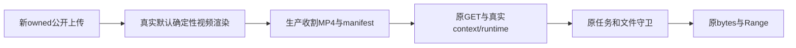

# T1324 本地实施结果

原预览路由已补传真实账号组选择。新隔离库的公开上传与真实默认视频渲染产生 MP4/manifest 后，纯组 header/cookie、合法组内账号筛选及 legacy 原入口均读取原 bytes；Range、权限与文件守卫保护实际通过。此为执行结果，不是最终独立验收收据；新包真实 Next 自动 HEAD、自然播放器及后续用户采纳仍待 C 完整公共复验，共享 timeout Gate 待 C。

## 一行生产修复与真实链

唯一生产变更 `frontend/src/app/api/v1/local/execution-preview/[taskId]/[...artifact]/route.ts` 在原 resolveRequestContext 第三参数传 `{groupId:readRequestGroupId(req)}`，SHA256 `425b086ffd6be0fc18760f9f5df0b18387caefbc587002af8a965aab17b5d22c`，2913B。唯一新组合test SHA256 `0d17b630601b1d0fc8c249f60dd7e3e8e6cff5070523bd47bfc5df5276208225`，15244B。Range、错误状态、cache、MIME、文件/manifest、服务/通用权限均未改；原header优先/cookie兜底仍由真实resolver核身份/账号active/group/member。

初始36项锁bytes/SHA全部匹配，packet SHA/合法lease核验后才写测试。每次运行前完整保存锁源、测试/config/runner及本fixture额外实际producer依赖；见各run BEFORE_INPUTS与snapshot。新增blob PUT/资产契约/身份等只读来源另列前快照，不回写旧锁。真实生产task、context、preview runtime/readVideo、执行service、manifest与sandbox没有mock，也没有人工植入主证manifest。真实默认HyperFrames/Chromium/ffmpeg执行确定性2秒中性视频，ffprobe核H264320×180/48帧和AAC；没有使用AI worker或重建worker/dist。实际视觉审核meta为skipped/未配置视觉模型，不新发供应商模型；原AiService步骤名model_call_started属于旧租约步骤，不能据其名称冒实际模型调用。

fixture唯一替代为owned DB/media、临时channel authority与“禁止自动下载”护栏；实际默认渲染器和所有业务端口原样执行。ctx由该新库真实identity.resolveLocalContext取得，不硬编码canonical user。临时master key及新session只留内存/正常owned DB哈希；不读现用户认证，不持久化upload签名URL。所有生成输入是新中性测试素材，不复制旧用户库或旧6661结果。

## 原运行逐项保留

| run | 原退出/耗时 | 实际分类 |
|---|---|---|
| red-v1 | exit1 /17.587s | driver真实为file-pglite对象，fixture误断言字符串；业务前失败，0task，非目标RED |
| red-v2 | exit130 /364.351s | 新合法隔离任务原渲染因无可溯字幕于12:51:14真实failed；旧waitFor吞terminal错误仍观察，后由本刻公开只读证实后按Root授权只停observer，非自然通过，非预览RED |
| red-v3 | 自然exit1 /60.845s | 补现渲染合同所需中性字幕后的全新fixture；真实公共render待采纳、原MP4存在可解码，但原group请求preview404，有效目标RED |
| green-v1 | 自然exit0 /100.771s，2PASS | pure与legacy两个完整新公共render/routecase；pure内另含真实合法组内filter，共54个真实GET响应 |
| readonly-regression-v1 | 自然exit0 /25.584s，31PASS | 原Range2与原context29，两个旧文件未改；不是完整主证的mock context替代 |
| frontend-type-v1 | 自然exit0 /72.164s | pnpm --dir frontend exec tsc --noEmit --incremental false，最终route/test字节 |
| boundary-v1 | 自然exit0 /1.429s | node orchestrator/process/boundary-scan.mjs --quiet |
| semantic-v1 | 自然exit0 /1.533s | node orchestrator/process/semantic-boundary-scan.mjs |

red-v3实际原新task `ai-task-e4fea611-21`，manifest final.mp4 57311B/SHA `3a5160a06ed94cf48c2cd55b98795a7b29accb73874b0ca77e14e1b9803b29ea`；原header GET404。该完整新失败绑定本地当时HEAD7311f1b486e3989b03d53bc6d52130f6bb1bda13/完整前快照，不冒旧U16现场具体下层首throw。旧6661 MP4/404/未采纳/observer130原件保持只读，未重发或取消。

red-v2漏记录期不补拍：12:56:27.646Z，经Root授权仅附着精确owned Vitest worker49131，验证PID后调用其已有execution.tasks.get/ai.tasks.steps.list同原ctx；原任务 `ai-task-26b35949-21` 真实failed，步骤原时间12:51:14与此刻读取分列。没有开第二PGlite、改任务/dispatcher/计时或读任意环境/凭据；关闭本诊断连接，原observer SIGINT退出130。原case未跑finally dispose，不冒已dispose；其原进程树现已独立证实不存在，owned DB保留。随后新fixture改为等terminal/待采纳集合后在外断言，不再吞failed/cancelled，不缩仍running任务预算。

## 已实际覆盖与证据限度

pure29/legacy25个GET响应原件见各responses.json和TEST_COVERAGE.json。纯G header与cookie、合法G+filter、legacy header/cookie200且整文件逐字节相同；header/cookie冲突沿原header优先。closed/open/suffix Range206精确比对切片、Content-Range/Length；5类非法Range416与空body。private/no-store、video MIME、inline disposition保持。

同owned跨group、实际新第二用户session、外国账号/缺账号、账号组member不一致分别沿原真实resolver/属主门拒绝，未用假的ctx/readVideo；缺task、非exec、非待采纳、非video、清单外路径和逃逸/NUL等拒绝。为到达具体file门，在真正manifest命中的原final.mp4上受控移走/换目录/换symlink，实际拒绝后恢复原文件；不是拿清单前门404冒lstat覆盖。非video/非exec/状态等保护仅在新owned真实产物建立后临时改变原行并精确恢复，不充主RED，不称整场测试零写。preview GET本身只读；原task/results、公开task DTO与source asset逐值不变，原文件SHA相同，0采纳/0生成重发。未声称所有项目/全父矩阵或PG并发已验。

本轮直接调用生产GET(Request)与生产public service链，未启动Next HTTP服务器；没有调用GET(HEAD Request)冒框架HEAD。真正Next自动HEAD的状态/headers/空body、自然cookie播放器加载播放及合法采纳/下载/解码在新包实际HTTP另验。本人先独立审C规格，后依Root授权实施；本报告不能自签最终独立验收。

## 安全、资源与交接

test3600000ms/hook180000ms/外层86400s、retry0/singleworker；新有限任务1800s、结果观察900s且不续期，命令预算保持更长值。Vite/cache、PGlite、媒体、工作区与TMPDIR位于自有runtime；禁止下载/安装，无build/dist。受控新key失败不会重发原failed/unknown ID。最终统一timeout Gate待C原命令与真实同源码收据，本报告没有代填通过。

独立ps核6个已记录自有observer/renderer PID均不存在，精确owned路径没有进程；正常case await真实renderer promises及dispose，原中断case清理限度另列。没有触两controller、当前candidate服务/用户数据或共享浏览器profile。自有DB及真实原MP4留存；不泛称整个系统所有历史短暂进程已枚举。

独立秘密扫描与精确源/证据索引见 SECRET_SCAN/FINAL_SOURCE_MANIFEST/OUTPUT_INDEX；签名URL、master/session不输出。索引排除可再生cache和owned DB/tmp原始派生，保留原始JSON/log/前快照及真实源/成片MP4。报告与源/test冻结交独立复核，未commit、未改控制或task状态。
