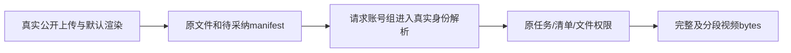

# T1324 独立局部验收

Root 独立核对当前冻结实现，未发现阻断这项一行修复的实质问题，可精确整合。Root 未执行测试或模型、未改产品；本结论不代签新包真实 Next HEAD、播放器、采纳或统一 timeout Gate。

报告 SHA256 `9dc66cdb0eb8b5832c1b990493ef4363772be013fc17739dd5a833c457c6bdb2`；索引 `5896586783e55dfa6da9ff6f043091097ad130a3b4d37e779c658dc27f3bd3ea` 的 281 项逐件 bytes/SHA 重算匹配。red-v3、green-v1 各 47 项事前快照逐件匹配，无缺文件。最终 route SHA `425b086ffd6be0fc18760f9f5df0b18387caefbc587002af8a965aab17b5d22c`、新组合 test SHA `0d17b630601b1d0fc8c249f60dd7e3e8e6cff5070523bd47bfc5df5276208225` 均与实际文件一致。

已读原 SPEC、设计审、唯一生产 diff、完整 route、真实 request-context 解析、原 execution preview/manifest/sandbox 链和新组合测试。修复只将原请求的 group 选择交回既有 resolver，仍核真实用户、账号 active、组和 membership；不拼造 ctx。原 GET/Range/MIME/cache/错误状态、任务所有权与 manifest/文件门均未改，没有新增 HEAD handler。

red-v3 的默认生产渲染实际产出 H264/AAC MP4 后，原 group 请求仍 404，构成有效新组合 RED。前两轮分别是 driver 形状断言错误、缺字幕渲染输入及观察器继续等待，不能算预览 RED。后者原步骤失败时间与后来附着本 owned worker 只读时间分列，observer exit130 与未执行 finally dispose 如实保留；未重发原失败任务。

green-v1 自然 exit0/100.771s 为两个完整 render/route case，pure 内含真实组内账号筛选；54 个实际响应与整文件/切片比对覆盖 header/cookie、legacy、Range206/416、归属拒绝、状态/清单/文件保护。目录、symlink、缺失文件使用真正命中 manifest 的同一路径，恢复后原文件相同，未以清单更早的拒绝充文件门。临时保护注入仅在新 owned 行/文件，不能称整场测试只读；GET 前后原 task/results、公开 DTO 和来源素材相等、0采纳。实际第二用户 session 走真实 resolver，没有 mock context/readVideo 或人工植入主证 manifest。

原 Range/context 31 项辅助回归、最终 frontend 类型及 boundary/semantic 的已发生 exit0 已核，不冒本次重跑。真实默认 HyperFrames/Chromium/ffmpeg 与合成中性输入不等于模型视频生成；该 fixture 视觉审核为 skipped/未配置，步骤名 model_call_started 不代表实际供应商调用。

新包仍需真实 HTTP GET/自动 HEAD、cookie 视频加载播放、原合法采纳及下载解码。此处直接 GET(Request) 不代签框架行为。原 U16 6661 保持失败现场与未采纳状态，不因局部通过追认旧首个下层异常。清理限于 6 个已记录 owned PID 与精确 owned 路径，均无存活；中断 case 的 dispose 缺失单列，不声称枚举所有短暂进程。

本新增独审文件单列整合，原索引不改；写完即 RELEASE 本次独审写权。
