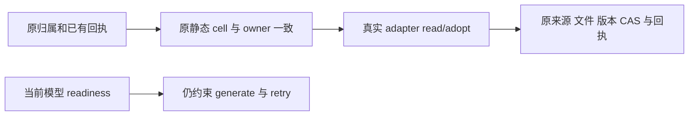

# T1325 独立设计初审

结论：本版设计无阻断 finding。仅为对当前草案和已读实际消费者的独立设计审，不是正式工具 PASS、完整 source lock 核验或产品执行授权。当前未见本任务 formal INPUT_LOCK/MODULE_SCOPE/packet，不能冒未来锁已存在；本次0产品修改、0测试/HTTP/模型、0数据库/凭据读取。

审者为 B `/root/sol_daily_implementation_current`；草案作者 C。按 Root 本轮明确授权，仅写本文。原 T1322 protection-v6 是审者此前实际执行且已冻结的历史完整失败，本次没有重跑，不能以该历史证据代替本任务新 RED。

绑定草案：

- SPEC `docs/features/t1325-generated-candidate-adoption-readiness.md` SHA `2e1422c149afd0a9fc2bf73e46193359a69c7f1cd56cc67a86773beba4329eac`。
- ANALYSIS `docs/verification/t1325/ANALYSIS.md` SHA `11fbfe243dab7419584829df88af77adb401edeba8655884622320f0831d2c03`。

## 可执行的最小边界

当前 `CreativeResultAdapter.probe` 混有生成 readiness 和静态交付项检查。实际装配七个 adapter 的 probe 后续都解析当前模型或 image capability，不承担最终版本写入。候选采纳不发模型，因此采用一处 generic service 修改有实际源码依据。

保留既有 `rows → cells → cellFor(outputType, platform, kind)` 为唯一静态矩阵，选中的 `cell.owner === row.owner === adapter.owner` 必须成立；未知 adapter、无静态 cell 或 owner 错配准确拒绝。不能只删除 probe，也不能另造一份各 owner 的 kind/platform 列表、按错误码 catch 放过，或用始终 supported 的 probe 替身。实际 owner 的 read/adopt 继续原调用与错误；不要加载旧模型凭据、重算冻结果或改归属。

原 `scopedResult → adoptionReceipt 同 body/key 重放` 顺序保持。新静态检查不提前阻断已有真实回执重放；新写分支仍需原 `assertWritableWorkspace`、候选状态/值/owner/ID、真实 owner.adopt、output 写入与回执 CAS。generate、capability 目录和 retry 原 probe 不动，不能借此绕新生成配置准入。

## 七个实际 adapter 的核对

| adapter | 原采纳链仍守的边界；缺端口/不支持分支 |
|---|---|
| article text/sections | text adopt 明确 title/summary/body 与 expected owner/version；sections 走真实 readTaskType 与 ArticlesService。readTaskType 缺失时不走结构分支，sections 在文本 adopt 的 isTextKind 门被拒；若已识别 article-draft 但 articles 缺失，structural 明确抛错。原 source/rule/字段 basis 与 artifact CAS 继续 |
| graphic text/cardBriefs | owner/version 校验后真实 adoptTextCandidate；服务实际 parse graphicPostTextKind、核 candidate.kind/status、来源/目标字段、采用回执及版本。TypeScript cast 不作为运行时授权，真实服务检查保留 |
| output_script | cellFor 将 owner 范围限定为 video/script；adopt 原 expected owner/version/string；真实 service 再核 candidate.status/result/baseVersion、当前 artifact 与 adoption digest/CAS。不能因 adapter 的 adopt 不显式接收 kind 就省静态 cell 门 |
| publication text | adapter 明确 publish_title/description/publish_tags 及 existing/create expected；服务复核候选 kind、真实 account/output/platform/原 publication revision、rule port 与事务回执。不支持 kind 仍在 adapter 拒绝 |
| article media | cell 仍限定 article/合法 platform/cover 或 image_card/owner；真实 observed/binding 核 task/output/section/唯一结果/asset/file，adopt 再核真实 editedValue、原正文/段落 basis、confirm 与 createVersion CAS |
| graphic media | cell 仍限定 image/合法 platform/cover 或 image_card/owner；真实 media/bound、文件与相同 editedValue、原 cardBriefs/参考/正文 basis、confirm 和 CAS 均保；combiner 只按既有 media kind 分派 |
| publication cover | 静态 cells 保 publish_cover 仅既有 image/video 与平台；adapter/adopt 的 expected owner/kind、真实 account/media/binding、发布平台、文件、publication/baseRevision 与 CAS 仍在。实际 owner.adoptCover 在 assertCoverAssetFile 未装配时明确 CAPABILITY_UNAVAILABLE，不能吞错或生成 receipt |

实际 root 当前注册的是完整组合 adapter：graphic_post/text+media、wechat_article/text+media、output_script、publication/text+cover。所需服务缺失时真实方法抛错或 owner 的显式门拒绝，不存在应被 generic 假定为“已支持并采纳”的 fallback。新测试应断言零 owner 版本/回执副作用，不能仅接受任意异常后把静态 owner/kind 保护算通过。

## 验证边界

认可草案要求：本任务新 owned 完整公开模型/ledger/文件→下载解码→当前配置不可用→原 candidate/body/key 新 RED；修后同一路径成功且模型/turn/call/文件数不增加。已有 v6 原失败完整保留，非本任务新 RED。其余七 adapter 族需真实消费者组合与静态反例；没有真实 publication 来源的公共样本缺测单列，不能凭 mock adapter 签全族。

安全回归仍须准确覆盖静态错误 outputType/platform/kind/owner/adapter、真实跨 scope、归档、非 ready/取消失败、文件/source/basis/CAS、body/key 冲突和合法回执重放。缺 port 的拒绝与当前模型未配置的合法采纳须分开断言，不能仅断言 probe 不调用。若实际发现必须改 interface/adapter/其它生产源，按草案先报精确 delta，不能自动扩一源范围。

未发现目前必须增加生产源的事实。以上是设计可行性判断，后续正式锁和受测源/新证据才可形成实现验收；不预签功能恢复、真供应商或 whole task。

## 本次实际只读源码绑定

下列为本次读取时 SHA，非 formal 输入锁收据：

- `backend/src/modules/creative-results/creative-results.service.ts` — 41043B，`b794d931d4bf3cc50eafd7a1690706d0389cda1712968117ac68b01aa2dbe4d8`。
- `backend/src/modules/articles/articles.creative-adapter.ts` — 7197B，`7655bdd09c7a8c82fa9caa033ff77679f506626b6f3bb6052e0d3f9c2086571c`。
- `backend/src/modules/graphic-posts/graphic-posts.creative-adapter.ts` — 3408B，`b0bdedcf13fc21f6848f09e3513567f7d6934b287e387eedd8bbcd642adfdd34`。
- `backend/src/modules/output-scripts/output-scripts.creative-adapter.ts` — 2390B，`c0e90f831318c1ba05c7bdb052b27f264e76914dca30b68f4a5ef07bda4e7326`。
- `backend/src/modules/publishing/publication-results.creative-adapter.ts` — 4381B，`c2f2abbc9ccd1a6aa7879aa9dc953bb97eebe8654c62802e88680135438cddaa`。
- `backend/src/modules/publishing/publication-cover.creative-adapter.ts` — 13823B，`b4a5f14639786eba2eaf02853c4e5fdf7f8716fbe2749e71b9f8cb3262ec9482`。
- `backend/src/modules/creative-results/article-cover-media.adapter.ts` — 23599B，`1b973b2f865c8ab269ee59135b6da710239a63332af5590d14a0cf9dbc67aae2`。
- `backend/src/modules/creative-results/graphic-post-media.adapter.ts` — 29670B，`8bdc78965097a1791a535fcb5e88ace9f7042266ab522f888053ac2c6c19ed45`。
- `backend/src/modules/articles/articles.text-results.ts` — 17346B，`69e45194800c55d097bdd86dafc9ffad87f1c1d7e7598d6a870f1e5b86f4d8a2`。
- `backend/src/modules/graphic-posts/graphic-posts.service.ts` — 47317B，`acef744823fc8c268f1ef5c006da43584ae632ea09b12519f70a574bad63255d`。
- `backend/src/modules/output-scripts/output-scripts.service.ts` — 16368B，`5d7bad8bcb6991feffff02261fcbf95f478fa817f18460cbe9a5e9737ec2d106`。
- `backend/src/modules/publishing/publication-results.service.ts` — 23847B，`b220fddcaeaaf82320595012b6b911f11a3173656f9914d580825fe14ab12b62`。
- `frontend/src/server/persistence-client.ts` — 472734B，`2503085236dcdace8d8f5368faaab44bd1a40ed938294fe25fa00c8088faa0de`。

findings：[]。本文完成后 RELEASE 唯一 review 文件写权，等待 C/Root 后续正式锁与实施派发。
