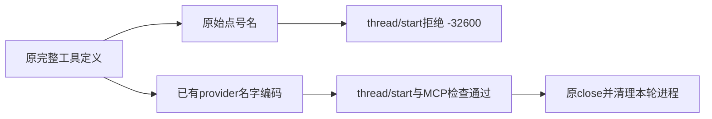

# T1326：Codex原生前置真实诊断

名字转换决定了本轮新前置能否通过：collect与material两族均相同。原动态工具名在 `thread/start` 得到 `CODEX_RPC_REJECTED` / RPC `-32600`；仅复用已有 `chatToolProviderName` 编码后，原 session、认证和 MCP 检查均通过。`taskTools=false/true` 不改变这个前置结果，不能从前置推出模型是否看见 functions 工具。

| 输入族 | 名字 | taskTools=false | taskTools=true |
|---|---|---|---|
| collect | 原名 | thread/start -32600 | thread/start -32600 |
| collect | 既有编码 | 前置通过 | 前置通过 |
| material | 原名 | thread/start -32600 | thread/start -32600 |
| material | 既有编码 | 前置通过 | 前置通过 |

实际八组在同 source `7790be04ca16b65a8161c06c5943ba607e8ecd4d` 与 Codex 0.159.3 二进制SHA `4d210f7c5a18fd0386434df23b5bdbb8c0e7257d3e8a2b30b0769c8bbe99a878` 上执行；源码解析binary与不可变包binary逐字节相同。唯一test执行exit0，test约13.84秒、runner约15.965秒，未过期、无重试。29份最终来源锁字节/hash实际匹配，独立R先设计评审后实物装配评审通过。

只发 `initialize/config/read/account/read/thread/start/mcpServerStatus/list`；`turn/start=0`、业务工具调用=0，不创建execution/AI root、候选或采集run，不改变设置、不读取复制认证。最多八factory各发现与正式两RPC，实际16 children全部原close，PID/PGID均不存在；临时目录删除，runner未强杀。资源即时登记PID/PGID/出生身份，外层9小时包含600秒精确清理余量。

旧825/848只有持久安全code、缺rpcMethod/rpcCode，本轮**不是原worker重放，也不证明旧任务具体拒绝方法**。这组证据支持另行审查最小provider名字适配及反向映射的修复，不授权顺改taskTools，不代表turn或三个自主功能实际成功。原任务UNKNOWN、原ID/期限/状态及目录保持，未重发、恢复、取消或补签。

原装配曾HOLD：detached子进程清理缺失、mergeConfig会拼接其它测试、fixture包解析/锁相对路径。修fixture后用 `vitest list --json` 实际导入且只收集一个test，未执行it，再由R核最终三文件与29锁。旧hash保存在 `PRE_REPAIR_LOCK.json`、审阅输出仍在会话；开始修复前未另存旧三个完整文件字节，`ASSEMBLY_REPAIR.json` 明确记录该证据缺口，不重建冒原件。

原件位于 `runtime/prefix-20261017/`：`PRE_RUN_LOCK.json`、`ASSEMBLY_REVIEW.json`、`COLLECTION_RESULT.json`、`RPC_TRACE.json`、八份INPUT、`RESULTS_PROGRESS.json`、`RESULT.json`、`RPC_CHILDREN.json`、`RESOURCES.json`、`CLEANUP.json`、`execution-result.json`。本报告不完成父功能验收或全局32失败；统一timeout/pmem/reconcile由C收尾如实记录。
