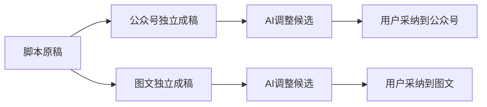

# 当前交付结果（最终包，界面验收收尾中）

脚本保留唯一原稿，公众号和图文各自形成独立成稿；每个平台保留一个「重新组织内容」入口，也可以通过AI对话提出修改、审阅候选后采纳。采纳写回所选平台，不覆盖脚本或另一个平台。真实模型内容操作分别来自旧包806a42及7f1，最终13dd逐消费者核对复用；没有把40项功能都说成新包当场执行。

最终13dd包已用真实Codex完成三类自主任务：采集正常结束并新增5条内容，素材整理完成候选确认和标签读回，研究形成正式候选后在原任务下采纳为1条知识和1个修订；实际记录用量分别为67,244、30,192、69,960 tokens。研究首验收程序因公开回执预览被截断退出，随后同ID完整来源核对和采纳尾验通过；原程序FAIL与独立尾验PASS都保留，没有重发模型。7f1旧采集/研究的预算UNKNOWN不会被新成功改写。雷达策略升级沿7f1真实三阶段、项目Brief、刷新及幂等证据和未变默认调用分支复用，本包不再额外升级。

唯一普通聊天性能实测来自7f1：首段文字18.155秒，可见首字18.171秒，首段文字到显示约16.6毫秒。公众号/图文/制作/复盘/脚本点击至正文可见且主操作可用分别约357/184/597/137/92毫秒。每项仅一个样本，使用T7外盘和预热页面；不是冷启动、p95或整页全部功能就绪。模型调用记录包含启动、预检、线程和模型等混合等待，无法精拆；18秒仍是未解决的实际等待，不把自动Skill目录隔离称为普通聊天性能修复。

文章初次异步加载专属助手、旧账号作品归属读取、缺失实测值被计负偏差的产品修复和受控保护已完成，最终干净包的前后端完整非增量类型检查、两条聊天补验84项与包装45项也已通过。新包已实际完成旧账号作品/报告读取与原确认回执重放、文章专属助手与正文HTML导出、图文原生预览，以及校准三族在正常和最小桌面窗口的数值展示。校准数据是公开API录入的人工内部发布/指标，非真实平台实绩；首轮误用无发布记录的副本所致FAIL仍保留。正式前端验收合同/命令绑定仍在收尾，功能结果与正式门完成分别记录。

新增真实界面检查发现：素材63的标签已在taxonomy保存，但素材详情显示“—”，已单列T1341，当前尚未修复；知识原文和来源链接在正常与最小窗口的只读操作通过。原观察程序错误要求详情panel含素材名的FAIL与标签DOM缺失分别保留。

仍须具体保留：390极窄屏鼠标滚动失败、仅原生焦点滚动后发送按钮可达，不冒充完整适配；正式桌面最小视口按宿主及各任务约定核。没有真实指标时六维分只是建议候选，不代表实测表现；自动调整经验置信度仍未接入，旧结构表历史来源兼容仍有单独欠账。未配置的音视频等供应商和公开投影未暴露的完整冻结输入/路由没有代签。全局对账仍为32条失败，包含旧审核/前端收据和八条lesson失败；独立诊断已区分缺PG环境、旧断言与未证构建接线，不等于32个产品bug，也不等于全部范围外。

交付包：[CreatorOS-1.2.0.dmg](/Volumes/T7-MacData/CodexBuilds/t1300-final-20261017-13dd66ce-907831dcd2/candidate/CreatorOS-1.2.0.dmg)（[Downloads副本](/Users/zyongzhu/Downloads/CreatorOS-1.2.0.dmg)），846,988,776字节；源码 `13dd66ceb3b296461b54f544b78aab3a08058b6b`，SHA256 `922cb618742cf49d2487b7c41884e52c2880d1a076bb002ac018f929033ee9b7`。固定流程构建433.5秒，明确跳过安装；未安装、未发布，Developer ID签名与公证未配置。用户原App未动。

证据：[新包与干净检查收据](/Users/zyongzhu/Workbase/Thirdspace-creator/docs/verification/t1328/final-integration/runtime/final-candidate-13dd66ce/FINAL_PACKAGE_READBACK.json)、[三族真实结果](/Users/zyongzhu/Workbase/Thirdspace-creator/docs/verification/t1315/final-root/runtime/bound-final-13dd66ce/FINAL_RESULT.md)、[具体消费者复用依据](/Users/zyongzhu/Workbase/Thirdspace-creator/docs/verification/t1328/final-integration/runtime/final-candidate-13dd66ce/CONTENT_REUSE_SOURCE_PROOF_13dd66ce.json)、[原性能样本](/Users/zyongzhu/Workbase/Thirdspace-creator/docs/verification/t1329/runtime/final-performance/runs/final-7f1-rev3/RESULT.json)。恢复旧版本后，正式脚本审核读取该版本而非更高版本号的真实操作仍引用806原件，不冒本包重做。整任务通过状态目前仍为false。
