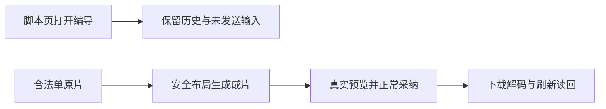

# 本轮修复与验收结果（当前候选 74b）

本轮已落实脚本确认稿作为唯一原稿，公众号、图文承接该脚本并按平台重组，通过 AI 对话校正，用户确认后分别形成各自成稿，不反向覆盖脚本原稿。相关真实模型、采纳和隔离结果保留原包验收身份；AI 剪辑与布局也引用既有实际验收，本次新包只补验受两处修复影响的入口与单原片路径，不宣称全部按钮或全功能通过。

新候选包已构建：[CreatorOS 1.2.0 DMG](/Volumes/T7-MacData/CodexBuilds/t1300-final-20261018-74b03effa-script-bare/candidate/CreatorOS-1.2.0.dmg)。源码为 `74b03effa508e793712de3be738c0b518ed7117b`，包 846,966,271 字节，SHA256 `ef1b6c590076db387f5055e168e7d96de1a5b2adf0a996054c2278d6a4a6225f`。干净源码的前后端完整非增量类型、45 项打包检查、实际打包、DMG 校验和本地签名校验均通过。仍是 ad-hoc 本地候选，未做 Developer ID 公证、安装或原生壳操作验收，未推送或发布。

这次落实了两项实际缺陷：脚本页在桌面最小窗口没有编导入口，以及合法省略 clips 的单原片渲染被质量门整单拒绝。0953 保留为此前已验检查点，新代码属于当前 74b 包。

脚本页在 1366×900、1280×800、1024×680 都完成了真实本地入口、两条历史锁卡、关闭重开、未发送输入、同一 DOM、焦点、断点及返回刷新验证；当前控制提交的原命令重复也通过。真实 Chrome 200% 的设置、缩放读回与恢复已发生；只证明本次标题、输入及历史区域可见，不宣称所有底部控件同时在屏幕内或完整键盘遍历。现役严格执行器随后再次运行同一旅程并通过；已由现役 taskctl 真正再次严格执行并完成 T1342；T1343 亦由相同支持路径完成。原卡仍展示原确认稿版本 ID 和英文维度，未借这项修复扩大为全页文案优化；可见文案检查按原规则实际执行，原文和截图没有遮改。

单原片已经越过原硬拒绝门，实际生成四秒、640×360 的原产物。新包每次使用独立副本，沿同一原任务完成真实 Next GET/HEAD、三类 Range 与越界响应、原生播放推进、正常按钮采纳、正式素材及制作状态读回、下载逐字节核对与解码，并已通过现役严格重复；没有新增渲染或模型。蓝橙几何边界与原片相同，AAC 是合成静音，不代表人声听感验证。原 RGB 差 41 的观察器失败和真实色差继续保留，其唯一原因未证，不能由界面通过推断色彩已修复。原关闭源仍是待确认状态，确认发生在各自的新副本中。

本地保护证据分开记账：视频模板两文件 133 项通过；脚本容器定向 23 项通过，另外四个未变文件 169 项沿其原实际通过结果继承，不冒一次 192 项全绿；LED-047 的 174 项通过。原组件 RED、190/2 的首轮、两个测试数据缺字段导致的 05a 构建类型失败、Chrome 上下文关闭、播放器边缘观察及制作状态机时序失败全部保留。已纠正的仅测试装配、观察时序和签名 URL 证据清敏，不改生产断言、质量边界或原失败状态。

0953 的真实三次模型根、联合文章/图文重组、采纳恢复、正文导出、来源失败恢复、键盘、历史选择、标签、旧作品及人工 PNG 五页翻页等证据保留原包身份。[精确消费者差分](../../t1342/control/SOURCE_CONSUMER_REUSE_0953_TO_74B.json)已机械核对：非测试源码恰两处，583 个依赖清单/worker/contract 文件未变，两包 13 个启动文件的 26 份实物哈希相符；这不等于全部 sidecar 或全部界面字节相同。本次两处源码改动之外的继承据此分列，不把历史真实模型调用冒成 74b 再次调用。图文联合重组已经真实成功；单独图文局部校正沿 806/7790 原证据继承，PNG 五页零模型验收不替代 fresh 局改。旧失败和 UNKNOWN 仍按原 ID 分列。

普通聊天约 18 秒等待尚未解决：此前 7f1 单次 warm 样本首段约 18.155 秒、界面可见约 18.171 秒，不能代表冷启动或分位数，也不能推断本次入口修复带来提速。当前 image.edit 未独立验证；旧参考图蓝杯变红杯成功保留，不冒新路由 ready 或新的失败。外部视频、官方音频/ASR、embedding、RedFox 等未配置，与缺少合法平台输入、暂不支持及未测分开；本地 ASR 有历史实际成功。旧未知任务不自动重发，时间轴滑块和其它明确欠账仍保留。

唯一一次本轮共享树 pmem 已通过，全局 reconcile 自然退出 1，用时 1262.977 秒，共 33 项错误：32 项与 0953 上轮的消息和细节逐字相同，新增 1 项是本次脚本布局修复使 T1328 旧收据过期。随后保持原合同、watch 与 runner 不变，在 74b 同两来源上真实完成新 author 和 taskctl strict，已刷新 T1328 收据；原全局 33 项不改写成 32 或全绿，未再跑全局。期间配置变更是 C 将 1342/1343 严格命令参数从 V2 登记为 V3，产品三个固定源码哈希未变。这是包含原外来工作文件的共享树结果，不冒干净候选构建结果。两条交叉旧前端收据不能统称范围外；父任务 T1300 已由 taskctl 按交叉旧收据缺口明确置为暂停，仍未完成，不能把本轮局部功能通过写成全部能力或全局通过。

完整逐操作状态见 [40 项功能、56 个路由键、7 项性能矩阵](RESULT_MATRIX_74b.md)。T1342、T1343 与 T1328 的现役支持工具收尾均已完成；最后的 62776 验收服务已关闭，controller/sidecar PID 均不存在，原 source 前后哈希相同。所有已结束浏览器与副本服务按各自原件清理，不把 143 退出当作数据库正常刷盘证明。[最终状态与原件指针](../../t1342/control/FINAL_SUPPORTED_CLOSEOUT_74b.json)保留实际事件及全局限制。
