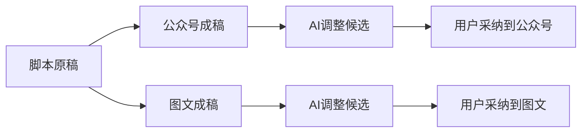

# 本轮结果（7f1候选实测，后续修复验收中）

脚本保持唯一原稿，公众号和图文各自形成独立成稿；每个平台保留一个「重新组织内容」入口，也可以通过AI对话提出修改、审阅候选后采纳。采纳写回所选平台，不覆盖脚本或另一个平台。内容链的真实模型证据来自806a42，当前7f1按已逐项核对的消费者和参数继承，不能说全部在7f1重新执行。

7f1实际完成了素材整理的工具调用、候选确认和标签读回；雷达策略升级已用同次采集产生的合法条目完成原父子任务、项目Brief、刷新和幂等，稳定工作台也已实看。采集虽新增5条内容，但自主根因超过原预算仍为UNKNOWN；研究同样预算UNKNOWN，尚未形成正式可采纳结果，不能称整个自主能力已通过。两种每日选题跳过分支已真实通过且0模型，原测试尾断言失败和独立只读续验分别保留。

普通聊天唯一一次实测：首段SSE文字18.155秒，可见首字18.171秒，完整正文18.172秒；首段文字到显示约16.6毫秒。公众号/图文/制作/复盘/脚本的点击至内容可见且主操作可用分别约357/184/597/137/92毫秒。每项只有一个样本，使用T7外盘和已预热页面；不是p95、TTI或冷启动，也没有同条件旧基线可计算提速比例。

文章助手初次加载仍通用、旧账号作品页错误、缺失实测维度被计负偏差都已独立入账；文章就绪修复已完成受控组合与保护验证，作品权限兼容和数值修复仍在各自红绿验证中。自动Skill目录隔离已受控通过，仍需修后新包真实三族确认；不能把受控通过追签原预算UNKNOWN。

剪辑助手1366宽屏空工程已操作；390窄屏仅原生焦点滚动后发送按钮可达，鼠标滚动失败，未达到完整适配。无真实指标的六维分只是建议候选，不能代表实测表现评分。未配置的音视频等外部供应商、完整冻结输入/路由未公开部分和其它历史缺证仍按具体操作保留。全局32条对账失败不等于32个产品bug；八条原lesson的内部首错已逐条补证，原FAIL和短路未运行不洗绿。

当前已交付候选DMG：[CreatorOS-1.2.0.dmg](/Users/zyongzhu/Downloads/CreatorOS-1.2.0.dmg)，source `7f1d4ec9ec9f5dcb7f898e12408206ef41bac3c9`，SHA256 `0aee74b08c36defcd731a00bf6d72b1be1bc1239b992a7609431c958fce111dd`。这是未安装、未发布的本地候选，后续修复尚未进入这个包。

具体证据：普通聊天/Tab见final-performance/runs/final-7f1-rev3；自主三族见t1315/final-root/runtime/final-7f1-result；U35见t1332/final-package/runtime及project-readonly-stable-v1；每日跳过见t1309/final-package/runtime/final-7f1-result。旧806完整40操作矩阵与当前逐消费者复用证明保留。整任务通过状态仍为false。
