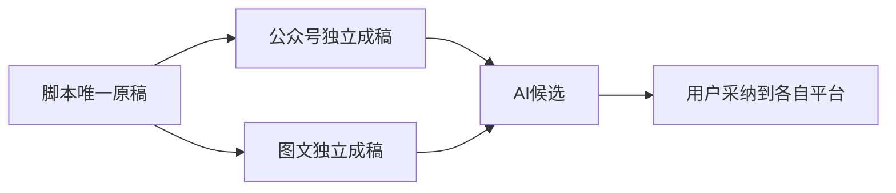

# 本轮结果简页（待填最终实测值）

本文是沿本轮 REPORT 的一页简体中文结果框架。旧806a42结果、旧失败和原索引保持原字节；最终新包和性能尚未填写，不代表全功能通过。

**交互已完成的部分。** 脚本作为唯一原稿；公众号与图文各自保存、各自采纳，不反写脚本。平台保留一个“重新组织”入口，并可继续用AI交流调整。806a42已实际验证盲预测两来源锁定/刷新、整稿采纳、图文原PNG预览与6页采纳、恢复旧v2后的正式审核、普通复盘节点。历史公众号/AI调整操作按实际未变消费者继承，执行包来源逐项保留。

**选Codex后的真实功能。** 上述内容链已用真实Codex执行。806a42的三类自主任务实际调用模型但0工具、功能失败；T1334工具可见性与T1335知识来源边界分别修复，受控测试与真实新包结果分开。最终三族与雷达策略结果待实际填入：采集【未执行新包】、素材整理/采纳【未执行新包】、研究/知识采纳【未执行新包】、同真实item策略升级【未执行新包】。成功不能反推旧UNKNOWN已恢复。

**最后一轮性能。** 普通对话SSE首字【NOT_RUN】；页面首个可见文字【NOT_RUN】；完整正文可见【NOT_RUN，若仪器无法严格比对则写null及测量限制】；5页Tab点击到可见【NOT_RUN】。这些是单次实测，不是p95或TTI，也不与旧内盘样本计算提速百分比。

**仍有限制。** 1366宽屏剪辑空工程已操作查看；390窄屏鼠标滚轮仍失败，只核原生焦点滚动后按钮可达，未修成完整适配。图文原图像素可见性不等于所有排版质量/模板美学通过。metrics=[]时的评分只是保守建议候选，不是有实测依据的真实表现评分。外部账号/评论等真实来源、未配置的音视频服务、公开接口未暴露的完整冻结输入仍缺证或受限。全局32项是对账失败记录，须按真实根因逐条说明，不能等同32个产品bug；仅T1301历史前置RED缺证有特定用户accepted-risk，其它限制不借用此授权。

最终包路径【待实际产物】；source【待实际提交】；DMG SHA256【待实际hash】。固定本地包未安装、未发布；旧包、原数据库和历史证据保留。完整40功能按复合操作标明“本包新执行/旧包精确复用/未验证或依赖受限”，本页不把40项统一标PASS。

详细证据继续引用 REPORT_806a42.md、FINAL_COVERAGE_806a42.json、FINAL_806_FACTS_INDEX.json，并在最终新包真实结果后追加新综合收据。
