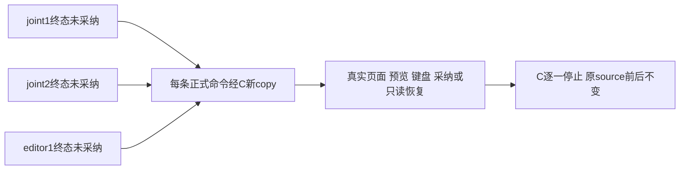

# 五项正式零模型旅程，离线准备

本目录与已封三根生成驱动分离；此刻没有运行浏览器/服务/模型，没有创建实际副本或实际binding。五个任务均只有一个正式it，每个taskctl命令可重复且每次新UUID输出、新副本。新模型始终0。

|任务|checkpoint|操作与隔离|
|---|---|---|
|T1302|joint1、editor1|三候选真实native/专属输入/字段与事实选择；UI采纳、当前exact及另平台/稿面隔离|
|T1303|joint1、joint2、editor1|初派生、clean正常200、graphic和editor仅丢服务器真200客户端响应、自然reload→同原body/key恢复；旧卡历史回执明确重放|
|T1304|joint1、editor1|三候选内外Enter/Tab/ShiftTab/Esc、输入/选择保持、真实滚轮；1366×900/1024×680及原1024×700；真实Chrome200%|
|T1305|joint1、editor1|三来源分别真实同源hold→connectionfailed→中文error→关/重开同wire真实200及defaults/选择保留，0业务写|
|T1308|editor1|A=editor1/B=joint1；真实messages.list两个200全文不变、三种释放顺序，显式B胜出及back/refresh|

T1305联合两card首挂载可能同时发两个匿名同wire source请求，必须保各原input/header，不按请求ordinal发明article/graphic身份；editor是实际lazy读。每family/view都新context防缓存污染。T1308每order/view都新context，先route.fetch900000取真实200原body与SHA，再hold客户端响应；只控制完成顺序，不改正文、不写conversation指针。

T1304使用临时persistent Chromium profile，正常chrome://settings/appearance可见select选择200%，assert option200%、CDP cssVisualViewport.zoom=2、root/body CSSzoom=1。finally恢复原select与zoom1。不用CSSzoom/缩viewport冒真实缩放。overflow存在才要求实际wheel改变scrollTop，不用键盘动作冒滚轮成功。

重要前置：DB副本不带sessionStorage。旧joint1/joint2卡历史确认须从原已保adoption REQUESTS读取真实fields/fact，通过正常UI同body/key重放；响应必须原version、0新增版本/current不变，再由产品自然附confirmed。禁止直接注入storage或调用私有confirm。原source始终RO；若UI不能完成，如实FAIL。

每task实际旅程test28800/global30600/exec31800/run34200秒。命令完整生命周期最多3×(startup1200+stop600)+hash1800+cleanup600+34200=42000秒，独立outer43200。每个launch/stop subprocess真正有timeout；模型正请求route.fetch900000等原较长值保持，所有新正等待至少120000ms，retry0。当前没有合并3生成根的chain。

C lifecycle是唯一数据库copy/装载/服务owner；本command只传C批准intent并读实际path+SHA receipts。C实际helper尚未绑定时硬拒，不能退回fresh空DB。每次helper输出须含真candidateBinding/ready/sourceCopyProof/stopReceiptPath，已启动每个receipt均finally stop；部分启动失败由C原helper自清理。停止不称flush。正式run前需新实际controlHEAD、合同watched_paths、allowlist、包/SDK/全部closure锁；preparation collection不是验收PASS。
