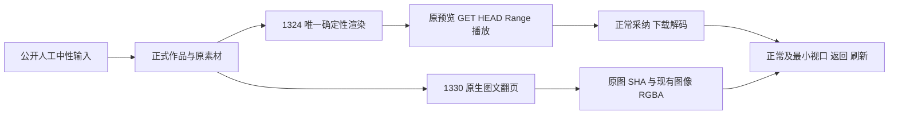

# 最终包两项媒体界面准备（未运行）

目前只有离线脚手架与合同装配，不启动服务、浏览器、渲染或模型。C独立媒体fresh服务采用0953真实包，当前公开设置rev0/六槽official/vision未配；不能据此声称已观察review返回null。

每条命令新UUID输出；1324初跑和strict共最多两个确定性render根，1330只人工文稿/中性PNG。禁止chat/模型候选提交，真实账本若出现供应商模型尝试则本0模型约束失败，不重发。原持久期限只有公口实际暴露时才能min；当前缺字段记录PUBLIC_DEADLINE_NOT_EXPOSED，不冒NULL或新期限。

1366×900与1024×680；每it8小时/global8.5小时/执行31800秒/inner34200秒；实际独立outer86400秒保原较长预算并覆盖40200秒完整串行余量（command实际等待36000覆盖run34200及清理），route.fetch/请求900000ms。C服务由C管理，命令只清自己浏览器/子进程，不把本group退出当服务已停。

T1324允许正常采纳后原产品同owner的materials链接、output主素材、production阶段更新；前后另核脚本和其它平台不变。原任务preview在采纳前检查，采纳后原preview失效不当破图。T1330 inline NoteRelay离页/返回/重新加载/刷新不是AI候选对话框关闭；现有img读取offscreen RGBA，不替换图或二次fetch blob。所有signed URL只内存用，证据副本移除uploadUrl/token。

等待C正式bootstrap/controlHEAD/实际完整输入锁和Root独立装配核后才能运行。模板、旧准备与当前staticparse不是实际业务PASS。

首READY6512与原16件完整字节保于REUSE_MAP.priorPreparationV1；v2只修命令覆盖预算、恢复后实际原图/正文复核和最后可见证据覆盖，不追写首准备为实际业务通过。
