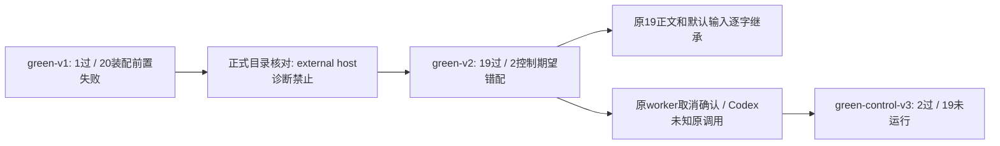

# T1328 服务边界组合验收结果

组合覆盖为 **原19项真实PASS继承 + 新2项真实PASS**。没有单轮21PASS；原green-v1的1PASS/20FAIL、green-v2的19PASS/2FAIL均保留原始exit1。这里只新增测试/证据，产品0改动、外部供应商I/O/付费模型0，不是最终包真实模型或UI验收。

## 实际运行与原件

|run|原始结果|分类|
|---|---|---|
|green-v1|21 executed，1PASS/20FAIL，exit1，89.910810s|普通tool首次并发实际通过；其余共同停external host授权前置，未到目标，不能签后续产品FAIL/PASS|
|green-v2|21 executed，19PASS/2FAIL，exit1，111.354493s|完整业务边界19项实际通过；取消即时终态/Pi未知恢复的夹具期望错配原样保留|
|green-control-v3|2 executed PASS，19 NOT_RUN，0FAIL，exit0，25.683065s|只执行获准的两项控制语义修正，5份关键中间态JSON真实落盘|

三次wrapper均自然结束，expired=false、error=null、registeredChildrenAfterCleanup=[]、remainingOwnedGroup=[]、afterInputDrift=[]。每case实际创建并关闭独立memory PGlite，没有新磁盘DB、host/scheduler/worker进程或build。后台测试控制台回执中的model账本记录是受控fixture，不等于发生外部provider调用。

当前测试32155B，SHA `8c214b5e1a8476eead0645be24ccaf77d78501adddd2f9cfde8aa68789018acf`。原d8af/052e两份测试、config/runner/冻结脚本/装配说明均分别存在原run的before-source目录，原输入锁和raw不覆写。

## 覆盖事实

green-v2的19项真实通过：合法普通tool首次start并发唯一child/attempt/意图；external-host正式拒绝且0新增tool/绑定/child；master、reserved、显式保存empty、none四稿族冻结；真实createDraftPrediction及lockPrediction后抛错的整事务回滚；默认rubric真实升版仍沿旧冻结版本及旧版本删除/改写的0半写拒绝；保存先行拒绝旧基线和真实保存竞争；legacy_unknown纯读/拒绝与同conversation新source独立；user/group/account/member/archive隔离。

19项的it正文/断言10071B逐字相同，SHA `f8f99adf002b23b7b86e6d2fdfd61271ef1dbac485f2537fb3ab5b84ff6f2beb`。当前fixture新增第三参数默认pi；正式createExecutionRoute('pi','legacy')实读探针exit0，四字段值/类型和JSON字节与旧字面量相等。除本test、ASSEMBLY、wrapper精确2case过滤外，green-v2至control-v3的40108个其他输入文件、916链接与absence均相同。证明见CONTROL_FIXTURE_INHERITANCE.json及GREEN_CONTROL_V3_INPUT_DELTA.json；每项映射在RESULT.json。

取消修正实际保存cancel-requested.json：source.running，task.running/runtimeStatus.cancel_requested；同原worker/attempt acknowledgeControl后cancel-acknowledged.json为source.failed、task.cancelled/runtimeStatus.cancelled。同库child/execution ID保留，源start重放严格不增task/call/result/prediction、不重读路由。这里source.failed是原协议对已取消候选的显示分类，不改取消事实。

未知修正仅此case在首次创建child前冻结受控Codex-v1当前配置，原聊天来源仍Pi，不声称读取真实模型配置。真实账本原call reserve/start/settle unknown，时钟只前进121秒，越过原120秒租约但仍在原600秒预算内。实际恢复报告为 `{requeued:0,unknownResult:1,failed:0,paused:0,cancelled:0}`；source.unknown、原task.runtimeStatus=unknown_result，原child/execution/call身份保留，没有填native thread/turn、人工改状态/租约或产生新调用。unknown前态、完整report、原source重放后态分列三份JSON。

两case各自使用新的memory PGlite；deterministic ID字符串可能跨库相同，只在同case库内证明原ID保持，不能跨库冒同一持久任务。

## 限定与门卫

`calibration.diagnose` external-host阳性被当前正式目录禁止；本组只证明真实拒绝，**source-reader的external_tool阳性分支未覆盖**。不伪造历史external来源，不放开授权。Codex现役正链复用已冻结public green-v2真实worker.structured-node，最终新包仍须按原计划真实公共验收。这组不替代U08新包真实诊断/score或其它母矩阵未验功能。

最终collection06实际21项/exit0/6.253230s；完整backend type05 exit0/53.677505s，test/config前后SHA相同。新增fs/contract route导入后实际boundary02 exit0/3.023047s，5条原基线、0新增，最终test SHA前后相同；未重复此前已过的其它门卫。原type01单个夹具类型失败及预备锁首次错误也保留，不洗成全绿。

最终control锁：GREEN_CONTROL_V3_INPUT_LOCK.json，40111files/916links/491个已安装依赖包，SHA `6d6468a76ae6d7ff263f7a9f3c6a14f279b19989f1d4f288b1ccaca0512670ec`。仅hash依赖，不复制binary。单test/hook180s、retry0、worker1、global8100s/执行8400s/外层9000s含600s清理余量全部保留。C源窗口已在实际cleanup后明确RELEASE，未操作taskcomplete/控制账本。
