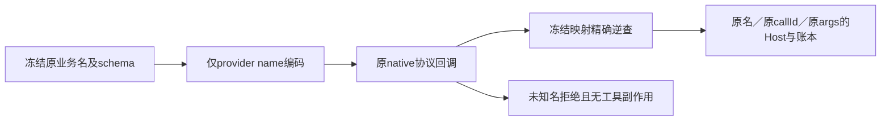

# T1329：provider工具名最小修复的受控结果

已修复自主Codex worker的工具名适配，独立Root受控评审PASS。唯一生产文件为 `ai-worker/src/execution/codex-agentic-worker-run.ts`：复用已有 `chatToolProviderName`，请求前拒绝碰撞，provider声明只编码name；回调先从冻结映射精确恢复原业务名，再进入原Host与账本。description/schema/顺序、原toolCallId/完整args、canonical receipt、owner、预算、认证、恢复及taskTools参数保持。

## 当场执行

| 范围 | 真实结果与界限 |
|---|---|
| 修改前完整公共RED | `runtime/red-v1`，exit1/42.369秒，三族均由正式create→原backend/dispatcher→本次原源构建worker→真实native协议，在raw工具名thread/start被受控外进程拒绝；durable unknown_result/CODEX_RPC_REJECTED、model call unknown，业务断言running≠succeeded。0turn/工具/HTTP/真实供应商调用。见RED_VALIDITY.json。 |
| 同公共链GREEN | `runtime/green-v1`，exit0/46.560秒，三族3/3通过；每族一个settled model，原业务名tool receipt与canonical callId/完整args深等，完整dynamicTools相对冻结定义只name编码、schema/描述/顺序完全相等。 |
| collect实际范围 | collect.plan→collect.run→collect.status三settled工具，真实原Host采集本轮受控HTTP的1条RSS item/run/snapshot；原同key重放不新增任务/请求，不同完整意图/外user拒绝。DNS/网络I/O为明确测试边界，不称真实外网或供应商决策。 |
| material实际范围 | 原Host material.search只读空库1 settled工具，0HTTP；未测试实际organize或标签采纳。 |
| research实际范围 | knowledge.write的dryRun预演1 settled工具，0HTTP、未读取真实来源、未保存知识或候选，不冒真实研究/知识写入。 |
| worker单元 | 原测试增加编码、碰撞0port、未知及原点号provider拒绝0工具port、普通名/schema顺序；GREEN13/13，原settled回放、started/unknown仅原turn恢复、缺绑定、usage预算及原turn归属保持。 |
| 相关worker | native-turn、durable-agentic-tool、agentic-worker-run/entry 4文件83/83；worker tsc --noEmit实际exit0。 |
| 相关contract | execution-worker源测试23/23，使用独立唯一include config；首默认contract config没有收集该src测试而exit1，原No tests found保在contract-worker-v1，不冒产品回归。 |

前置T1326固定八对照只证明新prefix名字准入差异；它不是本任务公共RED。受控readiness/status、外Codex协议与DNS/网络边界均是清楚标注的测试替身，原业务服务、Host、worker、权限、账本、候选消费者没有stub成功。实际供应商模型调用=0，完整新包真实collect/material/research尚待验。

## 来源、历史与资源

RED worker为1538258 bytes / SHA `24c1e7d8eb385e87ed7c69bc5d9b5f4d180df61abe09afe561335a30804a8728`，与原agentic worker字节一致；GREEN为1538699 bytes / SHA `e38822f119d96759cebd0ed395bad66fcbffb0f91cacbe92c30d5e7d36fdd1ad`。每轮构建201份实际worker源均捕获原字节snapshot；独立输出/缓存，不写共享ai-worker/dist、不复用运行中worker。T1327准备域并行变化另列，非此agentic调用的消费者，不把其它任务delta当本RED原因。

根独审设计2696e8…→supported PASS[REV:f5859499bc7d]→START/精确implementation lease后装配。Root核旧411锁全零漂移，要求补完整工具定义/参数深等与独立实际cleanup；原装配全字节保在assembly-before-root-review。最终cc2e0d…test/294a2d…lock、collection-v3只收三个it且未执行；Root实际重读补强并明确装配PASS后才执行RED，真实目标红发生后才改产品。

原unit RED为13例7PASS/6FAIL：五个新名字适配目标断言失败，另一个原恢复期望遗漏生产早已传入的第四AbortSignal参数。该旧夹具漂移单列，只补期望仍核原thread/turn/signal；原输出保留，完整unit字节观察标为执行后捕获，不冒事前锁。本任务不补拍旧TDD。

两公共轮的worker/RPC child各9个均正常原close后实际PID不存在，Host stop、persistence dispose、HTTP关闭、全局及env恢复逐项独立记录，异常不会跳后续；外层真实执行结果均未过期、未强杀、无残留。各case cleanup与全run execution-result保原件。本轮owned DB/媒体/空认证目录仅本地测试资料，保留原文件，不读或复制用户认证/现用库；不要将生成DB或大runtime盲目Git stage。

旧7790真实825/848及其UNKNOWN、期限、ID、目录不动，未retry/resume/cancel。本次新fixture三族通过不能追签旧现场具体RPC首因，不能追签research真实知识或material organize。

## 尚未完成

统一boundary/orphan、timeout与pmem/reconcile等等待当前并行窄修稳定后由C执行并如实保原32全局债。Root已实读唯一生产diff、unitdiff、公共RED/GREEN及原工具输入映射，受控实现评审PASS；新包真实三族及最终独占普通首字性能仍必须完成。父40/56原矩阵不改，不现在complete整任务，不安装或发布。
