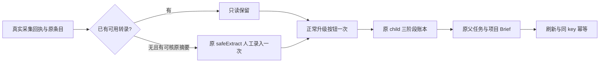

# U35 最终包真实策略升级准备（尚未执行）

仅准备一个完整公共链：新候选包同一 tools 组中，已有真实 collect 成功的条目 → 雷达“升级为项目”唯一点击 → 原 topic_preview 策略 child 三阶段调用 → 原父任务与项目/Brief → 正常刷新 → 同原 body/key 一次重放返回原项目。

当前为 NOT_RUN：没有启动服务、浏览器、数据库或模型，没有读取 session，没有创建来源、条目、定位、账号或项目。模板 null 不表示实际运行绑定；旧806包 collect174失败后的 U35 未执行事实保留。

## 执行前的具体依赖

由 C 提供新候选包五身份（sourceHead/packageSha256/baseURL/ownedRoot/sessionPath）和三份 confirmed 回执、实际 pure-group、冻结路由、同包真实 collect binding 与 receipt。collectionProof.binding 指向该次 B 实际 binding；handoff 指向同次 COLLECT_HANDOFF_FOR_R.json（actualCandidate/ownedScope/source/positioningStatement/collected{run,items,detail}/u35Submitted:false）；receipt 精确指向同次 collect/FINAL.json，从其顶层取原 aiTaskId/executionTaskId、run.run、detail.item 及 sourceSnapshot。两份原回执各自 SHA 校验，并核 handoff.collected 与 FINAL 的 run/items/detail 完整全等，不能混用嵌套层次。执行前由 Root 核实际来源，handoff 的 pending 字样不当作来源已审；C 只在实际认可后交执行绑定。collectionProof 与本次五身份和组必须全等。不得指向旧 UNKNOWN、旧 completed 控制库或806旧包。

positioningStatementId 使用该组已有真实定位，不补账号；已有升级/transform 视为依赖不满足，不再新生成。实际 dispatch 合同验证请求与响应，所有列表完整分页。公开 projects DTO 不含 groupId/accountId，不对此造断言；作用域由 pure-group 请求、真实父/child DTO 和现役服务隔离共同核对。

原 transcript.status=done 时不覆盖；否则仅允许实际持久 snapshot.safeExtract 的非空原文字节，证据明确标注“验收人工提供的原来源摘要；不是全文、ASR或新近新闻”。上传前保存 source/item/run/snapshot 与文本 SHA，唯一 uploadManual(paste) 后核 itemId/manual/done/完整原文。只有标题、来源不可核或无正文即停止，不生成替代输入。不调用 ASR、collect 或 rewrite_only。

先经 Root 审实物，再由 C 支持实际 binding/input-lock/runtime 输出 scope。不得直接编辑本模板假装运行许可。未来绑定包含六 runner 文件及只读 registrar 的 SHA、真实 source/包/deps/links/absence 输入锁，输出为 final-package/runtime 下唯一目录，START/动作意图 wx 防覆盖。wrapper 读取 session 仅在内存，日志不打印认证内容。

## 唯一调用与成功标准

正常 `/intelligence` 搜索真实标题，在实际 ItemCard 内点击“升级为项目”。保原 enqueue 请求、HTTP 回执、父 ID；失败或未知绝不再点击。观察 checkpoint 原 topicTaskId/transformId，不造任务或 drain。业务 status 与 runtimeStatus 分开判定；失败、blocked、取消、paused、waiting_user、partial、unknown_result/unknown 即留原状态停止，不能用运行状态遮蔽业务失败。原 child 成功必须有3个 settled model 调用及原 operationKey，父 completed 后核真实项目、七阶段、创建活动、来源/策略/改写 Brief。逐阶段保原 callId/resultRef/operationKey；inspect 不投影 providerResult/providerMetadata，topic_preview 不符合 chat-only modelCalls.summary，所以实际 provider/runtime/model/nativeTurn 明确 NOT_EXPOSED，配置与账本成功分列，不冒三次实际 Codex 身份已公开。模型语义仍待 Root 实际复核，公开缺失的冻结 prompt/route 不冒充有证。

正常刷新显示原项目链接，打开项目读回全等。仅使用第一次实际 enqueue 原 body/key 再调用一次，核返回原父/项目、parent/child 列表、transform、Brief、阶段/活动及原 child calls 前后全等；不能用新 key、新模型或新项目证明幂等。只有该一次幂等重放为允许的第二 enqueue HTTP，不是第二次 UI root。

页面正常 local observability/client-config 初始化单列 SYSTEM_INITIALIZATION 并记录 method/status；不是“零副作用”声明。当前项目 page→buildDraftWorkbenchVm 是 GET 读侧，ScriptRichEditor 初次 setContent(emitUpdate:false)/saved 不触发 dirty autosave，rail 不在 mount 创建会话；实际请求仍完整核查，若出现未知正常初始化需先报告而非无依据放行。其余业务 POST 限唯一 UI enqueue，API 仅额外允许有条件 manual-summary 和原 key 幂等。settings 前后读回不变。失败保原 ID、响应和资源清理，不取消/续期/重发原持久任务。

## 原预算与清理

单次请求最长15分钟、最短正预算2分钟；保原8小时观察和24小时 outer。阶段上限：preflight30分钟 + setup2小时 + UI30分钟 + 观察8小时 + 尾读30分钟 = 11小时30分钟；单it12小时，global12小时30分钟，覆盖 before/after 各180秒仍有余量；execution85800秒/outer86400秒，清理预留600秒。所有请求/观察/尾读再与原父/child deadlineAt 和原有限观察窗取 min，余期不足120秒不发新请求；wrapper 额外时间不能续任何持久任务期限。

清理复用现役只读 register-owned.cjs，逐 PID 核 PGID/lstart/comm/runId 后 TERM/KILL/等待；父 PGID 先保存身份，清理后核无 owned group、registered identity 消失、输入 files/links/absence 零漂移。后端任务不由测试取消。完整终态须同时读 RESULT、真实 EXECUTION_RESULT、清理与输入漂移；先写的 RESULT 不能代 wrapper 终态。

离线 collection：`T1332_FINAL_U35_COLLECTION_ONLY=1 node frontend/node_modules/@playwright/test/cli.js test --config docs/verification/t1332/final-package/runner/playwright.config.cjs --list --reporter=json`。仅导入合同和收集唯一 it；不读 session、不启动 browser。`python3 runner/run.py --collect` 只打印 NOT_RUN。实际运行须 C 新绑定及 runtime scope 后，显式 `--execute`，不在本准备阶段执行。
