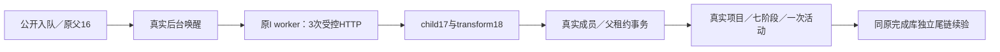

# T1332 纯组雷达策略升级：实施与受控验收

两处生产修改已恢复纯组工作区的真实项目创建，并把父执行凭证、成员与项目幂等读写放在同一个现有租约事务。历史账号 ID 完整保留；纯组使用带类型标签的稳定 ID。队列核真实 child/transform/来源/定位关系；没有把 generationProgress 新增成质量门。

## 当场结果与限制

- 原目标 RED `red-profile`：真实父 blocked/creating_project，child succeeded、3 settled模型账本/3 loopback HTTP，末端 AccountRequiredError、项目0；Root已独立验过。原件与锁2295b52…不改。
- 新 `green-worker-bind`：真实原父 `execution-task-598d9882-16` succeeded/completed；child17 succeeded；transform18；项目 `project-radar-1b26335a5686103fcbbcb58693f3155c` 真正创建，来源/拆解/策略/候选正文保留。模型账本3 settled、loopback HTTP3、外部付费0。真实host/server dispose、业务worker94831自然exit0且实际PID已不存在、PGID空、输入漂移0。
- 该原run **exit1/31.8717s**：尾部fixture错误地向正式项目DTO断言不存在的group/account。原3ad源码快照、888c9be…输入锁及全部失败原件保持冻结；没有重跑模型链。当前测试已把同等归属断言移到实际project row，正文/七阶段/活动/幂等断言不减；collection与完整frontend类型检查通过。
- 独立 `completed-readonly` **exit0/11.3201s**：只打开同次已完成598d9882库，无host/调度器/模型/新app key/迁移/隔离；SQL强制只读。真实projects/intelligence transport核公开标题/Brief、七阶段、一次project_created、真实row user/group/account、foreign user/group拒绝；原同item enqueue一次沿原completed父早返回。17业务表计数/IDs/整行SHA、原execution payload摘要前后全等；原3个settled call不增，fork/fetch/新ID/SQL只读拒绝尝试全0；artifact/version/output/publication均0。client真实close，PGID空、输入漂移0。

因此准确结论是：**真实受控主业务链成功，原整轮测试失败，独立原任务尾链续验通过**。不把原exit1改记exit0，也不等同最终不可变包的真实供应商U35验收。

## 回归与证据分类

- 两服务完整回归unit03：68/68 PASS，retry0，包含四种历史metadata族、缺内容/错误child交叉、缺省/null内部runtime观测兼容、真实成员/组/租约、取消、并发、稳定ID/恢复与事务回滚。
- 唯一测试架构引用修正后unit04：受影响8族PASS，25项按-t未运行；原68项未减少。两生产未再变化。
- 真实queue→真实任务服务→真实radar/project事务组合，与底层受控proof/故障注入分开。后者只证明权限、锁序、主键/读错误及回滚，不能冒完整模型来源；完整宿主/worker链由上述公共RED/业务成功原件证明。
- 受影响既有26/26 PASS（lease、group-workspace/account-group、topic-preview-runner、rewrite-only）；timeout-policy实际exit0；boundary02实际exit0，5条既有基线违规/0新增；orphan实际exit0，0错误/100警告。
- backend-tsc03完整exit0/53.364s、五源中backend四源前后0漂移；当前DTO修复后的完整frontend-tsc02 exit0/17.712s。独立continuation collection03/type02均exit0。

## 如实保留的装配事件

1. unit启动两次命令路径装配失败，后续独立label执行，不冒测试结果。
2. backend-tsc01/02原错误保留；自身可选值断言修正，R负责其六条测试类型诊断，最终全backend类型真实通过。
3. boundary01真实FAIL：新增测试跨模块repository import；改同DB schema只读后复验PASS。最初并行工具completion未标label，曾误对调boundary/orphan退出码；追加 `COMMAND_ATTRIBUTION_CORRECTION.json` 澄清，原log不改。
4. 首个green在host前绑定检查失败、0public/DB/task/model。其最初hash错误被finally dispose断言覆盖；当前fixture已保原异常、NOT_CREATED与完整cleanup事实。
5. 当前worker29750220…并非原6bf77788字节：**B执行既有受影响rewrite-only回归的beforeAll真实子build**造成共享dist变化，此副作用此前未识别。Root独立查证源码、raw8PASS/文件时序；不归因C/R，不恢复dist/再次build。新binding b220…逐项冻结实际Node+5workers/build来源，明确当前混合源码/非最终包。新888c9be…锁仅补一行binding，原helpers/config/binding不改。

正式执行源/测试快照见 `FINAL_SOURCE_BINDING.json`，实际指令与原结果见各带label收据。输出索引只收文字证据；不将DB、binary、node_modules或编译缓存入Git。C/Root持有最终流程收尾与整包验证，B不改控制账本或代签父矩阵。
