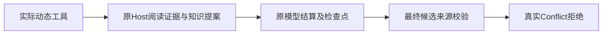

# T1334 本地实现与受控验收结果

唯一生产差分为 `ai-worker/src/execution/codex-agentic-worker-run.ts:51` 显式传入 `createControlledCodexSession(cwd,signal,undefined,false,true)`。原测试补精确5参断言，其它caller、helper默认值、工具注册/名字编码和权限保持原字节。当前不是整任务或最终包验收通过。

原 red-v3 三个独立串行公共链均实际失败：collect 为 COLLECTION_INCOMPLETE/partial，material/research 为 AGENT_NO_PROPOSALS；各1个settled model、0工具。Root已核55项原件及原完整业务断言。修改后实际CLI仍关闭code_mode执行/shell/MCP/web_search等，仅functions进入direct namespace。外部CLI与HTTP资料明确为合成I/O，真实服务、自然dispatcher、worker、Host/账本及采纳端口保持实际调用；本轮0真实供应商模型，不声称已证明真实模型视图或最终806原失败的完整首因。

| 执行标签 | 实际结果 | 限定 |
| --- | --- | --- |
| green-v1 | collect与material完整公共链PASS；research FAIL；整轮exit1/58.330秒 | collect实际plan/run/status→run/item/snapshot；material原proposal→confirm→adoptionReceipt→真实tag，采纳前资产/标签不变。research的Host web.read返回transient/none，model unknown，保原ID与DB。 |
| green-research-v2 | 原AI ai-task-6aaeb083-7保持running，观察器按Root授权停止，exit143/544.558秒 | 同SHA worker小copy，仅为外盘worker增jsdom/readability两个精确链接。真实web.read与knowledge.write成功，仍未完成候选提交。原中文错误/模型结算在该轮未观察；不能追签v3事实。 |
| diagnostic-research-v3 | 新AI ai-task-23a350a5-7／exec_6fcdde10-f464-4baa-9aee-a7fa36ef36ea，提交校验真实拒绝；观察器授权停止，exit143/301.577秒 | 原1model settled、2tools settled，CLI三final帧真实write，readCodexCall/settleGenerationCall/saveCheckpoint成功，Chromium已退出，然后commitAgenticResult进入并被ConflictError拒绝。不是浏览器关闭等待。 |

v3 trace共5次自然同ID恢复后的commit拒绝；只读Debugger时点只取到前4次相同原中文错误“知识候选与已结算原生工具来源不符”，原backend栈为 `agentic-proposal-staging.service.ts:42:115` → `execution-agentic-candidate.service.ts:110:49`。第5次仅有ConflictError与安全码null，不冒中文错误也已取到。Debugger只在原poll帧读取owned.errors，07:01:35.916Z暂停、.919Z恢复，3毫秒排除于自然时序证据；立即关闭自建loopback inspector并核端口已释放。

只读源码链与原错误一致：recordCodexToolCall存完整incoming含callId；worker最终canonical工具事实显式只有type/toolCallId/toolName/input；知识来源校验的passthrough保留额外callId后与canonical作全对象比较。此字段差异的根因修复另登记T1335，先SPEC独评/真实公共RED；本任务没有越权修改该业务服务或放宽来源门。

所有三次GREEN/诊断的mandatory before/after files/links/absent核验均0漂移，登记进程实际身份最终均为null、无owned残留。green-v1三族实际await host.stop/persistence.dispose；后来两次按精确identity仅停止观察器，未观察到test finally的host/dispose await，诚实记NOT_OBSERVED_PROCESS_TERMINATED。没有task cancel、改状态/租约、恢复原unknown、旧DB重开或付费重发。

外盘ESM问题仅在装配处理：green-v1原worker位置createRequire能解析而import失败；独立离线复现ERR_MODULE_NOT_FOUND。随后新phase两个精确symlink解决解析，不改生产。离线CLI回放2只证明原输入/真实成功回执可使同fixture输出final三帧，不冒原当时已emit；首回放因文本缓冲观测问题45秒中断，原件保留。生产worker始终7727daf3…／1540654B，受控GREEN独立构建，shared dist写0。

必要回归实际结果：82 worker tests PASS（retry0），18 contract PASS（chat-worker-entry 3、chat-worker 15），worker/full frontend类型exit0；诊断观测版full frontend类型另实exit0/57.612秒、collection仅research、两shim语法0。18项命令曾请求internal/execution-worker，但原config未收集它；C已独立精确include该文件23 PASS，两个集合不重复。C diff/timeout/boundary/orphan均exit0，orphan原100 warnings/0 errors保留；详见 `docs/verification/t1328/final-integration/runtime/t1334-final-gates-v1/FINAL_GATE_SUMMARY.json`。该C门是透明观测前原生产差分的证据，不冒当前观测test又重跑过所有门。

原件位于外盘0700 owned根 `/Volumes/T7-MacData/CodexBuilds/t1334-tool-visibility-20261017-706cfbe7`，各标签OUTPUT_INDEX分别为：red-v3 ec80c807…（55项）、green-v1 a5c18459…（80项）、green-research-v2 db749380…（37项）、diagnostic-research-v3 7f5dd80d…（33项），Root均已独核。原v1/v2/v3 RED装配失败及观察器窄修也完整保留，没有覆盖成成功。

剩余：T1335校验窄修及同链知识候选/采纳GREEN；C统一新完整包、新owned根后唯一真实collect/material/research，实际来源/提案/采纳读回与公开元数据；collect真实item交R唯一U35。旧806三族174/204/225及所有旧UNKNOWN均保原，不重发或追签；性能仍最后独占，pmem/reconcile/最终状态由C统一处理。
