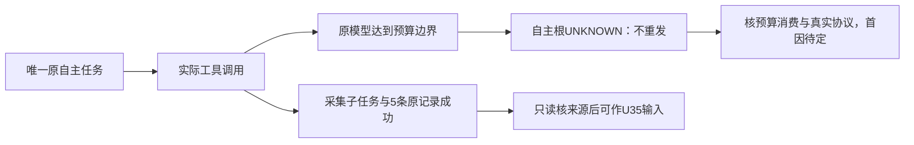

# T1337：诊断自主任务完成前预算耗尽

状态：待审的事实登记与零模型只读调查，不START，不授权生产修改。

本轮7f1d4ec9新包已经恢复实际工具调用，但采集和研究的原自主根在形成完整业务终态前进入`CODEX_TOKEN_BUDGET_EXHAUSTED / unknown_result`。工具副作用成功与自主根完整成功必须分列，不把预算码直接归因于累加、供应商或上下文，也不凭此否定T1334/T1335已实际通过的局部修复。

## 已证事实

- 实际来源提交`7f1d4ec9ec9f5dcb7f898e12408206ef41bac3c9`；DMG 847026757字节、SHA `0aee74b08c36defcd731a00bf6d72b1be1bc1239b992a7609431c958fce111dd`；新候选60616/独立ownedRoot `t1300-candidate-A5DZUu`。原六槽设置revision1未改变。
- 原采集AI `ai-task-7441aa97-72`、执行`exec_355bc7df-e517-44fa-bf13-236dd25f17c7`，当前公开状态AI running/runtime unknown_result、execution blocked/runtime unknown_result、errorCode `CODEX_TOKEN_BUDGET_EXHAUSTED`。Root/B已实际读取原账本：1个model unknown、原累计totalTokens110205超过原maxTokens100000，5个settled工具；原collector子任务93与run94成功，新增5条items及对应5个snapshots。完整安全回执由B原ID只读补证后独立封存，不能用当前公开DTO缺少budget字段捏造该数值来源。
- 原研究AI `ai-task-7441aa97-161`、执行`exec_d612d7e7-76ca-42b4-b9f4-c85f56872eef`也公开blocked/unknown_result及同budget码。最终token/tool/候选账本待B沿原ID补齐，不先假定与采集的内部首因相同。
- 原素材AI `ai-task-7441aa97-124`、执行`exec_5230d575-cec2-4c72-8f22-3815ffe0b14e`完整候选、用户confirm与标签域读回已通过，正式模型meta tokensUsed63015。该通过不代采集/研究完整通过。
- 原三根wrapper自然exit1/223.74092583399033秒、expired=false、error=null、afterInputDrift=[]、registered/remaining=[]；API DISPOSED/browser NOT_CREATED。没有第二次采集/研究提交、任务取消/恢复或预算改写。原UNKNOWN与副作用均保留。

## 当前调查范围

只读核：原AI/执行任务/全页inspect/results/events/工具回执与冻结预算，原官方tokenUsage通知的total/last/cached语义及本包实际消费路径，`codex-native-turn.ts`与`codex-agentic-worker-run.ts`预算观察、已安装且与本包绑定的Codex0.159.3 schema/配置接口。记录真实可见字段和未暴露字段，任何计费/上下文假设必须有协议和实际回执支持。

当前源码对原通知total进行赋值，不得未经证据登记“通知反复累加”的修复。只读调查不能调用turn/start、重新跑模型、重开旧DB、resume/cancel原任务、改变user设置、提高/绕过预算或修改生产。无需新增通用架构、供应商、账号或测试框架。

## 不在本次登记内的实现

没有拟定生产写集；未确认首因。若调查证实产品缺陷，必须另补准确最小方案、独立评审、DEC与当场完整公共RED/GREEN后才能授实现写权；保本登记与原新包失败。不能扩大T1334原caller或T1335知识比较任务的技术范围，也不能借T1331额外周期。

原合法采集run/items/snapshots可在Root逐来源核后作为U35输入，与原自主根UNKNOWN分开；新handoff必须明确`COLLECT_SIDE_EFFECT_SUCCEEDED_AGENTIC_FINAL_UNKNOWN`及`originalAgenticComplete:false`，不套旧整体PASS标签。U35尚未执行不能先写成功。

## 原件指针

- `docs/verification/t1315/final-root/runtime/run-final-7f1d4ec9/{OUTER_RESULT.json,CASE_RESULTS.json,collect/observation.json,research/observation.json,material/FINAL.json}`。
- `docs/verification/t1328/final-integration/runtime/final-candidate-7f1d4ec9/public-binding/SHARED_BINDING.json`与原实际来源、三个confirmed收据。
- 后续原ID安全inspect/来源补证与冻结索引由B追加，只读诊断不把模型自述或未暴露字段写为实测。

本项只登记待审调查；整包相关完整功能仍未通过，旧两个已验修复的局部结果保持。无新模型、生产改动或taskcomplete。

## 原ID最终账本追加（不改前述首因未知）

B已冻结同原ID公开全页inspect/results/events：研究原model unknown/113622tokens，三个settled工具（两次真实web.read分窗及knowledge.write）；仅一个staged知识草案，无正式agentic_proposals、未confirm。素材model settled/63015tokens、两个settled工具，正式采纳和标签读回完整通过。采集model unknown/110205tokens、五settled工具与原run94成功五条均保持。input/output/cache分量不在当前公开DTO投影，events全页实际空，不能把总量当prompt长度或准确费用，也不把events空推为无native通知。

原件：`docs/verification/t1315/final-root/runtime/final-7f1-result/RESULT.json`；68项冻结索引`OUTPUT_INDEX.json` SHA `d858ba908f4a4a9a385e6f12b6eced36dfef3da5e434aa5842eab643635ee23e`。现只读诊断不重发、不修改budget/生产；原首段“研究最终账待补”是此前登记时事实，以本追加已冻结字段补齐，不覆盖当时原件。
