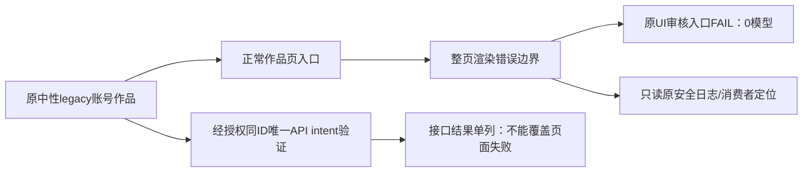

# T1338：诊断旧账号作品页的真实渲染错误

待审事实登记，当前不START、不授生产写集。

7f1d4ec9新包中，R按已审legacy account-only/no-group验收创建中性账号`acct-7441aa97-360`、项目`project-7441aa97-363`和composition383，通过真实页面进入正式作品审核。原UI没有产生模型根，页面实际为错误边界（digest `1542333634`），不是仅缺少定位器。Root/R已对同原ID只读DOM/图确认；首wrapper exit1/128.53087908303132秒、expired=false、afterInputDrift=[]、所有登记PID current=null、remainingOwnedGroup=[]。原120秒locator超时为实际错误页的表象，不能直接称模型不可用。

原账号无平台登录、externalAccountId=null、secretReference=null、followerBaseline=0；scope明确user-7441aa97-1/account360/groupId=null，不能换纯组来使该输入族消失。候选提交为`7f1d4ec9ec9f5dcb7f898e12408206ef41bac3c9`，DMG SHA `0aee74b08c36defcd731a00bf6d72b1be1bc1239b992a7609431c958fce111dd`。当前仅确认真实页面渲染错误，不猜数据归属、query解析或具体service根因。

当前允许的调查仅为原ID公开只读DOM/截图/安全错误栈与路由数据消费者核对。R已获Root单独授权用原ID及唯一原intent验证真实API入口，仍保原UI FAIL；API具体结果独立落盘后再追加，不预填成功。不得为调查自动重发原审核/新建替代作品、导入或种库、修改生产、绕开UI错误边界或放宽归属门。

若日志证实需要修产品，另写最小精确方案/DEC、独立评审及当场公共RED/GREEN后授实现，不能扩大T1313后端任务已验范围或把本项当现有T1331额外周期。当前无生产方案、根因结论或修复PASS。

原件根：`docs/verification/t1313/final-package-combined/runtime/runs/legacy-work-9e10f961-69cf-4906-a121-180dc2e1a284/`，含`UI_ORIGINAL_FAILURE.json`、`PRIMARY_FAILURE.json`、`EXECUTION_RESULT.json`、`LEGACY_PUBLIC_SCOPE.json`。同ID后续只读取证与日志由R独立追加/封存，不改首失败。

独立的校准经验case42.237秒通过和context当前实际测试不能替本legacy UI通过。本项是待诊断的新包可达性缺口，非新原生壳/供应商/模型故障定性。
