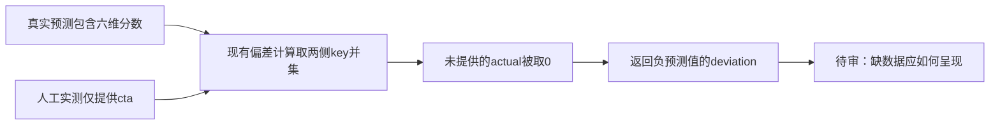

# T1339：核对缺失实测维度被计为负偏差的数据准确性

状态：待审事实观察；不START、不改生产、不重发模型或修改现有结果。与T1336自动调整经验置信度的既有no-op分开。

新7f1包的校准公共协议测试实际通过，但人工透明输入只提供`actualMetrics:{cta:4}`；原`calibres-7441aa97-482`仍返回缺失维度的负偏差：hook=-1、emotion=-1、social=-2、quotable=-2、product_path=-2。该输入是人工验收值，不是平台表现数据；协议操作成功不能证明缺失维度的数值解释正确。

已读源码：`backend/src/modules/calibration/calibration.service.ts`的computeDeviation（359–395）将预测维度摊平并合并keys，非有限或缺失actual取0后相减；overview（614–641）将缺失actual显示null，但继续取已存deviation，因而可能同时显示actual缺失与负偏差。当前只是准确定位该行为，不推定有真实平台亏损/模型质量下降，也不回写旧结果。

实际原件：`docs/verification/t1313/final-package-combined/runtime/runs/calibration-learning-111c3d50-5cd1-4f27-a3f6-e6ab89768a61/RESULT.json`的manualResult及businessState。AI诊断/锁定、manual ingestion关联、显式Learning→默认量表回流的协议PASS保持；Learning confidence40及自动confidence桥未实现另T1336，不混成同一根因。

后续仅允许先读原合同、调用者、旧缺值/明确零值测试与保存/概览消费者，提出能区分缺失和真实0的最小方案及历史兼容，独立评审后再考虑真实RED和实现。当前无生产写集、无新模型、无数据迁移/重算授权；不把pending调查当已修复或整包全绿。
