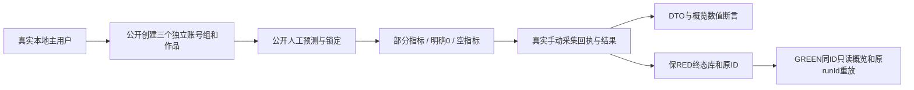

# T1339：零模型公共链装配

阶段：TEST_PREPARATION / NOT_RUN。已审SPEC42fe69d6；当前仅三测试与本runtime写权，唯一生产service未改。真实RED执行前等待R1338八源稳定，最终锁后保持实际消费源至cleanup。

实际业务：真实persistence factory/迁移/身份/工作区权限→compositeTransport→calibration transport/service/repository/transaction；每次调用前按原Endpoint params/query/body parse，返回按正式response parse。没有模型、供应商、AI候选或直接SQL写域数据。人工predictedMetrics和actualMetrics明确为测试输入，不声称平台数据。

首次public case串行建立partial(cta4)、zero(hook0/cta0)、empty({})三独立组，各有真实project/output/rubric/prediction/lock/results.create。三族创建完成且保存FIXTURE后才soft断言，以免首个缺值RED阻断另外两个自然存量。结果、overview所有KPI/维度/行band/reason、不同actual重放、feedback计数、原SQL领域事实分别保存。反馈包装调用原adjustConfidence，返回/异常原样；persistence当前no-op不接通T1336。首次空pair要求0次，partial/zero各1次，重放0增。跨组读取/写入正式拒绝，不替换权限service。

首次result省略ingestionRunId，真实ensureManualRun建立manual source/run并完成。幂等重放**明确携带该公开返回的原真实ingestionRunId**，保prediction唯一键且actual9999不可改变原持久实际数据。原因：现役ensureManualRun省略runId重放会再次completeRun更新completedAt（ingestion.service1016–1023/repository386）；不是本任务修改目标，不把五类表全等外推到省略runId重放。

RED新owned DB自然保存旧坏deviation。GREEN第二case只打开该已正常DISPOSED的本轮DB，同原随机测试key/ctx/prediction/result/run；不启业务任务，不插入历史行。原rubrics/rubricVersions/predictions/calibrationResults/ingestionRuns按整行JSON前后全等，原row.actualMetrics与旧raw deviation保持；公开DTO/overview纠正读取投影。新fresh GREEN另库跑原第一case完整断言。不存在DB/key/正常清理则拒绝历史续验。重复返回必须仍原ID/actual/run；未授其它历史或UNKNOWN库。

新根：`/Volumes/T7-MacData/CodexBuilds/t1339-missing-actual-20261017-42fe69d6`，C已0700创建。fixture专用应用key首次RED随机生成、0600持久，仅内存设置env；证据只存在/权限，禁止记录key/hash或auth。DB/tmp/cache/media/workspaces全在此根；不复制依赖或数据库，不读取现用7f1数据/session。网络fetch若实际发生即记录origin并抛错；AI/execution/call表及child fork均要求真实空，发生意外为装配失败而非数值RED。闲置dispatcher按原factory启动与原dispose停止，不stub生命周期。child fork透明记录真实ps身份，外wrapper保身份一致才清理；记录TERM不冒退出。

预算：每个public lifecycle从首次初始化前固定1800秒，正请求min(900秒,原剩余)，不足120秒拒绝启动；原请求仅一次，不续窗/重发。请求超时是观察超时，不声称回滚或取消在途动作，finally执行真实dispose并保DB。每it3600秒/hook180秒/retry0/worker1/串行。RED execution=3600+2×180+360=4320秒；GREEN execution=2×3600+4×180+360=8280秒；各加before/after hash2×1800+cleanup600，outer分别8520/12480秒。wrapper保运行PID身份、所有已登记fork实际身份、残留PGID和full input before/after。

输入锁沿T1337实际成功source/deps清单当场hash，加当前四src新生产文件/本test/helpers/Node动态库，排除旧外盘worker/browser/其它测试与absence（本任务不调用它们）；不复制巨大树。RED baseline单service SHA在实际稳定窗冻结。GREEN仅允许Root认可唯一service delta，原RED锁/原DB事实/索引不可覆。语法/collection/fullfrontend/backend types各原始cmd/exit/时间收据保留；R已有实际包含本test并SHA一致的完整类型可精确继承，不能冒本轮自行运行。

后续：Root核目标RED后C授唯一service；同公开GREEN及现有校准service/acceptance/contract/repository/default-rubric必要回归。其它通用Gate由C归并，不重复T1337。
