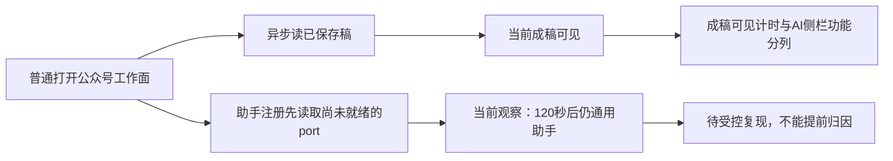

# T1340：核对公众号工作面初次加载后的专属助手注册

状态：待审事实与最小方向，不START、不改生产、不提交模型。不是性能夹具放宽，也不把成稿正文可见冒为专属AI侧栏可用。

7f1d4ec9候选60616、人工纯组grp-7441aa97-48/project-7441aa97-940已显示公众号成稿/重新组织内容，但正常打开文章页后等待现役专属textarea placeholder「告诉我这篇文章需要怎么调整」满120000毫秒仍未出现。原v4截图实际仍为通用助手占位/建议chips；v5该条件自然Timeout、blocked[]/pageerrors[]、0业务模型。原manual项目/稿件/三输出均为透明人工性能前置，不修改校准406已锁定项目。

Root已只读核源提出候选：article-workbench.tsx的load先更新stateRef/draftRef后setDraft(initial)，setDraft在无变化时未notifyEditorChanged，而registerEditor先于异步get完成且依赖outputId，可能使初次注册的preparation未更新。当前是需要真实受控组合RED证实的原因候选，不写成已证明根因或修复。

已知现役ai-copilot-content.tsx3661专属placeholder逐字为上述文案，不能改用通用输入框当专属注册通过；正常图文与其他工作面需作保护对照，不能通过放宽embedded owner、全局强制模式、删合法chips条件或伪造prepared上下文来消除断言。只读稳定DOM/图/原native预览状态待当前同project采尾追加。

原件：docs/verification/t1329/runtime/final-performance/preflight-final-7f1-v4/{DOM_article.json,article.png}与preflight-final-7f1-v5/FAILURE.json（原等待120秒）；同目录manual-fixture-final-7f1/FIXTURE_RECEIPT.json。后续预检状态与性能结果独立保存，普通聊天唯一root未因此重发。

拟后续先盘点实际ArticleWorkbench→DraftChat provider/注册port→专属AI消费者，最小只在文章实际状态变化后通知原port的可靠就绪点，保护scope/卸载、busy、保存竞态与原prepare/opaque ticket；不新增backend/worker/契约或新模型请求。准确生产/现存组合测试W、原公共RED/GREEN需独立完整方案后确定，目前没有实现写权。性能可以按真实「成稿内容可见+主操作可用」另列；不能称专属AI侧栏功能ready或整个页面全绿。

## 足额稳定尾证与最小修复风险追加

原同940的preflight-final-7f1-v6在文章main后实际等待120000毫秒：专属placeholder仍不出现，7个通用chips仍在；同时原native open shadow中真正可见的`.noterelay-wechat`两个p与人工原稿逐字相等，重新组织内容/复制按钮可用。图文对应专属placeholder正确、0通用chips，`.noterelay-rednote-card.is-active`两段原生可见正文逐字相等。实际页面/HTML/安全DOM在该独立目录保存，0模型/blocked[]/pageerrors[]/browserclose；不将早期loader截图追签就绪。

Root另只读提醒：不能简单在load末尾调用现有notifyEditorChanged；Provider在readState().dirty时可能retireDerived，而首次脚本承接与空current本来不同，可能反杀T1303首次派生采纳。候选设计必须区分「已加载状态可读刷新」与「真实编辑使派生资格失效」，保原注册token/prepare票/derived proof。需要实际异步load→嵌入助手→首次派生准备/采纳的组合前置RED，再定准确局部机制，不能重注册伪装首次或改全局embedded准入。当前仍仅事实/源码假设，没有生产W。
