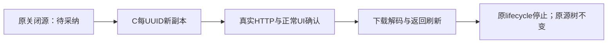

# T1343 原产物的实际新包 UI 续验（NOT_RUN）

仅离线准备，不读取session/DB/key、不启动服务或浏览器。C提供实际新包、known-fixture lifecycle adapter、原closed-awaiting checkpoint与最终锁后才可执行。

固定命令：`python3 docs/verification/t1343/runtime/final-ui/runner/command.py T-1343 <actual-bootstrap绝对路径>`。每次UUID由C已有lifecycle `launch` 产生独立新副本，真实READY后观察，finally `stop` 核源树未改及全部PID消失。author与strict均从同原closed-awaiting源新copy，副本各确认一次；原源仍awaiting，不冒重复采纳同服务。

复用现役T1324标准8runner与成功task200 continuation的HTTP/播放/正常采纳消费者，不创建项目/脚本/文章/素材/render/模型。只核本次原项目、video output、source asset/实际存在artifacts及完整公共ledger。原source/MP4/HTML/SHA和RGB FAIL不改；bbox、4秒/音轨依据原只读证据，最终下载全流解码另实际执行。

正常1366×900/最小1024×680，真实production入口（必要正常更多→返回制作页）、原task预览、实际Next GET/自动HEAD/三Range与416、原生播放、唯一UI采纳、真实asset/materiallink/output/production、下载字节相同、返回与刷新。没有source script/article便不伪造其DTO。

保原8h test/30600 global/31800 execution/34200 inner/36000 command/独立86400与清理600；每正请求900000ms及至少120000ms。观察截止取本次源原期限与新窗min，不续任务期限；不足两分钟不开始，不重发UNKNOWN。新包副本恢复不是供应商新调用。

