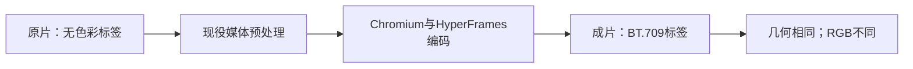

# T1343 同一成片的只读结果

合法裸参数现在已真实渲染为待采纳成片，原片完整显示。两张1秒代表帧中的蓝矩形均为 `[80,90,239,249]`、25600像素，橙矩形均为 `[360,120,509,219]`、15000像素；没有缩成右栏或空舞台。真实源/成片均为640×360、4秒，均有AAC双声道音轨（本人工输入是静音，不声称有语音）。`READONLY_VISUAL_GEOMETRY.json`保存实际像素、ffprobe字段和完整证据SHA。

原GREEN不是全通过：颜色确实不同，原逐通道≤24断言失败、wrapper退出1及原PRIMARY_FAILURE完整保留，没有调整阈值。确认、Range后续及下载尚未发生。源库仍为原task `ai-task-46c2b534-28` awaiting_confirmation；新固定包将复制已关闭库，仅同ID/同产物实际预览、UI确认和下载，不再渲染。

## 已证与未证

- 原source-DECODE实际视频流未给出color_space/primaries/transfer；成片三者均为bt709。音轨与4秒均在实际ffprobe结果中。
- 当前未修改的executor.ts：831–842 `isStaticSafeH264`要求三BT.709标签；1058–1075缺标签进入`unknownColorMetadata`分支，使用`format=yuv420p`；1093–1100输出统一写BT.709标签。按原实际缺标签数据，该源码路径符合已见色彩变化的线索，但不是实际子进程命令日志。
- executor中的媒体处理、Chromium解码、捕帧/编码再解码都可能参与颜色解释。产品已按原策略删除prepared media/work，不为诊断恢复、重建或再次渲染。没有直接保留中间片及每步实际ffmpeg命令，因此本轮不把该线索定为已证唯一色差原因，也不据此改executor/调阈值。
- 实际模板已在原写成功后透明复制，generated-index.html确有640×360满幅主video、object-fit:contain和0秒原轨调度；Root已独立读。没有在本次最小模板diff加入CSS色彩filter。actual SourceAssembly与HTML SHA记录在READONLY_VISUAL_GEOMETRY；0953仅提供工具，本次执行模板来自当前repo TS。
- 原Next GET handler+Request确实200并得到可全流解码MP4；不是网络HTTP/Next自动HEAD或UI采纳。本次公开执行list不能映射私有总账本，supplier口径仅publicObserved=0/privateTotal=NOT_EXPOSED，真实routing未配/manifest.skipped/global-fetch[]分列。

## 已释放与后续

原wrapper后置hash0漂移，3登记进程均gone，PGID空，persistence已DISPOSED。CLOSED_DATABASE记录实际lsof退出1且空；CLOSED_SOURCE_SNAPSHOT记录关闭后的db/media/workspaces 2179文件（不读取key内容），HANDOFF给出专用0600 key格式和原deadline。生产/测试/SDK源窗已明确RELEASE；模板保持b3315b0f原字节不再改动。C负责新包副本HTTP/HEAD/Range/UI确认与下载验收，本次不提前签完整GREEN或任务完成。
