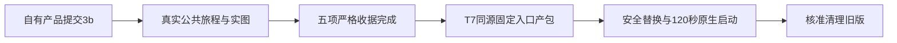

# 本轮账号与日报修复验收结果

五项产品任务已由taskctl实际执行严格旅程并完成，唯一受验产品提交为`3b0f1471de3bf2f4de371849e29112a35a7ab4b3`。本报告与后续纯文书提交不是新的受验产品版本。T1352同源本机包已构建并安装至`/Applications/CreatorOS.app`；新App真实启动128.875秒，完整tar/runtime与原生窗口核验通过。13项核准旧缓存与旧App备份共14项清理完成，两份唯一trace先归档保全；清后同一新App持续运行，原6组ID集合不变。

## 用户可见变化

账号页移除手动登记、共享资源、历史整理三个整块，保留已有数据与合法API。账号组与平台账号使用单层对象和右侧管理动作，保真实归档、隐藏恢复与转组。完整零组且无旧账号时，首页首屏直接引导建首组；创建后进入该组，选择支持平台即一次启动扫码，可在核验完成后继续同平台或其它平台。

获准切组后立即清除旧工作区，等真实新组页面提交再显示；同scope刷新保实例，项目/画布详情退出到对应列表。富文本与结构稿dirty/saving接既有离开确认，取消保原scope与原稿，明确离开遵守原语义，不伪称自动保存。

日报图只使用可信单账号原生自然日统计；缺口留空、真实0保留、多平台/多账号不强加、公众号未知总计不猜。无日报时诚实空态或同卡展示最近最多5条累计作品，独立图卡读取不拖工作台其它卡。正常/最小/暗色/真实Chrome200%及真实键盘筛选均有候选证据。

## 严格完成收据

| 任务 | 报告收据 | 实际完成事件UTC |
| --- | --- | --- |
| T-1345 | `ba353eb53958` | `2026-10-18T15:13:54.056Z` |
| T-1346 | `9c5c35009d43` | `2026-10-18T14:55:04.534Z` |
| T-1347 | `239fe5624fde` | `2026-10-18T15:21:44.353Z` |
| T-1348 | `8e89f8d4e355` | `2026-10-18T15:08:37.070Z` |
| T-1350 | `d4f53bce217b` | `2026-10-18T15:11:41.167Z` |

完整事件白名单与命令身份见`control/FINAL_SCOPE_GATES.json`。T1346/1348/1350各自taskctl门确实执行完整公共suite，不伪造缓存复用；各合同只认自己的检查项。T1345一例覆盖1366与1024，另三项两例覆盖1280与1024，T1347两例覆盖1366与1024。

源级240项前端、受控宿主六run公共持久链、类型/边界/孤儿/LED047等日志来自共享开发源轮次，不能冒精确新包通过。最终正式与strict浏览器均在clean managed的同一3b源上，以私有合成持久数据经真实公共API运行；不使用真实用户数据、真人扫码、模型、采集、付费或发布。成功扫码连续流程由实际组件和受控宿主真实transport/service证明，浏览器故意中止扫码启动只验一次click与unknown恢复。

## 保留的失败与边界

- T1348 strict01：1024设置写13.6ms读ECONNRESET，原false写回执UNKNOWN未重放；断连后其它HTTP真实200、库只读true。获准全新根strict02完整通过，原FAIL与三份证据保留。不得称失败写成功、超时或整服务崩溃。
- T1347 strict两完成见证之后清理曾较长，最后自然exit0，未改预算/发终止信号；具体框架等待根因未定位，不把自然结束冒已修cleanup。
- T1349既有窄项目列表标题/更多裁切未修；T1351管理页视频离开guard旁路仍为未实证源码风险。WebKit/Tauri原椭圆根因未复现，不能据Chromium圆点证明Tauri根因。
- 全局原完整reconcile实际exit1、40ERROR/0WARN。原32失败身份不冒根因相同；七份旧宽路径收据失配确由本批字节触发，T1353独立跟踪，未扩大旧accepted-risk。1338作品页隔离、1342最小编导交叉路径本轮已实际补验，不等于旧整任务全程重验。
- LED061原global子输出缺失，根因UNKNOWN；clean managed原命令378PASS/1缺sharp原生模块FAIL、持久交叉28PASS另列；T7同锁闭包补齐后的实际消费者26PASS只是该闭包恢复，不把原全局改绿。见`control/RECONCILE_SCOPE_CLASSIFICATION.json`。
- 检查测试结果时曾误将单份config.env片段输出到本轮工具结果，实际披露另记`control/TEST_RESULT_ENV_DISCLOSURE.json`。不复述值、不擅自轮换；原results只本地ignored/0600，提交只白名单摘要。本批git历史及staged未含原results/config.env。

九项foreign改动与T1255原行保持原样，其未提交改动未进入受验候选或本轮提交。全局对账遥测生成副本独立保存后已恢复foreign原统计字节。

D/E/F均有T1352真实构建、安全替换、128.875秒同源启动及14项精确清理证据；见[本机交付结果](../t1352/REPORT.md)、[安装执行报告](../t1352/INSTALL_EXECUTOR_REPORT.md)与[清理执行报告](../t1352/CLEANUP_EXECUTOR_REPORT.md)。全局原40ERROR继续保留。
