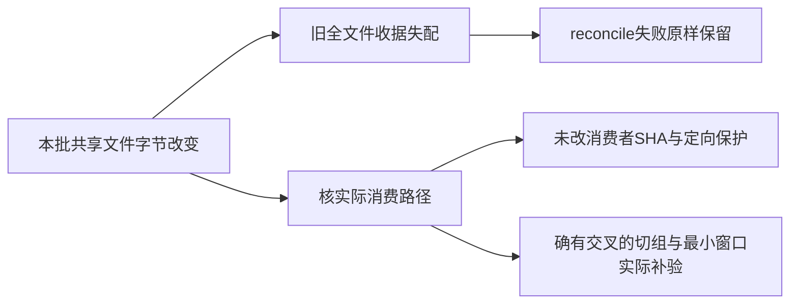

# 本批变更对既有界面收据的影响

当前只是静态归因与实际消费者检查；最终reconcile尚未运行，本页不宣布历史任务重新通过。静态证据快照在T1347实现中取得，最终源码冻结后需重核。

HEAD88945为本批变更前的已提交源码。`RECEIPT_DRIFT_PRECLASSIFICATION.json`把receiptCommit→HEAD的旧提交差异、已知外来脏文件、本批未提交写集逐项分开。本批使T1343、T1342、T1341、T1338、T1330、T1328、T1324七份原有效整文件收据新增字节失配；不能称为开工前旧债。T1294同时有原提交/外来差异与本批persistence相交，T1298/T1296仍有原提交差异。

`UNCHANGED_LEGACY_CONSUMERS.json`当前实际核对七任务64个未改生产消费者文件，与其各自已接受收据源码逐字节相等。persistence-client当前diff只有给既有groupOverview application注入nativeReports一处；仅将这一处还原后的完整文件SHA与HEAD逐字节相等。旧视频/图文/图片/预览/预测持久消费者没有其它行变更。onboarding-data现有有scope的loadState正文及项目/雷达信号块SHA与HEAD相等，本批只增加无scope时零组/旧账号判断及必需import。以上能说明改动范围，不代替原功能全程重验。

T1338另有真实共享AccountSwitcher路径变化，必须本轮/accounts/works真实heading/空态及组数据隔离旅程补证，不能只有body。T1342可沿本轮最小窗口真实脚本页面检查助手入口可见；同scope保存刷新与未保存切组分别证明。已有定向保护回归只按实际运行日志列，最终这些当前合同未通过前不完成任务。

Root已明确不因宽watched路径机械重跑整T1300/模型/渲染，也不把既有accepted-risk自动扩大。本批可用性、源级验收与后续本地新包安装仍各据真实证据；旧整份媒体/预测旅程未重新全程验收，收据失配不会被本页或SHA检查涂绿。
