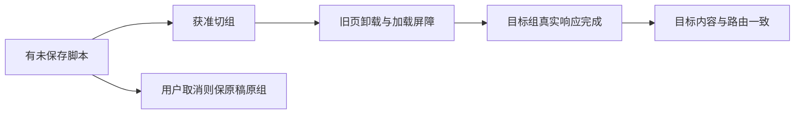

# T1346 / T1348 / T1350 执行者功能与实图核对

候选3b0f1471de3bf2f4de371849e29112a35a7ab4b3，attempt09全新私有PGlite/media/auth，Google Chrome实际1280×800与1024×680，两PASS/166.29秒，两个原witness各29point且completed=true。未改源码或真实用户资料。

执行者实际view：正常home-b-ready、accounts-b-ready；最小home-pending、canvas-new-group-list、rich-cancel-preserves、structure-cancel-preserves、minimum-script-assistant。新组身份与实际可见内容一致，pending看不到旧稿；绑定面板显示乙组及乙成员；画布获准切组后实际到甲组创作空间，旧输入清除；两脚本取消后原稿仍可见；最小编导入口真实打开dialog，输入与操作可达。独立Root/视觉审查结论另外保存，本页不冒独审或用户本人体验。

真实ABA两原HTTP终态及顺序见每窗口aba-network.json；B先完成、A后完成，A后再次核最终B排他/无屏障。保存中取消只一次版本创建，真实响应交付后同scope刷新保持原编辑器实例；自动保存另外先记录两条真实preferences200/true，真实Tab失焦后保存，再返回原组读回、真正历史前后及刷新。原120秒dirty与UNKNOWN设置写不改成成功，见attempt08。

/accounts/works实际从旧乙accountId切甲后旧作品标题不在，再打开甲真实账号同ID属性；素材/默认知识库/选题/雷达/发布/定位/账号空态均走实际公开路径与真实锚点，故障列表重读恢复。最小脚本助手是T1342交叉入口补证，作品归属是T1338交叉路径补证；不等于重跑这两个任务全部旧旅程。

图像与操作仅证明本合同。T1349原项目列表首列标题/右更多裁切尚未修，项目scope核实际可见实体行及正确同ID打开入口，不冒标题布局已通过。T1351驻留视频宿主manager旁路仍源码风险，未宣称丢稿/越权或已修。所有实体是代表性合成持久事实，0模型/采集/取消不能冒后台任务自然完成；用户原Tauri椭圆根因与新App安装不由本浏览器报告代签。Next原日志保留取消时aborted/ECONNRESET，不能称服务全程无异常；TRACE_EVENT_SCAN.json实际两trace未发现未处理Page事件。

