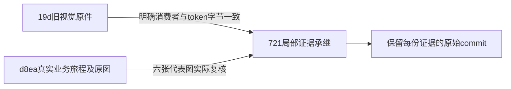

# T1355 最终视觉来源与局部消费者承继核对

结论：允许有边界承继旧视觉证据。三份绑定生产组件、共享tokens.css/globals.css及本次列明的局部基础组件，在旧视觉源19d、最终业务旅程d8ea与当前strict target721之间逐字一致。本轮实际查看d8ea已有旅程的六张代表图，没有发现这些局部状态产生新的视觉阻断；这不是在721执行了新的完整UI旅程。

## 三种身份分证

| 字段 | 实际身份 | 证明范围 |
|---|---|---|
| visual_execution_commit | `19d33c0cdf68fce8d3eef8fafc5577084987301f` | 原稳定候选视觉报告/原图的真实运行来源；不改标 |
| journey_execution_commit | `d8ea55831914cbe51afec210b6b3c1c0c8c691f3` | `candidate-final-attempt02/SAFE_SUMMARY.json` 的真实业务旅程与本轮所看六图来源 |
| strict_target | `721dfacf7b3bcbe82eb9c39b61acf1fb1df367d2` | 当前最终目标；只读核其局部消费者字节一致，不冒此版本新UI执行 |

最初交接的eb19124为中间目标，本轮也核对了该commit，结果一致，但不把它当当前strict target。旧报告最前部的main混合诊断及其SHA保留原身份；本映射使用git中19d稳定候选的真实文件字节，不把main诊断SHA套在19d上。

## 独立只读比对

本轮以`git show <commit>:<path>`实际读取各版本字节并计算SHA256，以`git rev-parse <commit>:<path>`记录Git blob。完整四版本SHA/blob/字节数写入 `SOURCE_MAPPING.json`。三生产源SHA如下，四版本全部相等：

| 文件 | SHA256 |
|---|---|
| account-binding-panel.tsx | `006bd21e71404678f2f74d9d872649559f5b8efc97d758d007cabdb86cd51889` |
| account-group-manager.tsx | `8df36d789c0fac7d0000a77f929080a02560034f0761964821216ba5e5c89326` |
| native-report-panel.tsx | `c4a51e5292b2fa98f346c513244540e4b9a3773608f96c008d37d73068c717ee` |

三文件均位于`frontend/src/features/platform-account/`。另实际比对 `frontend/src/styles/tokens.css`、`frontend/src/app/globals.css`，以及Button、Dialog、SectionCard、Input、DropdownMenu、workspace-error-copy六个明确局部依赖，结果全等。此清单不等于整个App、全局外壳、所有传递依赖或运行环境均未改变。

## 六张代表图实际观察

本轮通过view_image实际查看 `candidate-final-attempt02/artifacts/` 中normal/minimum两目录各自的以下三图；逐图路径、SHA与像素尺寸见映射JSON。normal为1366×900、minimum为1024×680。没有重新启动浏览器、服务或测试。

| 图 | 正常/最小两窗已见内容 | 不能仅由图证明 |
|---|---|---|
| waiting-single-title.png | 小红书绑定只有一个标题，目标组名清楚，等待状态、取消及刷新动作完整；弹窗未越出视口 | 实际扫码、轮询、取消、键盘或焦点行为 |
| verified-auto-closed.png | 弹窗已不在画面，对勾与绿色绑定反馈、平台选择、当前组1名成员及长账号名清楚；最小窗平台入口重排两列，未见长名与行内动作碰撞 | 是否自动关闭、核验与保存先后、成功反馈时长 |
| read-failure-retains-run.png | 弹窗仍在；“绑定结果已返回，正在核对账号”、网络错误及原位刷新入口完整可读，没有显示最终成功 | 原run身份、0额外start、刷新后恢复是否发生 |

d8ea安全摘要记录两窗passed，耗时27.233秒/23.252秒、整轮exit0；真实同ID绑定服务提交、Next读回与自动回位由该旅程提供行为证据，本评审者未执行这些动作。正常/最小的错误截图左下角仍有开发环境“1 Issue”指示；未展开读取，不据此定位产品错误，也不以其不存在为验收前提。

## 可承继范围与保留项

沿项目oil-ui-pro 0.10.0已有界面评审及T1022页面规范，本次只做来源与局部像素承继核对，不评分、不提新风格、不改产品。没有新增按钮或需要删除的重复标题。原视觉报告关于200%局部充值控件有限遮挡、暗色/200%弹窗等未覆盖组合，以及不能仅凭图证明动作/焦点的边界继续保留。

允许将19d原视觉证据作为721下这些明确未变化消费者的已有证据引用，并同时引用d8ea的真实业务旅程；必须保留上述三个身份。六张d8ea图是本轮实际查看的已有图，不能写成721新完整UI运行。NativeReport组件虽字节未变，但六张图均是manager/Panel表面，不能冒NativeReport真实授权采集恢复。受控宿主不是真人扫码，不签公众号原1726首因、外部登录窗口自动关闭、AA、全页无遮挡、安装或全局Gate。

仅在 `docs/verification/t1355/visual-final-source-mapping/` 新增本报告和映射JSON；未改旧报告、中央工件、生产或任务状态，未commit。
