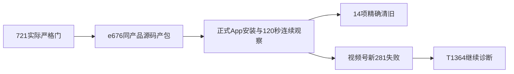

# T1359 本机交付结果

本轮新包已实际构建、安装并精确清旧。视频号唯一新采集仍失败，T1364继续诊断；本报告不表示全部平台恢复或整个用户任务结束。

## 来源与实际交付

严格门执行源为`721dfacf7b3bcbe82eb9c39b61acf1fb1df367d2`，安装源码为`e6769b474fde3db583bf08b04104e4f3a57bd6c9`；六产品目录树全等，见SOURCE_FREEZE.json。本次后续文书提交没有安装到App，不能代替这两个真实身份。五项前端strict和T1357后台契约、T1363受控公共链均沿各原件，不把受控平台合成数据当真人扫码/采集。

唯一执行者delivery_execute使用独立T7干净源码、新Cargo target与原固定入口`CREATOROS_LOCAL_SKIP_INSTALL=1 pnpm -C frontend desktop:package-local`。四基本测试45项通过，唯一构建426.822秒、exit0、无超时。标准原生依赖实载、版本、包内attestation、codesign、hdiutil及只读DMG树同源通过；签名为ad-hoc，未Apple公证，没有Release/tag/push/外发。最初依赖探针、secret扫描exit1的12个候选及分类原件保留，没有改成原运行全绿。

|对象|实际路径或SHA256|
|---|---|
|正式App|`/Applications/CreatorOS.app`，观察PID31464|
|主程序|`a411dab13aa3ae49923dfd70e9fbc7563944797c8514482dbff48a9ee7950f1b`|
|sidecar tar|`3c3872523cc7d78e5363fd3c49ce18fdfb0e03106c957e8d1f07cdbdbcfb2608`|
|新DMG|`/Users/zyongzhu/Downloads/CreatorOS-1.2.0.dmg`|
|DMG SHA256|`3be1288e1937d8a67a9c5dc8a86aa5ff163b2f7b2cdfa1fbce9fd1ac672609ba`|

## 安装与清旧

第一次安装前检查发现原两定时任务running，安全停止安装；原任务随后自然failed，未取消/暂停/续期。旧traffic活动0条新建、3条更新，属于旧任务，不能当新包测试。旧PID9852正常quit观察1.246秒，无force signal；同卷暂存/备份替换，只正常open一次。首次就绪121.596秒从open起算，并非完整连续观察；另一次完整120.399秒25点观察确认新PID31464/runtime stamp稳定。

运行目录与tar核对31851文件、746链接、5059目录，缺失、字节/链接与类型差异均0。运行目录核验脚本误处理隐藏文件名前导点的原FAIL保留；canonical仅移除完整`./`前缀，隐藏文件原名及SHA匹配。这是核验helper错误，不是产品视频采集器修补。其他runtime进程17→16，其中PID88462消失原因UNKNOWN，执行者未单独kill/pkill；不签所有进程都未变化。

安装后公开6组ID不变，24次活动查询最终0；目标视频号accounts.get成功，CLI没有暴露HTTP状态数字，不能称HTTP200。XHS112、KS1目录完整分页可读，DY46为legacyPartial；抽查同ID指标可读，不能代签所有页面原生UI或新采集恢复。

14项核准删除实际完成（13缓存+旧App备份），引用/路径/同卷身份核验后执行；两份独有trace先原字节归档，9个保护root保留，新App与DMG身份不变，用户Library数据/auth/profile/runtime未删。du归属6438984KiB；df并发快照内部+851865600B、T7+3335622656B，均不冒精确归因释放量。两个清理helper前置失败均0删除并保原。

## 视频号真实失败与未完成边界

Root同源安装后单独放行一次新采集，唯一POST对应`collection-92ecb053-281`，startRequestId=`req-92ecb053-279`。从2026-10-18T22:45:43.005Z至22:47:48.452Z共125.447秒，终态failed/EXPORT_FAILED、generation2、committedPages0，原deadline未改；没有第二POST、取消、重启或重新扫码。公开全分页读取报表0→0、作品0→0，新增/移除ID为空。

精确attempt与窗口的可信日志仅一条匹配事件：22:47:48.382Z，prepare/channelsDaily/REPORT_LINK_MISSING，entryPhase=wait_entry_or_centre、entryVisibleCount0、centreVisibleCount0、centreClicked=false。这是末次阶段观察，不能推断物理从未点击或预设菜单/登录/selector首因。安全原字节副本见final/VIDEO_FAILURE_SAFE_EVENTS.json。原观察器generation恒定假设FAIL、诊断生成器调用前SyntaxError分别保留，不作为产品根因。T1364保持未完成，后续只读导航须独立受审边界，不借本交付结果重发collect。

原1499/1502失败保留，公众号原1726仍failed/accountId=null，未真人完成新扫码绑定；旧已扫码会话不能代替新staging归属。T1354/T1363受控成功不证明这两个真实失败已恢复。原生像素能力不可用，没有原App画面/交互验收；无原生dirty读取接口，未证明无未保存，仅正常quit，未强退/丢弃。新采集native close/onStopped无公开确认，资源释放UNKNOWN。

## 全局门与证据

最终721完整reconcile实际44ERROR/0WARN原件及分类保留：32旧身份、7此前宽收据、2本批早先新增、3本批最终新增失配。T1353/T1360引用不变，不将新漂移统称旧债，不改旧PASS或称全局通过。本次仅SHIP/文书，无新增产品源码，按Root批准复用该真实结果，不重跑全局或已过UI。foreign9与T1255整行保持，提交索引排除其修改。

执行者最终原件在`/Volumes/T7-MacData/CodexBuilds/t1359-final-20261019-e6769b474fde/checks/SAFE_SUMMARY.json`与`DELIVERY_REPORT.md`；本报告使用白名单字段投影，完整输入路径/SHA见FINAL_SAFE_WHITELIST.json，机器结果见FINAL_DELIVERY_RESULT.json。未复制raw/config.env/凭据/日志明文或真实POST幂等key。构建前SOURCE_FREEZE.json和FINAL_SCOPE_GATES.json中installedAppVerified=false保持历史原样；本次最终安装true单列，不回写旧快照。
