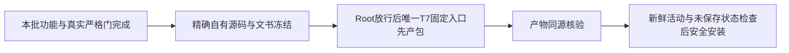

# 本批源码交付准备（尚未产包或安装）

已完成绑定自动收起、首页累计浏览展示、平台作品真实入口/账号选择、总览指标，以及真实切组刷新收尾的本批合同。原用户数据和Project/Publication不伪造、不覆盖；已采集平台目录与工具创作项目各用真实入口。

受验产品提交：`eb19124edd11bea80d7bc0b3937096335830e749`；最后真实strict目标：`721dfacf7b3bcbe82eb9c39b61acf1fb1df367d2`。后续纯文书commit只记录收据/状态，其产品目录与该目标的零diff证明另存SOURCE_FREEZE.json，不能把新文书HEAD冒旧run或旧图片来源。最终App仍旧3b，T1359已START，但必须等Root明确放行唯一T7构建；不自行第二包/安装。

|任务|实际终态|报告收据|
|---|---|---|
|T-1354|两视口真实strict PASS|98f1613ba0d2|
|T-1355|两视口真实strict PASS|fff9f5e92b3b|
|T-1356|两视口真实strict PASS|f09f084b6785|
|T-1357|后台/契约定向实际PASS|—|
|T-1361|两视口真实strict PASS|0cbb9f0efcf7|
|T-1362|两视口真实strict PASS|df3766632db6|
|T-1363|后台/契约定向实际PASS|—|

五项frontend门均taskctl verification_executed=true且全新私有库、无DTO成功替身；平台身份/目录输入明确合成，官方导航race为真实受控Chromium/source/witness→真实binding commit→同ID读回，不是微信真人扫码。T1363真实DOM公共RED120312ms→27PASS，另139/38/183等保护与独审保原，原1499没有重POST。

最终完整reconcile实际44ERROR/0WARN：32开工旧身份、7此前批宽收据、2本批早期绑定首页宽收据、3本批最终公共切组宽收据。新增失配登记T1360，不归旧债，不改旧PASS，不称全局通过。详见t1362/control/RECONCILE_FINAL_SCOPE_CLASSIFICATION.json。当前合同比旧宽路径审计分开；未为hash触发无关模型/渲染或重复UI。

独立图审保留两项非阻断局部遮挡（组名tooltip/200%充值空白区）及旧T1349项目窄窗边界，不签AA或全页无遮挡。T1358首次装配/组读长耗时原观察仍未知，不用本轮快速运行宣称普遍性能已修。

foreign9和T1255完整工作行逐字保留；stats新输出0600先保再恢复，T1073本次新旧SHA相同亦分别保。原始Playwright JSON/config/env与trace只本地私有保存，提交只用白名单安全摘要、报告与SHA；不读取/输出密钥。当前构建四基本测试、产物/新App启动与真实原生窗口验收将由唯一operator另行实测，不能复用T1352旧3b结果。
