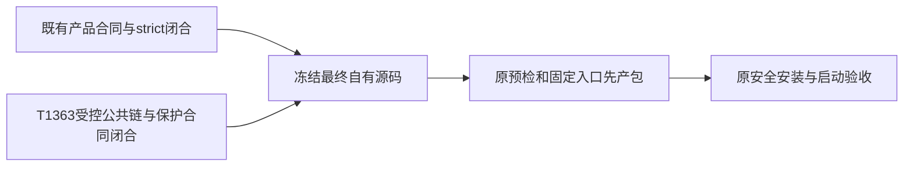

# T1359 第二轮独立有限复审原件

审阅时间：2026-10-18T20:31:43.959003+00:00；独立性homogeneous（GPT-6.1 Sol/high）。本次是T1359单独round2，不是T1363第三轮。规范packet为`round2.json`，正式裁决由control用reviewctl计算；本代理不写verdict/events/任务状态。

control已确认当前SPEC冻结，实际SHA256为`efc362d9f1f8d37e03cb532b51d288de0608efdcc8cfbafafe20f320c183049f`。首轮已审SPEC的SHA`97b272841c993f9cd74b27ef4cbe2908ea8d122d4ee420dcd965d51ae92eb0c1`与当前HEAD内原文件字节一致。逐字比较确认唯一区别为第5行增加“以及T1363既有直接报表入口晚到的受控公共链/保护合同闭合”；context唯一changed_line_ref的实际行与指纹匹配。完整被审文件和差异保存在`round2-SPEC.input.md`、`round2-SPEC.diff`。

本次新增依赖对应T1363已独评的窄合同：真实DOM晚到原入口必须经过完整source→collector/service持久链RED→GREEN，旧合法入口及实际点击分支歧义、身份、原期限、取消与关闭未确认族保持；安全diagnostic不反杀采集。增加此修复的交付前置，与本轮候选应包含已验修复一致，不增加安装或清旧动作。没有把T1363受控成功写成真人平台恢复，也没有改变T1363所保留的原1499首因UNKNOWN、原任务不重发或后续一次新owned采集须独立策略的边界。

原包装技能冻结/提交候选、四项基本测试、版本/secret检查、固定入口与SKIP_INSTALL先产包、正式Next退出及T7依赖闭包未改；产物身份/签名/DMG/attestation核对、fresh活动任务与未保存状态、安全正常退出替换、启动观察最短120秒且预算至少300秒及原更长预算、原生截图能力限制、公开组只读核对也逐字未改。原用户数据/auth/runtime/任务保留，清旧精确集合与引用/独有证据保护、UNKNOWN不重发、无外部发布/push全部保留。已有产品合同/strict未闭合前不build/install的条件没有降低。

首轮findings为空，本轮差异未发现新缺口，故packet仍为findings=[]。这只是单依赖delta的方案读审，不证明任何前置验收已经完成。未运行测试、预检、打包、安装、清理、浏览器、服务、平台、用户库或真实采集；未改SPEC/生产/中央状态，未commit。

## 输入SHA256

| 路径 | SHA256 |
|---|---|
| `docs/features/t1359-current-binding-fixes-local-package-install.md` | `efc362d9f1f8d37e03cb532b51d288de0608efdcc8cfbafafe20f320c183049f` |
| `docs/verification/t1359/review/round1.json` | `8b6108febace4822a53fa75dee7e2569b2337837457b0da3a75e42bc5b68a1cc` |
| `docs/verification/t1359/review/round1-inputs.json` | `c5e21af9bd7d7a0c7eae98c16c91b66e2689b664e01f10b13731ac222a452bf7` |
| `docs/verification/t1359/review/round2-context.json` | `790a237df664c77696444b1aa2554a552e3cd40382b8941cbcae84d5528680ce` |
| `docs/features/t1363-wechat-video-report-entry-diagnosis.md` | `6a8fdf09ddda85ed889404e8446234fc8aeeeff1c21543ad5c9d28ff4bbe5319` |
| `docs/verification/t1363/spec-review/round-2/findings.json` | `eafbc10deacdf76b54fb2636cc39255a79ea3b77daf7a7d78795ed32a550ec18` |
| `.agents/skills/packaging-creatoros-release/SKILL.md` | `49edf78d6b0cb3064a4892c88a6d1b1b0968058fcaddf4e5538f1fe7a58b89b3` |
| `orchestrator/SYSTEM_ARCHITECTURE.md` | `eb1826d4c09054df622d9718c38ca372bd19833e72bd1a752757631a5747c1df` |
