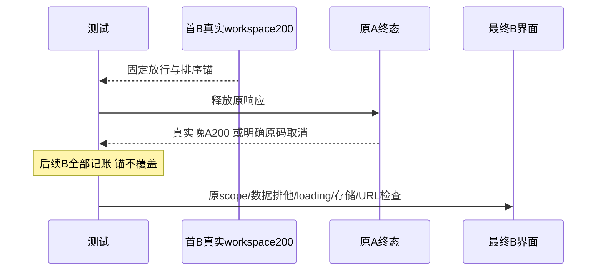

# T1361 最终测试协议的有限独立审查

审查时间：2026-10-18T20:39:18.920505+00:00。结论：已核control实际三行测试delta，冻结首B锚、分开finished/明确取消的排序以及新增结果标记，保持FR1361-1与PAGE_SPEC“真实A完成/取消后B稳定”合同；未发现需修改的缺口，规范findings=[]。仅静态测试协议审查，不代签新运行或产品验收。

原测试SHA`01b5c26df8619b399817071b41ab5d29ad7ca643f4f497566935d1c348025ba2`；control校准后SHA`fe5e96ed491b1bfb2047d6d85ea0c61d1a3316866f57b0e57d772dbec9d3503d`。本人先读原冻结完整相关流程；在生成原件前control主动告知测试已改，首次哈希校验因此中止、未写出报告。随后本人独立读实际diff并再次核SHA，确认相对HEAD仅第63/70/72行变化，差异保存为`ACTUAL_TEST_DELTA.diff`，本代理没有修改测试。

只读取SPEC、PAGE_SPEC、安全摘要及normal/minimum witness的status/时间/scope/bytes SHA与相关点，安全投影另保`WITNESS_SAFE_PROJECTION.json`。未读rawtrace、env、响应正文或headers，未运行测试/浏览器/服务/平台/用户库，未改SPEC/生产/测试/中央状态，未commit。

## 本轮FAIL实际事实及更正

Root和control最初按已有failed分支推断“A先ERR_ABORTED”，control随后在`INTERPRETATION_CORRECTION.md`撤回。本人亲读实际witness白名单投影独立确认：

| minimum date-url实际事件 | 时间 | 状态与scope |
|---|---:|---|
| 首个已解析B回执 | 1792355705701 | finished/200，workspace=B |
| b-http-before-a点 | 1792355705768 | 仍持首B；loading=true，选择与Cookie=B |
| 原A释放后完成 | 1792355705784 | finished/200，workspace=A |
| 后续B完整刷新回执 | 1792355705820 | finished/200，initialScope=B且workspace=B |

A比首B晚83ms；原response回调每次workspaceB都覆盖bResult，第70行把A与后续第二B比较，出现5784<5820的36ms排序FAIL。这个样本没有A取消证据。错误解释另保`SAFE_SUMMARY_INTERPRETATION_ATTEMPT01.json`，不采用其取消归因。原exit1/最小窗3749ms FAIL保留；第70行中止后，最小窗第71–72行最终B排他未执行，不能因协议校准补成PASS。

normal原16835ms PASS、completed=true；两race真实A均finished/200/workspaceA：date-url A=1792355689485晚于首B1792355689336；same-clean-url A=1792355691879晚于首B1792355691710。两个最终点均loading=false/error=null且选择/Cookie=B。仅保正常窗原输入族，不外推最小窗已完成。

## 实际delta核对

- 第63行仅加`!bResult`：首个已解析真实workspaceB回执成为第69行放行A时的固定排序锚，第69行原status200/finishedError=null检查不变。`network.push`仍在判断之前，第二B及其完整initialScope/workspace全部记账。该锚只证明“首B HTTP后释放A”，不能冒页面完成或initialScope提交；没有改请求、Cookie/header/body或拼Flight。
- 第70行仅将A.at>=首B.at移入原finished分支，原A200、finishedError=null、真实workspaceA解析均保。另分支仍只接受ERR_ABORTED/NS_BINDING_ABORTED，aResult的实际写入点只产生finished或failed，必须等真实终态才进入。不会把UNKNOWN、普通网络错或没有终态当取消。允许合法取消早于B符合PAGE_SPEC；这只是静态取消族保护，不是本轮观测。
- 第72行只增加terminationOrder：区分old-A-payload-after-first-B与原码取消前/后，原aResponse/bResponse和其实际时间全部保留，不伪称取消为晚A200。Date.now毫秒相等时该标签不能证明更精细物理先后，原时间仍可复查。
- 第71行与current()、其它所有行逐字不变：B筛选名称可见，初始化loading/error节点为0，storage/Cookie=B，公开getGroupOverview真实workspace.id/name=B，可见各指标卡与DTO一致，B videoViews=200/browseViews=null，A可见项0，platform/accountId/startDate/endDate query清理；最终snap继续记录。原120秒等待、已提交筛选、快速反向、返回/刷新、同组键盘、空组和副作用计数/pageerror保护保留。这里无pending仅指初始化loading消失；现测试unfinished是记账，没有全网络unfinished=0断言，本次不虚构该断言或扩范围。

实际差异没有修改生产、合同或完成标准。不能为等晚A200把有效取消改成产品缺陷，也不能强制取消来代替晚payload族。现normal有两原晚A200；后续重跑若仅得到取消，必须分族如实报告，不能追签晚payload已重新覆盖。control需按校准后的精确测试字节重跑两视口完整旅程；本报告不代签该新结果、strict、产包、安装或真人采集。

## 精确输入SHA256

| 路径 | SHA256 |
|---|---|
| `frontend/tests/e2e/t1361-pending-filter-workspace-refresh.spec.ts` | `fe5e96ed491b1bfb2047d6d85ea0c61d1a3316866f57b0e57d772dbec9d3503d` |
| `docs/features/t1361-pending-filter-workspace-refresh.md` | `39a81160d1e20ec90f0744920a054f04d5f59d445043011ff9ab49f5b7460814` |
| `docs/verification/t1361/control/PAGE_SPEC.md` | `0a7c3ba7cb4343480b53a8fc3d4ba9f7aebac2872f1792a753219e95cb48d79b` |
| `docs/verification/t1361/candidate-final-attempt04/SAFE_SUMMARY.json` | `ac0bcabefbc1d905cdc2e78f67495a701e3f91841ccc8da115f81430bf05be40` |
| `docs/verification/t1361/candidate-final-attempt04/INTERPRETATION_CORRECTION.md` | `1cbfad5a7bb379e17fceb252d3ac264c64170cb09dceefe75d74eef0529b1530` |
| `docs/verification/t1361/candidate-final-attempt04/SAFE_SUMMARY_INTERPRETATION_ATTEMPT01.json` | `17f7e5c017e0c60e51b9df1e3f17c4b0f11db5439576349b7a7038fcf9e4181e` |
| `docs/verification/t1361/candidate-final-attempt04/artifacts/t1361-pending-filter-works-cdfaf-sh-待完成筛选与切组使用真实Next收尾并排除旧响应-t1361-minimum/witness.json` | `0c48b5f78db5a186ddd5228f5694e4ae56712c80a6a95ce8124c26013696cf2c` |
| `docs/verification/t1361/candidate-final-attempt04/artifacts/t1361-pending-filter-works-cdfaf-sh-待完成筛选与切组使用真实Next收尾并排除旧响应-t1361-normal/witness.json` | `0ef22a1d4bcf819f85afe288a21ee361da73d54b2a2fa920147a8f8f62154ee2` |
