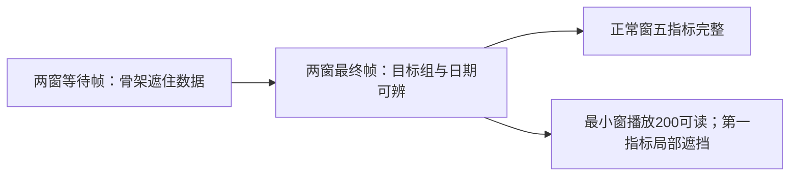

# T1361 最终05四帧的独立像素核对

结论：当前四帧已实际查看，未发现新的主任务视觉阻断；最小窗组名提示条局部遮挡第一指标数值的既有NB-01仍存在。只签四帧可见内容，不签完整UI、请求次序或功能Gate。

## 来源身份

- 当前四图 `visual_execution_commit` / `journey_execution_commit`：`721dfacf7b3bcbe82eb9c39b61acf1fb1df367d2`。
- 本次安全摘要声明 `productCommit`：`eb19124ed`（Git解析完整为`eb19124edd11bea80d7bc0b3937096335830e749`）。
- 原 `visual-independent/VISUAL_REVIEW.md` 绑定d8ea，产品e511，原身份、有限继承方式与NB-01保留；本报告没有改写旧报告或把旧图改ref。
- 依据项目oil-ui-pro 0.10.0存量界面评审与T1022账号组页面规范；不开新风格，不评分。本轮仅只读合同/安全摘要并view_image，未启动UI、服务、测试或操作浏览器。

## 四帧实际观察

| 当前05图片 | 视口 | 已见像素 | 限制 |
|---|---|---|---|
| normal/date-url-b-pending.png | 1366×900 | 主内容显示“正在打开工作区…”与骨架；侧栏当前组为“转组后的新采集”，主区没有可见旧项目/作品/指标数值 | 只证明截图时内容已遮挡，不能证明整个等待期间均如此或请求已终态 |
| normal/date-url-b-final-after-old-a.png | 1366×900 | 当前组“转组后的新采集”、全部平台、全部账号、2026-09-20至2026-10-19；五指标0、0、0、200、—完整可读；继续创作、待办、热门选题可见 | 文件名不能证明旧A响应次序；不签未展示的下方区域 |
| minimum/date-url-b-pending.png | 1024×680 | 侧栏图标折叠，主区加载文案与骨架，无可见旧数值；组提示条显示“转组后的新采集” | 没有数值不等于全部等待时刻都无旧响应 |
| minimum/date-url-b-final-after-old-a.png | 1024×680 | 主区真组名、平台、账号和日期清楚，期间发布0、待分发0、视频播放合计200、文章阅读—可读；主要筛选完整 | 左侧黑色组名提示条压住第一指标数值区域，该数值不签完整可见；下方三卡仅露开头 |

图示仅表示所见状态，不证明状态间请求或用户操作实际发生。

## NB-01保留与结论边界

最小窗最终帧底部组图标右侧的黑色组名提示条伸到第一指标数值位置，使该局部无法完整阅读。主内容另有完整组名，日期、其他四指标和筛选仍可读，没有从该图确认整条切组任务被挡住。此现象与原报告NB-01一致，不能写成全页无遮挡。未操作页面，不猜鼠标/键盘触发原因，不证明移开后消失；后续若另有取图或调整，仍须实际验证，不在本轮扩改样式。

安全摘要记录：05整轮exit0，两窗分别16.653秒/14.679秒passed。安全见证每窗completed=true、14点、pageErrors=[]；date与same-clean两族均记录实际A.finished/HTTP200晚于首B，counts为collectionSubmissions14、aiTaskCount0、scheduledJobCount19。以上是执行方运行来源，本评审只读引用；没有亲手操作、重放或验证网络。该安全见证文件未单列pending数组与baseline，本报告不凭截图补造pending0或基线相等；相应结论仍由执行方更完整账本负责。

本轮未看05其余图，不扩签同URL、空组、暗色、200%、键盘、焦点、返回刷新、完整滚动、所有副作用或真人采集。原d8ea报告的未覆盖状态继续原样保留，不能由本四帧代签。当前只签目标组身份/日期/已见指标与等待遮挡的有限像素证据，不改变功能验收、源代码、中央工件、旧报告或任务状态；无commit。

四图路径、SHA256、实际像素及安全摘要/旧报告SHA记录于同目录 `IMAGE_INVENTORY.json`。
