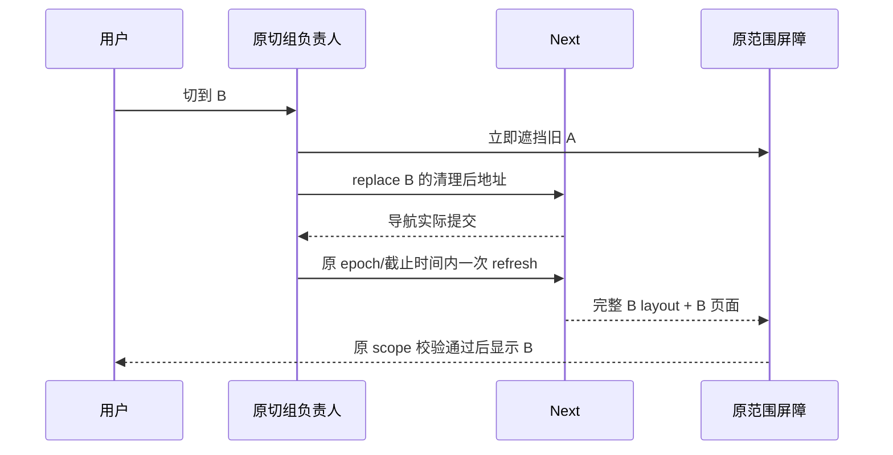

# T1361 最小实现交接

当前只完成窄实现、组件保护和一个真实 Next 公共场景。T1361 全输入族、两视口正式合同、LED047/timeout/boundary/orphan/类型及 T1356 完整回归由 control 继续，不能据此签任务全部完成或安装交付。

## 实际因果与实现

有效诊断的原 120 秒自然失败：含日期的 A 页面点击 XHS，服务端按 A 返回后暂停原响应；真实切 B 后原 B HTTP200，原 A 放行后也 HTTP200/Network.finished，但 Provider 直到超时仍提交 server=A/live=B，Switcher `refreshPending=true`，epoch 有效。此次 actual `willReplace=true`，replace 与 refresh 同毫秒调用，排除了“当前红样本未执行 replace”。临时两源日志已按原字节撤回，原件/SHA/精确 patch 与撤回校验均在 `diagnostic01/`。

锁定 Next16.2.9 的队列源码说明该调用顺序存在具体失效路径：旧 A action 被 B NAVIGATE 抢占时，B.next 取得旧链但 last 仍可指旧 A；紧接 REFRESH 可挂在旧 A.next，无法随 B 继续消费，而全局 React 状态已指向该 refresh 的 deferred。运行时没有读取 Next/React 私有指针；精确链指针属于源码推导，实际提交日志与修复前后的完整 refresh 响应差异为公开支持证据。

生产仅改 `frontend/src/components/shell/account-switcher.tsx`：同一切组先发 replace，等它的真实 React transition 提交后再发 refresh；同 URL 也发 replace，以替代尚未提交的旧筛选意图。侧栏、外部 manager 入口和切组失败的重试沿同一 owner。两步共享同一个 pending、epoch、原 120 秒 timer/deadline；取消、卸载、ABA、过期世代不发下一步，不续期、不固定 sleep。最终完成仍调用原 Provider 的 scope 校验，Provider 生产源未改。

## 已执行验证

| 证据 | 实际结果 | 证明边界 |
| --- | --- | --- |
| `components-baseline.log` | 原两组件 52 PASS | 旧 async fixture 的有限输入 |
| `components-red.log` | 新真 void API + 上层 React Suspense 失败，导航未提交已提前 refresh 一次 | 实现前的实际 RED；没有把 Promise 返回值当导航完成 |
| `components-green-final.log` | 两组件 55 PASS，exit0 | 原 52 项与新增两阶段、原预算耗尽后的晚导航、快速反向旧导航保护 |
| `eslint-final.log` | 聚焦两修改文件 exit0 | 首次 lint 的测试 render 赋值错误已原样保在 `eslint-focused.log`，移到 layout effect 后复核 |
| `diagnostic01/SAFE_SUMMARY.json` | 原 120 秒真实 FAIL | 只临时观测，未实现绕过；原 A/B 身份和最终失败均保留 |
| `public-green01/SAFE_SUMMARY.json` | 无 debug 的真实 Next 同场景 PASS，exit0 | 单个 1366×900 公共场景，不代签全族/最小视口 |

公共 GREEN 中原 A 仍按 primary 返回并真实 finished；B 导航 HTTP200 后，新增一次完整 refresh Flight 同时含 `initialScope=transferB` 与 `workspace=transferB`。原 A 放行后最终 B 页面正确、URL `/`、storage/cookie B、loading0、error null、pageErrors0、external0。B 意图至可见为本次 771ms，释放 A 至可见本次 397ms；不承诺一般性能。已实际查看修前错误图与修后 B 页面图。

首次 diagnostic wrapper 因 main/candidate 两份 Playwright module 在发现测试阶段失败，0 浏览器/0 切组实验；保留 `wrapper-discovery-fail-private.log`，统一 runner/config/spec 的 main module 后 fresh 新根执行，服务源仍为 candidate。后续公开 GREEN 也使用 fresh 独立 helper/PG/真实 service seed/Next，未访问用户 App/DB/profile，0 真实平台采集/模型。

## 交接冻结

准确 SHA 见 `FINAL_SOURCE.json`：

- AccountSwitcher：`b064a41d918305d23a1193b061e8b6c2e82da9e5dcadc91ffb68d27d832d6fa3`。
- Provider 测试：`2ed3f2eb1d5f7144287e4a92f3d9accf9a0ef6f8e424ddcc48179bd7bfd2e62b`。
- Provider 生产：原 `8faac4038fb82d5ddcf172e05d36cf7c47c1b11cf7817806620ba31076451db0`。

main 只有上述一个生产源与一个原测试文件由执行员修改，未写工作流、SPEC、BACKLOG、manifest 或 DEC。candidate 只复制正式 AccountSwitcher 源供公共 GREEN；两源临时 debug 已逐字撤回，无 debug 提交。Playwright 正常退出后 41367/41368/41369 无监听，已明确把 candidate/Next 窗口交回 control；后续不再启动本执行员服务。最终整合提交与全局状态由 control 负责。
