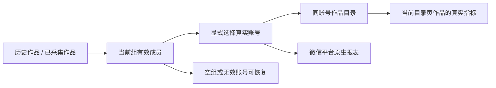

# T1362 独立实现审阅

结论：**源码审阅 PASS，未发现可定位的新增缺陷；不等于 T1362 整体验收 PASS。**

审阅者为独立于实现作者的 fresh 审阅代理。审阅对象是冻结提交 `472bdf2d25a19071fc468f7d8c0948cec808614e`，不是共享 HEAD 的全部内容。已逐一计算清单中 7 个生产文件的工作区与该提交 SHA-256，均与 `../control/PRODUCTION_FREEZE.json` 一致。只写本报告及同名 JSON；没有改产品、测试或流程真相源。

## 范围与依据

先读 BACKLOG 的 T1362 与 SPEC，再读 PROJECT、PROJECT_CONTEXT、产品流程及物理架构；技能与项目流程版本均为 `3.29.0`，无需升级。阶段路由为 `4-build / implementation`，本次承担独立源码审阅，不执行实现或阶段转换。页面判断依据项目内 oil-ui-pro `0.10.0` 及账号组 UI_RULES，沿用现有品牌与组件方向。

审阅依据为 `docs/features/t1362-account-detail-workspace-data.md`、冻结提交与父提交差异、7 个生产文件及其直接消费者和定向测试源码、`red/SAFE_SUMMARY.json`。追踪了 session/request-context、server contract client、账号组 owner/member 服务、原生报表面板、引导读写和组摘要投影；没有访问用户数据库、App、浏览器或 profile，没有读原始环境、trace 或凭据。

人话结果：历史作品入口现在通向当前组的平台账号；用户选定真实账号后，才读该账号目录和作品指标。创作项目与平台目录保持各自含义。

## 审阅结果

| 结果合同 | 源码核对结果 |
| --- | --- |
| FR1362-1 入口与手动确认 | 组历史步骤指向 `/accounts/works`，项目页提供同一路径。`OnboardingCard` 仅放开组内手动确认条件；`StepRow` 的用户点击才提交 `review-imported-projects`。保存锁、scope/generation 校验和错误反馈未改变。`loadState` 不把目录或真实作品推断成 Project；无 legacy Project 的组也能手动完成。 |
| FR1362-2 当前组真实账号 | route 先经既有 `getAccountGroup` owner 服务读取当前组，拒绝归档组，导航仅渲染 `active && leftAt === null` 成员。组模式忽略旧账号 cookie 的默认账号，不擅自选择另一组账号。空组明确说明本组尚未绑定并保管理入口。 |
| FR1362-3 切换与越组 | 新账号 Link 只生成目标 `accountId`，不继承 `workId` 或 3 类 cursor。显式不存在、越组、归档及离组账号在任何 account/catalog 读取前返回不可用提示与当前组成员导航。未修改 T1361 导航 owner。 |
| FR1362-4 目录与详情 | 仍先读真实目录并仅在当前页命中 `workId` 时读作品指标；粉丝、目录、作品指标的错误分支分开。粉丝区域改名为“粉丝记录”，没有把无粉丝记录写成无作品。目录历史、分页及数值路径未重写。 |
| 原生报表保护 | 仍按同组真实 member 构造 groupVersion/membershipVersion；`NativeReportPanel` 保持 `groupId:accountId` key、user/group/account props、`initialReadError` 与能力分支。未把报表失败退化成目录无数据，未新增自动采集。 |
| 旧 account-only 路径 | 无组且默认 session account 的目录读取分支保留；无组的显式 account 参数拒绝规则与父提交相同，未放宽旧权限合同。未把既有显式参数限制归为本次新增回归。 |
| FR1362-5 总览诚实展示 | 摘要 `browseViews` 与表格 `browses` 分别消费已有 DTO；`null/undefined → —`，真实 `0 → 0`。`sampleCount` 保原数值并标“发布指标样本”。平台状态使用已有 collected platform/knownCount/eligibleCount，未按数值 truthiness 或 sampleCount=0 宣称从未采集。unavailable 时有独立说明，已有合法发布值不清零。播放/阅读图数值与排序不变。 |
| FR1362-6 副作用与物理边界 | 本次生产差异仅既有前端展示、导航和人工引导确认准入；没有新 backend/API/schema/entity、采集、模型或外部任务。使用既有 Link/SectionCard 与 tokens，没有业务落库旁路。 |

**Findings：无。** 本轮没有发现满足“具体输入、可定位代码和实际影响”的新增问题，不以偏好、未测像素或未发生的失败推导代码缺陷。

## 证据边界

- 本轮仅执行只读文件/差异检索、流程上下文查询、SHA 核对和报告写入；**未运行测试、lint、类型、服务或浏览器**。
- 冻结清单记录作者定向 `68 passed / 6 files`、lint `0 error / 1 existing warning`，本报告仅引用其存在，不重复执行或独立代签这些结果。
- 已保留公共 RED 的四项真实失败及正控制；SAFE_SUMMARY 明确原纯 typed 公共片段仍为旧 scope，不能将它当作该族公共 RED。本报告没有将其改写成已证。
- 两窗口 1366×900 / 1024×680 的完整入口链、真实切组、返回/刷新、纯 typed 无 Project 的手动完成及持久读回、暗色和浏览器 200% 可达性仍须由相应运行证据验收。源码与组件断言不能代替这些操作或独立像素检查。
- LED047、timeout-policy、前端类型、boundary/orphan、全局 reconcile 与 strict 完成不属于本次只读审阅执行结果。视频号采集恢复、真人平台和本机打包安装均未由本报告证明。

Decision：冻结源码可继续进入既定公共链和视觉验收；本报告不批准提前完成任务，也不把其他任务的证据扩写成本任务通过。
